**Required reading**

:::info[Source]

Adapted from [Forms in Angular](https://v20.angular.dev/guide/forms) by the Angular team (Google), angular.dev (v20), licensed under [CC BY 4.0 (text), MIT (code samples)](https://angular.dev/license). Changes: converted to Markdown for offline use; code examples inlined; interactive embeds and site navigation removed.

:::

Applications use forms to enable users to log in, to update a profile, to enter sensitive information, and to perform many other data-entry tasks.

Angular provides two different approaches to handling user input through forms: reactive and template-driven. Both capture user input events from the view, validate the user input, create a form model and data model to update, and provide a way to track changes.

This guide provides information to help you decide which type of form works best for your situation. It introduces the common building blocks used by both approaches. It also summarizes the key differences between the two approaches, and demonstrates those differences in the context of setup, data flow, and testing.

## Choosing an approach

Reactive forms and template-driven forms process and manage form data differently. Each approach offers different advantages.

| Forms | Details |
| :-- | :-- |
| Reactive forms | Provide direct, explicit access to the underlying form's object model. Compared to template-driven forms, they are more robust: they're more scalable, reusable, and testable. If forms are a key part of your application, or you're already using reactive patterns for building your application, use reactive forms. |
| Template-driven forms | Rely on directives in the template to create and manipulate the underlying object model. They are useful for adding a simple form to an app, such as an email list signup form. They're straightforward to add to an app, but they don't scale as well as reactive forms. If you have very basic form requirements and logic that can be managed solely in the template, template-driven forms could be a good fit. |

### Key differences

The following table summarizes the key differences between reactive and template-driven forms.

|  | Reactive | Template-driven |
| :-- | :-- | :-- |
| [Setup of form model](https://v20.angular.dev/#setting-up-the-form-model) | Explicit, created in component class | Implicit, created by directives |
| [Data model](https://v20.angular.dev/#mutability-of-the-data-model) | Structured and immutable | Unstructured and mutable |
| [Data flow](https://v20.angular.dev/#data-flow-in-forms) | Synchronous | Asynchronous |
| [Form validation](https://v20.angular.dev/#form-validation) | Functions | Directives |

### Scalability

If forms are a central part of your application, scalability is very important. Being able to reuse form models across components is critical.

Reactive forms are more scalable than template-driven forms. They provide direct access to the underlying form API, and use [synchronous data flow](https://v20.angular.dev/#data-flow-in-reactive-forms) between the view and the data model, which makes creating large-scale forms easier. Reactive forms require less setup for testing, and testing does not require deep understanding of change detection to properly test form updates and validation.

Template-driven forms focus on simple scenarios and are not as reusable. They abstract away the underlying form API, and use [asynchronous data flow](https://v20.angular.dev/#data-flow-in-template-driven-forms) between the view and the data model. The abstraction of template-driven forms also affects testing. Tests are deeply reliant on manual change detection execution to run properly, and require more setup.

## Setting up the form model

Both reactive and template-driven forms track value changes between the form input elements that users interact with and the form data in your component model. The two approaches share underlying building blocks, but differ in how you create and manage the common form-control instances.

### Common form foundation classes

Both reactive and template-driven forms are built on the following base classes.

| Base classes | Details |
| :-- | :-- |
| [`FormControl`](https://v20.angular.dev/api/forms/FormControl) | Tracks the value and validation status of an individual form control. |
| [`FormGroup`](https://v20.angular.dev/api/forms/FormGroup) | Tracks the same values and status for a collection of form controls. |
| [`FormArray`](https://v20.angular.dev/api/forms/FormArray) | Tracks the same values and status for an array of form controls. |
| [`ControlValueAccessor`](https://v20.angular.dev/api/forms/ControlValueAccessor) | Creates a bridge between Angular [`FormControl`](https://v20.angular.dev/api/forms/FormControl) instances and built-in DOM elements. |

### Setup in reactive forms

With reactive forms, you define the form model directly in the component class. The `[formControl]` directive links the explicitly created [`FormControl`](https://v20.angular.dev/api/forms/FormControl) instance to a specific form element in the view, using an internal value accessor.

The following component implements an input field for a single control, using reactive forms. In this example, the form model is the [`FormControl`](https://v20.angular.dev/api/forms/FormControl) instance.

```ts
import {Component} from '@angular/core';
import {FormControl, ReactiveFormsModule} from '@angular/forms';

@Component({
  selector: 'app-reactive-favorite-color',
  template: `
    Favorite Color: <input type="text" [formControl]="favoriteColorControl">
  `,
  imports: [ReactiveFormsModule],
})
export class FavoriteColorReactiveComponent {
  favoriteColorControl = new FormControl('');
}
```

:::warning

In reactive forms, the form model is the source of truth; it provides the value and status of the form element at any given point in time, through the `[formControl]` directive on the `<input>` element.

:::

### Setup in template-driven forms

In template-driven forms, the form model is implicit, rather than explicit. The directive [`NgModel`](https://v20.angular.dev/api/forms/NgModel) creates and manages a [`FormControl`](https://v20.angular.dev/api/forms/FormControl) instance for a given form element.

The following component implements the same input field for a single control, using template-driven forms.

```ts
import {Component} from '@angular/core';
import {FormsModule} from '@angular/forms';

@Component({
  selector: 'app-template-favorite-color',
  template: `
    Favorite Color: <input type="text" [(ngModel)]="favoriteColor">
  `,
  imports: [FormsModule],
})
export class FavoriteColorTemplateComponent {
  favoriteColor = '';
}
```

:::warning

In a template-driven form the source of truth is the template. The [`NgModel`](https://v20.angular.dev/api/forms/NgModel) directive automatically manages the [`FormControl`](https://v20.angular.dev/api/forms/FormControl) instance for you.

:::

## Data flow in forms

When an application contains a form, Angular must keep the view in sync with the component model and the component model in sync with the view. As users change values and make selections through the view, the new values must be reflected in the data model. Similarly, when the program logic changes values in the data model, those values must be reflected in the view.

Reactive and template-driven forms differ in how they handle data flowing from the user or from programmatic changes. The following diagrams illustrate both kinds of data flow for each type of form, using the favorite-color input field defined above.

### Data flow in reactive forms

In reactive forms each form element in the view is directly linked to the form model (a [`FormControl`](https://v20.angular.dev/api/forms/FormControl) instance). Updates from the view to the model and from the model to the view are synchronous and do not depend on how the UI is rendered.

The view-to-model diagram shows how data flows when an input field's value is changed from the view through the following steps.

1. The user types a value into the input element, in this case the favorite color *Blue*.
2. The form input element emits an "input" event with the latest value.
3. The [`ControlValueAccessor`](https://v20.angular.dev/api/forms/ControlValueAccessor) listening for events on the form input element immediately relays the new value to the [`FormControl`](https://v20.angular.dev/api/forms/FormControl) instance.
4. The [`FormControl`](https://v20.angular.dev/api/forms/FormControl) instance emits the new value through the `valueChanges` observable.
5. Any subscribers to the `valueChanges` observable receive the new value.



The model-to-view diagram shows how a programmatic change to the model is propagated to the view through the following steps.

1. The user calls the `favoriteColorControl.setValue()` method, which updates the [`FormControl`](https://v20.angular.dev/api/forms/FormControl) value.
2. The [`FormControl`](https://v20.angular.dev/api/forms/FormControl) instance emits the new value through the `valueChanges` observable.
3. Any subscribers to the `valueChanges` observable receive the new value.
4. The control value accessor on the form input element updates the element with the new value.



### Data flow in template-driven forms

In template-driven forms, each form element is linked to a directive that manages the form model internally.

The view-to-model diagram shows how data flows when an input field's value is changed from the view through the following steps.

1. The user types *Blue* into the input element.
2. The input element emits an "input" event with the value *Blue*.
3. The control value accessor attached to the input triggers the `setValue()` method on the [`FormControl`](https://v20.angular.dev/api/forms/FormControl) instance.
4. The [`FormControl`](https://v20.angular.dev/api/forms/FormControl) instance emits the new value through the `valueChanges` observable.
5. Any subscribers to the `valueChanges` observable receive the new value.
6. The control value accessor also calls the [`NgModel.viewToModelUpdate()`](https://v20.angular.dev/api/forms/NgModel#viewToModelUpdate) method which emits an `ngModelChange` event.
7. Because the component template uses two-way data binding for the `favoriteColor` property, the `favoriteColor` property in the component is updated to the value emitted by the `ngModelChange` event (*Blue*).



The model-to-view diagram shows how data flows from model to view when the `favoriteColor` changes from *Blue* to *Red*, through the following steps

1. The `favoriteColor` value is updated in the component.
2. Change detection begins.
3. During change detection, the `ngOnChanges` lifecycle hook is called on the [`NgModel`](https://v20.angular.dev/api/forms/NgModel) directive instance because the value of one of its inputs has changed.
4. The `ngOnChanges()` method queues an async task to set the value for the internal [`FormControl`](https://v20.angular.dev/api/forms/FormControl) instance.
5. Change detection completes.
6. On the next tick, the task to set the [`FormControl`](https://v20.angular.dev/api/forms/FormControl) instance value is executed.
7. The [`FormControl`](https://v20.angular.dev/api/forms/FormControl) instance emits the latest value through the `valueChanges` observable.
8. Any subscribers to the `valueChanges` observable receive the new value.
9. The control value accessor updates the form input element in the view with the latest `favoriteColor` value.



:::note

[`NgModel`](https://v20.angular.dev/api/forms/NgModel) triggers a second change detection to avoid `ExpressionChangedAfterItHasBeenChecked` errors, because the value change originates in an input binding.

:::

### Mutability of the data model

The change-tracking method plays a role in the efficiency of your application.

| Forms | Details |
| :-- | :-- |
| Reactive forms | Keep the data model pure by providing it as an immutable data structure. Each time a change is triggered on the data model, the [`FormControl`](https://v20.angular.dev/api/forms/FormControl) instance returns a new data model rather than updating the existing data model. This gives you the ability to track unique changes to the data model through the control's observable. Change detection is more efficient because it only needs to update on unique changes. Because data updates follow reactive patterns, you can integrate with observable operators to transform data. |
| Template-driven forms | Rely on mutability with two-way data binding to update the data model in the component as changes are made in the template. Because there are no unique changes to track on the data model when using two-way data binding, change detection is less efficient at determining when updates are required. |

The difference is demonstrated in the previous examples that use the favorite-color input element.

- With reactive forms, the **[`FormControl`](https://v20.angular.dev/api/forms/FormControl) instance** always returns a new value when the control's value is updated
- With template-driven forms, the **favorite color property** is always modified to its new value

## Form validation

Validation is an integral part of managing any set of forms. Whether you're checking for required fields or querying an external API for an existing username, Angular provides a set of built-in validators as well as the ability to create custom validators.

| Forms | Details |
| :-- | :-- |
| Reactive forms | Define custom validators as **functions** that receive a control to validate |
| Template-driven forms | Tied to template **directives**, and must provide custom validator directives that wrap validation functions |

For more information, see [Form Validation](./03-form-validation.md#validating-input-in-reactive-forms).

## Testing

Testing plays a large part in complex applications. A simpler testing strategy is useful when validating that your forms function correctly. Reactive forms and template-driven forms have different levels of reliance on rendering the UI to perform assertions based on form control and form field changes. The following examples demonstrate the process of testing forms with reactive and template-driven forms.

### Testing reactive forms

Reactive forms provide a relatively straightforward testing strategy because they provide synchronous access to the form and data models, and they can be tested without rendering the UI. In these tests, status and data are queried and manipulated through the control without interacting with the change detection cycle.

The following tests use the favorite-color components from previous examples to verify the view-to-model and model-to-view data flows for a reactive form.

#### Verifying view-to-model data flow

The first example performs the following steps to verify the view-to-model data flow.

1. Query the view for the form input element, and create a custom "input" event for the test.
2. Set the new value for the input to *Red*, and dispatch the "input" event on the form input element.
3. Assert that the component's `favoriteColorControl` value matches the value from the input.

**Favorite color test - view to model**

```ts
import {ComponentFixture, TestBed, waitForAsync} from '@angular/core/testing';

import {createNewEvent} from '../../shared/utils';
import {FavoriteColorReactiveComponent} from './favorite-color.component';

describe('Favorite Color Component', () => {
  let component: FavoriteColorReactiveComponent;
  let fixture: ComponentFixture<FavoriteColorReactiveComponent>;

  beforeEach(waitForAsync(() => {
    TestBed.configureTestingModule({
      declarations: [FavoriteColorReactiveComponent],
    });
  }));

  beforeEach(() => {
    fixture = TestBed.createComponent(FavoriteColorReactiveComponent);
    component = fixture.componentInstance;
    fixture.detectChanges();
  });

  it('should create', () => {
    expect(component).toBeTruthy();
  });

  it('should update the value of the input field', () => {
    const input = fixture.nativeElement.querySelector('input');
    const event = createNewEvent('input');

    input.value = 'Red';
    input.dispatchEvent(event);

    expect(fixture.componentInstance.favoriteColorControl.value).toEqual('Red');
  });

  it('should update the value in the control', () => {
    component.favoriteColorControl.setValue('Blue');

    const input = fixture.nativeElement.querySelector('input');

    expect(input.value).toBe('Blue');
  });
});
```

The next example performs the following steps to verify the model-to-view data flow.

1. Use the `favoriteColorControl`, a [`FormControl`](https://v20.angular.dev/api/forms/FormControl) instance, to set the new value.
2. Query the view for the form input element.
3. Assert that the new value set on the control matches the value in the input.

**Favorite color test - model to view**

```ts
import {ComponentFixture, TestBed, waitForAsync} from '@angular/core/testing';

import {createNewEvent} from '../../shared/utils';
import {FavoriteColorReactiveComponent} from './favorite-color.component';

describe('Favorite Color Component', () => {
  let component: FavoriteColorReactiveComponent;
  let fixture: ComponentFixture<FavoriteColorReactiveComponent>;

  beforeEach(waitForAsync(() => {
    TestBed.configureTestingModule({
      declarations: [FavoriteColorReactiveComponent],
    });
  }));

  beforeEach(() => {
    fixture = TestBed.createComponent(FavoriteColorReactiveComponent);
    component = fixture.componentInstance;
    fixture.detectChanges();
  });

  it('should create', () => {
    expect(component).toBeTruthy();
  });

  it('should update the value of the input field', () => {
    const input = fixture.nativeElement.querySelector('input');
    const event = createNewEvent('input');

    input.value = 'Red';
    input.dispatchEvent(event);

    expect(fixture.componentInstance.favoriteColorControl.value).toEqual('Red');
  });

  it('should update the value in the control', () => {
    component.favoriteColorControl.setValue('Blue');

    const input = fixture.nativeElement.querySelector('input');

    expect(input.value).toBe('Blue');
  });
});
```

### Testing template-driven forms

Writing tests with template-driven forms requires a detailed knowledge of the change detection process and an understanding of how directives run on each cycle to ensure that elements are queried, tested, or changed at the correct time.

The following tests use the favorite color components mentioned earlier to verify the data flows from view to model and model to view for a template-driven form.

The following test verifies the data flow from view to model.

**Favorite color test - view to model**

```ts
import {ComponentFixture, fakeAsync, TestBed, tick, waitForAsync} from '@angular/core/testing';

import {createNewEvent} from '../../shared/utils';
import {FavoriteColorTemplateComponent} from './favorite-color.component';

describe('FavoriteColorComponent', () => {
  let component: FavoriteColorTemplateComponent;
  let fixture: ComponentFixture<FavoriteColorTemplateComponent>;

  beforeEach(waitForAsync(() => {
    TestBed.configureTestingModule({
      declarations: [FavoriteColorTemplateComponent],
    });
  }));

  beforeEach(() => {
    fixture = TestBed.createComponent(FavoriteColorTemplateComponent);
    component = fixture.componentInstance;
    fixture.detectChanges();
  });

  it('should create', () => {
    expect(component).toBeTruthy();
  });

  it('should update the favorite color on the input field', fakeAsync(() => {
    component.favoriteColor = 'Blue';

    fixture.detectChanges();

    tick();

    const input = fixture.nativeElement.querySelector('input');

    expect(input.value).toBe('Blue');
  }));

  it('should update the favorite color in the component', fakeAsync(() => {
    const input = fixture.nativeElement.querySelector('input');
    const event = createNewEvent('input');

    input.value = 'Red';
    input.dispatchEvent(event);

    fixture.detectChanges();

    expect(component.favoriteColor).toEqual('Red');
  }));
});
```

Here are the steps performed in the view to model test.

1. Query the view for the form input element, and create a custom "input" event for the test.
2. Set the new value for the input to *Red*, and dispatch the "input" event on the form input element.
3. Run change detection through the test fixture.
4. Assert that the component `favoriteColor` property value matches the value from the input.

The following test verifies the data flow from model to view.

**Favorite color test - model to view**

```ts
import {ComponentFixture, fakeAsync, TestBed, tick, waitForAsync} from '@angular/core/testing';

import {createNewEvent} from '../../shared/utils';
import {FavoriteColorTemplateComponent} from './favorite-color.component';

describe('FavoriteColorComponent', () => {
  let component: FavoriteColorTemplateComponent;
  let fixture: ComponentFixture<FavoriteColorTemplateComponent>;

  beforeEach(waitForAsync(() => {
    TestBed.configureTestingModule({
      declarations: [FavoriteColorTemplateComponent],
    });
  }));

  beforeEach(() => {
    fixture = TestBed.createComponent(FavoriteColorTemplateComponent);
    component = fixture.componentInstance;
    fixture.detectChanges();
  });

  it('should create', () => {
    expect(component).toBeTruthy();
  });

  it('should update the favorite color on the input field', fakeAsync(() => {
    component.favoriteColor = 'Blue';

    fixture.detectChanges();

    tick();

    const input = fixture.nativeElement.querySelector('input');

    expect(input.value).toBe('Blue');
  }));

  it('should update the favorite color in the component', fakeAsync(() => {
    const input = fixture.nativeElement.querySelector('input');
    const event = createNewEvent('input');

    input.value = 'Red';
    input.dispatchEvent(event);

    fixture.detectChanges();

    expect(component.favoriteColor).toEqual('Red');
  }));
});
```

Here are the steps performed in the model to view test.

1. Use the component instance to set the value of the `favoriteColor` property.
2. Run change detection through the test fixture.
3. Use the [`tick()`](https://v20.angular.dev/api/core/testing/tick) method to simulate the passage of time within the [`fakeAsync()`](https://v20.angular.dev/api/core/testing/fakeAsync) task.
4. Query the view for the form input element.
5. Assert that the input value matches the value of the `favoriteColor` property in the component instance.

## Next steps

To learn more about reactive forms, see the following guides:

**Read next:**

- [Reactive forms](./02-reactive-forms.md)
- [Form validation](./03-form-validation.md#validating-input-in-reactive-forms)
- [Dynamic forms](https://v20.angular.dev/guide/forms/dynamic-forms)

To learn more about template-driven forms, see the following guides:

**Read next:**

- [Template Driven Forms tutorial](https://v20.angular.dev/guide/forms/template-driven-forms)
- [Form validation](./03-form-validation.md#validating-input-in-template-driven-forms)
- [NgForm directive API reference](https://v20.angular.dev/api/forms/NgForm)
