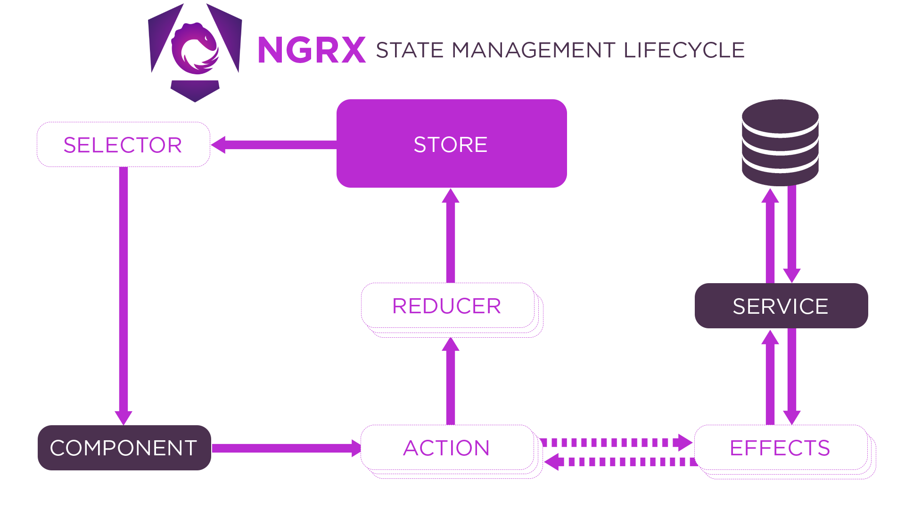

**Required reading**

> **Trainer note:** Read the key concepts and the diagram. Skip the counter tutorial at the end: it uses the old NgModule setup. The walkthrough two pages ahead is the up-to-date version.

:::info[Source]

Adapted from [@ngrx/store](https://v20.ngrx.io/guide/store) by the NgRx team and contributors, NgRx documentation (v20), licensed under [MIT](https://github.com/ngrx/platform/blob/main/LICENSE). Changes: converted to Markdown for offline use; code examples inlined; interactive embeds and site navigation removed.

:::

Store is RxJS powered global state management for Angular applications, inspired by Redux. Store is a controlled state container designed to help write performant, consistent applications on top of Angular.

## Key concepts

- [Actions](./06-actions.md) describe unique events that are dispatched from components and services.
- State changes are handled by pure functions called [reducers](./08-reducers.md) that take the current state and the latest action to compute a new state.
- [Selectors](./09-selectors.md) are pure functions used to select, derive and compose pieces of state.
- State is accessed with the `Store`, an observable of state and an observer of actions.

## Local state management

NgRx Store is mainly for managing global state across an entire application. In cases where you need to manage temporary or local component state, consider using [NgRx Signals](https://v20.ngrx.io/guide/signals).

## Installation

Detailed installation instructions can be found on the [Installation](./03-install.md) page.

## Diagram

The following diagram represents the overall general flow of application state in NgRx.

<figure>
  
</figure>

:::info

**Note:** All `Actions` that are dispatched within an application state are always first processed by the `Reducers` before being handled by the `Effects` of the application state.

:::

## Tutorial

The following tutorial shows you how to manage the state of a counter, and how to select and display it within an Angular component.

:::note[Live example not available offline]

The original page embeds a StackBlitz demo here. The full code is on this page.

:::

1. Generate a new project using the StackBlitz starter project.

2. Right click on the `app` folder in StackBlitz and create a new file named `counter.actions.ts` to describe the counter actions to increment, decrement, and reset its value.

*Code example `store/src/app/counter.actions.ts` not available offline.*

3. Define a reducer function to handle changes in the counter value based on the provided actions.

*Code example `store/src/app/counter.reducer.ts` not available offline.*

4. Import the `StoreModule` from `@ngrx/store` and the `counter.reducer` file.

*Code example `store/src/app/app.module.ts` not available offline.*

5. Add the `StoreModule.forRoot` function in the `imports` array of your `AppModule` with an object containing the `count` and the `counterReducer` that manages the state of the counter. The `StoreModule.forRoot()` method registers the global providers needed to access the `Store` throughout your application.

*Code example `store/src/app/app.module.1.ts` not available offline.*

6. Create a new file called `my-counter.component.ts` in a folder named `my-counter` within the `app` folder that will define a new component called `MyCounterComponent`. This component will render buttons that allow the user to change the count state. Also, create the `my-counter.component.html` file within this same folder.

**src/app/my-counter/my-counter.component.ts**

```ts
import { Component } from '@angular/core';
import { Observable } from 'rxjs';

@Component({
  selector: 'ngrx-my-counter',
  templateUrl: './my-counter.component.html',
})
export class MyCounterComponent {
  count$: Observable<number>;

  constructor() {
    // TODO: Connect `this.count$` stream to the current store `count` state
  }

  increment() {
    // TODO: Dispatch an increment action
  }

  decrement() {
    // TODO: Dispatch a decrement action
  }

  reset() {
    // TODO: Dispatch a reset action
  }
}
```

**src/app/my-counter/my-counter.component.html**

```html
<button (click)="increment()">Increment</button>

<div>Current Count: {{ count$ | async }}</div>

<button (click)="decrement()">Decrement</button>

<button (click)="reset()">Reset Counter</button>
```

7. Add the new component to your AppModule's declarations and declare it in the template:

**src/app/app.component.html**

```html

```

**src/app/app.module.ts**

```ts
import { BrowserModule } from '@angular/platform-browser';
import { NgModule } from '@angular/core';

import { AppComponent } from './app.component';

import { StoreModule } from '@ngrx/store';
import { counterReducer } from './counter.reducer';
import { MyCounterComponent } from './my-counter/my-counter.component';

@NgModule({
  declarations: [AppComponent, MyCounterComponent],
  imports: [
    BrowserModule,
    StoreModule.forRoot({ count: counterReducer }),
  ],
  providers: [],
  bootstrap: [AppComponent],
})
export class AppModule {}
```

8. Inject the store into `MyCounterComponent` and connect the `count$` stream to the store's `count` state. Implement the `increment`, `decrement`, and `reset` methods by dispatching actions to the store.

**src/app/my-counter/my-counter.component.ts**

```ts
import { Component } from '@angular/core';
import { Store } from '@ngrx/store';
import { Observable } from 'rxjs';
import { increment, decrement, reset } from '../counter.actions';

@Component({
  selector: 'ngrx-my-counter',
  templateUrl: './my-counter.component.html',
})
export class MyCounterComponent {
  count$: Observable<number>;

  constructor(private store: Store<{ count: number }>) {
    this.count$ = store.select('count');
  }

  increment() {
    this.store.dispatch(increment());
  }

  decrement() {
    this.store.dispatch(decrement());
  }

  reset() {
    this.store.dispatch(reset());
  }
}
```

And that's it! Click the increment, decrement, and reset buttons to change the state of the counter.

Let's cover what you did:

- Defined actions to express events.
- Defined a reducer function to manage the state of the counter.
- Registered the global state container that is available throughout your application.
- Injected the `Store` service to dispatch actions and select the current state of the counter.

## Next Steps

Learn about the architecture of an NgRx application through [actions](./06-actions.md), [reducers](./08-reducers.md), and [selectors](./09-selectors.md).
