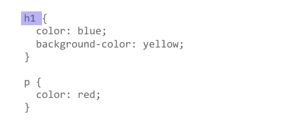

{/* Imported from MDN Web Docs by an import script - do not edit the text by hand. */}

You've already seen how, in CSS, selectors are used to target the HTML elements on our web pages that we want to style. There is a wide variety of CSS selectors available, allowing for fine-grained precision when selecting elements to style, and in the next few articles, we'll look at the different types in depth. In this article, we'll recap some selector fundamentals, including the basic type, class, and ID selectors, and selector lists. We'll also introduce the universal selector.

<table>
  <tbody>
    <tr>
      <th scope="row">Prerequisites:</th>
      <td>
        HTML basics (study
        Basic HTML syntax).
      </td>
    </tr>
    <tr>
      <th scope="row">Learning outcomes:</th>
      <td>
        <ul>
          <li>The basic selector types — element type, class, ID.</li>
          <li>Understand that IDs are unique per document — you should use an ID to select one specific element.</li>
          <li>Understand that you can have multiple classes per element, and these can be used to layer on styles as required.</li>
          <li>Selector lists.</li>
          <li>Universal selector.</li>
        </ul>
      </td>
    </tr>
  </tbody>
</table>

## What is a selector? {#what_is_a_selector}

A CSS selector is the first part of a CSS Rule. It is a pattern of elements and other terms that tell the browser which HTML elements should have the CSS property values inside the rule applied to them. The element or elements selected by the selector are referred to as the _subject of the selector_.



In earlier articles, you met various selectors and learned that there are selectors that target the document in different ways; for example, by selecting an element such as `h1`, or a class such as `.special`. Let's start by recapping the main ones you've already seen.

## Type selectors {#type_selectors}

A **type selector** is sometimes called a _tag name selector_ or _element selector_ because it selects an HTML tag/element in your document. In the example below, we have used the `span`, `em` and `strong` selectors.

Try editing the following example (click **"Play"** to open it in the MDN Playground) to add a CSS rule that selects the `<h1>` element and changes its color to blue:

```html
<h1>Type selectors</h1>
<p>
  Veggies es bonus vobis, proinde vos postulo essum magis
  <span>kohlrabi welsh onion</span> daikon amaranth tatsoi tomatillo melon azuki
  bean garlic.
</p>

<p>
  Gumbo beet greens corn soko <strong>endive</strong> gumbo gourd. Parsley
  shallot courgette tatsoi pea sprouts fava bean collard greens dandelion okra
  wakame tomato. Dandelion cucumber earthnut pea peanut soko zucchini.
</p>

<p>
  Turnip greens yarrow ricebean rutabaga <em>endive cauliflower</em> sea lettuce
  kohlrabi amaranth water spinach avocado daikon napa cabbage asparagus winter
  purslane kale. Celery potato scallion desert raisin horseradish spinach
</p>
```

```css
body {
  font-family: sans-serif;
}

span {
  background-color: yellow;
}

strong {
  color: rebeccapurple;
}

em {
  color: rebeccapurple;
}
```

<LiveExample html={"<h1>Type selectors</h1>\n<p>\n  Veggies es bonus vobis, proinde vos postulo essum magis\n  <span>kohlrabi welsh onion</span> daikon amaranth tatsoi tomatillo melon azuki\n  bean garlic.\n</p>\n\n<p>\n  Gumbo beet greens corn soko <strong>endive</strong> gumbo gourd. Parsley\n  shallot courgette tatsoi pea sprouts fava bean collard greens dandelion okra\n  wakame tomato. Dandelion cucumber earthnut pea peanut soko zucchini.\n</p>\n\n<p>\n  Turnip greens yarrow ricebean rutabaga <em>endive cauliflower</em> sea lettuce\n  kohlrabi amaranth water spinach avocado daikon napa cabbage asparagus winter\n  purslane kale. Celery potato scallion desert raisin horseradish spinach\n</p>\n"} css={"body {\n  font-family: sans-serif;\n}\n\nspan {\n  background-color: yellow;\n}\n\nstrong {\n  color: rebeccapurple;\n}\n\nem {\n  color: rebeccapurple;\n}\n"} height="280px" />

## Class selectors {#class_selectors}

The case-sensitive class selector starts with a dot (`.`) character. It will select everything in the document with that class applied to it. In the live example below, we have created a class called `highlight` and applied it to several places in the document. All elements with that class are highlighted.

```html
<h1 class="highlight">Class selectors</h1>
<p>
  Veggies es bonus vobis, proinde vos postulo essum magis
  <span class="highlight">kohlrabi welsh onion</span> daikon amaranth tatsoi
  tomatillo melon azuki bean garlic.
</p>

<p class="highlight">
  Gumbo beet greens corn soko <strong>endive</strong> gumbo gourd. Parsley
  shallot courgette tatsoi pea sprouts fava bean collard greens dandelion okra
  wakame tomato. Dandelion cucumber earthnut pea peanut soko zucchini.
</p>
```

```css
body {
  font-family: sans-serif;
}

.highlight {
  background-color: yellow;
}
```

<LiveExample html={"<h1 class=\"highlight\">Class selectors</h1>\n<p>\n  Veggies es bonus vobis, proinde vos postulo essum magis\n  <span class=\"highlight\">kohlrabi welsh onion</span> daikon amaranth tatsoi\n  tomatillo melon azuki bean garlic.\n</p>\n\n<p class=\"highlight\">\n  Gumbo beet greens corn soko <strong>endive</strong> gumbo gourd. Parsley\n  shallot courgette tatsoi pea sprouts fava bean collard greens dandelion okra\n  wakame tomato. Dandelion cucumber earthnut pea peanut soko zucchini.\n</p>\n"} css={"body {\n  font-family: sans-serif;\n}\n\n.highlight {\n  background-color: yellow;\n}\n"} height="220px" />

### Playing with class selectors {#playing_with_class_selectors}

Try editing the above example (using MDN Playground) to make the following changes:

1. Edit the HTML to change the content that the `.highlight` styles are applied to. You could, for example, add some `<span>` elements to wrap different parts of the existing content and apply the `highlight` class to them, remove some existing `highlight` classes, or add some new content to apply the `highlight` class to.
2. Edit the CSS to modify the declarations inside the `.highlight` rule, adding new ones if you feel like it, and note how this affects the styling of all elements that have the `highlight` class applied.
3. Create a new class rule inside the CSS with different declarations inside it (for example, with a selector of `.highlight2`), then try applying that to some of your HTML.

### Targeting classes on particular elements {#targeting_classes_on_particular_elements}

You can create a selector that will target specific elements with the class applied. In this next example, we will highlight a `<span>` with a class of `highlight` differently from an `<h1>` heading with a class of `highlight`. We do this by using the type selector for the element we want to target, with the class appended using a dot, with no white space in between.

```html
<h1 class="highlight">Class selectors</h1>
<p>
  Veggies es bonus vobis, proinde vos postulo essum magis
  <span class="highlight">kohlrabi welsh onion</span> daikon amaranth tatsoi
  tomatillo melon azuki bean garlic.
</p>

<p class="highlight">
  Gumbo beet greens corn soko <strong>endive</strong> gumbo gourd. Parsley
  shallot courgette tatsoi pea sprouts fava bean collard greens dandelion okra
  wakame tomato. Dandelion cucumber earthnut pea peanut soko zucchini.
</p>
```

```css
body {
  font-family: sans-serif;
}

span.highlight {
  background-color: yellow;
}

h1.highlight {
  background-color: pink;
}
```

<LiveExample html={"<h1 class=\"highlight\">Class selectors</h1>\n<p>\n  Veggies es bonus vobis, proinde vos postulo essum magis\n  <span class=\"highlight\">kohlrabi welsh onion</span> daikon amaranth tatsoi\n  tomatillo melon azuki bean garlic.\n</p>\n\n<p class=\"highlight\">\n  Gumbo beet greens corn soko <strong>endive</strong> gumbo gourd. Parsley\n  shallot courgette tatsoi pea sprouts fava bean collard greens dandelion okra\n  wakame tomato. Dandelion cucumber earthnut pea peanut soko zucchini.\n</p>\n"} css={"body {\n  font-family: sans-serif;\n}\n\nspan.highlight {\n  background-color: yellow;\n}\n\nh1.highlight {\n  background-color: pink;\n}\n"} height="200px" />

This approach reduces the scope of a rule. The rule will only apply to that particular element and class combination. You would need to add another selector if you wanted the rule to apply to other elements.

### Target an element if it has more than one class applied {#target_an_element_if_it_has_more_than_one_class_applied}

You can apply multiple classes to an element and target them individually, or only select the element when all of the classes in the selector are present. This can be helpful when building up components that can be combined in different ways on your site.

In the example below, we have a `<div>` that contains a note. The gray border is applied when the box has a class of `notebox`. If it also has a class of `warning` or `danger`, we change the `border-color`.

We can tell the browser that we only want to match the element if it has two classes applied by chaining them together with no white space between them. You'll see that the last `<div>` doesn't get any styling applied, as it only has the `danger` class. To get any styles applied, it needs the `notebox` class as well.

```html
<div class="notebox">This is an informational note.</div>

<div class="notebox warning">This note shows a warning.</div>

<div class="notebox danger">This note shows danger!</div>

<div class="danger">
  This won't get styled — it also needs to have the notebox class
</div>
```

```css
body {
  font-family: sans-serif;
}

.notebox {
  border: 4px solid #666666;
  padding: 0.5em;
  margin: 0.5em;
}

.notebox.warning {
  border-color: orange;
  font-weight: bold;
}

.notebox.danger {
  border-color: red;
  font-weight: bold;
}
```

<LiveExample html={"<div class=\"notebox\">This is an informational note.</div>\n\n<div class=\"notebox warning\">This note shows a warning.</div>\n\n<div class=\"notebox danger\">This note shows danger!</div>\n\n<div class=\"danger\">\n  This won't get styled — it also needs to have the notebox class\n</div>\n"} css={"body {\n  font-family: sans-serif;\n}\n\n.notebox {\n  border: 4px solid #666666;\n  padding: 0.5em;\n  margin: 0.5em;\n}\n\n.notebox.warning {\n  border-color: orange;\n  font-weight: bold;\n}\n\n.notebox.danger {\n  border-color: red;\n  font-weight: bold;\n}\n"} height="200px" />

## ID selectors {#id_selectors}

The case-sensitive ID selector begins with a `#` rather than a dot character, but is used in the same way as a class selector. The difference is that an ID can be used only once per page, and elements can only have a single `id` value. An ID selector selects an element with a specific `id`, and you can precede the ID with a type selector to only target the element if both the element and ID match. You can see both of these uses in the following example:

```html
<h1 id="heading">ID selector</h1>
<p>
  Veggies es bonus vobis, proinde vos postulo essum magis kohlrabi welsh onion
  daikon amaranth tatsoi tomatillo melon azuki bean garlic.
</p>

<p id="one">
  Gumbo beet greens corn soko <strong>endive</strong> gumbo gourd. Parsley
  shallot courgette tatsoi pea sprouts fava bean collard greens dandelion okra
  wakame tomato. Dandelion cucumber earthnut pea peanut soko zucchini.
</p>
```

```css
body {
  font-family: sans-serif;
}

#one {
  background-color: yellow;
}

h1#heading {
  color: rebeccapurple;
}
```

<LiveExample html={"<h1 id=\"heading\">ID selector</h1>\n<p>\n  Veggies es bonus vobis, proinde vos postulo essum magis kohlrabi welsh onion\n  daikon amaranth tatsoi tomatillo melon azuki bean garlic.\n</p>\n\n<p id=\"one\">\n  Gumbo beet greens corn soko <strong>endive</strong> gumbo gourd. Parsley\n  shallot courgette tatsoi pea sprouts fava bean collard greens dandelion okra\n  wakame tomato. Dandelion cucumber earthnut pea peanut soko zucchini.\n</p>\n"} css={"body {\n  font-family: sans-serif;\n}\n\n#one {\n  background-color: yellow;\n}\n\nh1#heading {\n  color: rebeccapurple;\n}\n"} height="200px" />

:::warning

Using the same ID multiple times in a document may appear to work for styling purposes, but don't do this. It results in invalid code and will cause strange behavior in many places.

:::

### Playing with ID selectors {#playing_with_id_selectors}

Try editing the above example to make the following changes:

1. Edit the HTML to apply the `#one` styles to the first paragraph rather than the second.
2. Edit the CSS to modify the declarations inside the ID selectors, and note how this changes the look of the HTML.

## Selector lists {#selector_lists}

If you want to apply the same CSS to multiple items, you can combine individual selectors into a _selector list_. The rule is then applied to all the individual selectors. For example, if I have the same CSS for an `h1` and a `.special` selector, I could write this as two separate rules.

```css
h1 {
  color: blue;
}

.special {
  color: blue;
}
```

I could also combine these into a selector list by adding a comma between them.

```css
h1, .special {
  color: blue;
}
```

White space is valid before or after the comma. You may also find the selectors more readable if each is on a new line.

```css
h1,
.special {
  color: blue;
}
```

### Playing with selector lists {#playing_with_selector_lists}

In the example below, try combining the two selectors that have identical declarations. The visual display should be the same afterwards.

```html
<h1>Type selectors</h1>
<p>
  Veggies es bonus vobis, proinde vos postulo essum magis
  <span>kohlrabi welsh onion</span> daikon amaranth tatsoi tomatillo melon azuki
  bean garlic.
</p>

<p>
  Gumbo beet greens corn soko <strong>endive</strong> gumbo gourd. Parsley
  shallot courgette tatsoi pea sprouts fava bean collard greens dandelion okra
  wakame tomato. Dandelion cucumber earthnut pea peanut soko zucchini.
</p>

<p>
  Turnip greens yarrow ricebean rutabaga <em>endive cauliflower</em> sea lettuce
  kohlrabi amaranth water spinach avocado daikon napa cabbage asparagus winter
  purslane kale. Celery potato scallion desert raisin horseradish spinach
</p>
```

```css
body {
  font-family: sans-serif;
}
span {
  background-color: yellow;
}

strong {
  color: rebeccapurple;
}

em {
  color: rebeccapurple;
}
```

<LiveExample html={"<h1>Type selectors</h1>\n<p>\n  Veggies es bonus vobis, proinde vos postulo essum magis\n  <span>kohlrabi welsh onion</span> daikon amaranth tatsoi tomatillo melon azuki\n  bean garlic.\n</p>\n\n<p>\n  Gumbo beet greens corn soko <strong>endive</strong> gumbo gourd. Parsley\n  shallot courgette tatsoi pea sprouts fava bean collard greens dandelion okra\n  wakame tomato. Dandelion cucumber earthnut pea peanut soko zucchini.\n</p>\n\n<p>\n  Turnip greens yarrow ricebean rutabaga <em>endive cauliflower</em> sea lettuce\n  kohlrabi amaranth water spinach avocado daikon napa cabbage asparagus winter\n  purslane kale. Celery potato scallion desert raisin horseradish spinach\n</p>\n"} css={"body {\n  font-family: sans-serif;\n}\nspan {\n  background-color: yellow;\n}\n\nstrong {\n  color: rebeccapurple;\n}\n\nem {\n  color: rebeccapurple;\n}\n"} height="280px" />

### Invalid selectors in selector lists {#invalid_selectors_in_selector_lists}

When you group selectors in this way, if any selector is syntactically invalid, the whole rule will be ignored.

In the following example, the invalid class selector rule will be ignored, whereas the `h1` would still be styled.

```css
h1 {
  color: blue;
}

..special {
  color: blue;
}
```

When combined, however, neither the `h1` nor the class will be styled as the entire rule is deemed invalid.

```css
h1, ..special {
  color: blue;
}
```

## The universal selector {#the_universal_selector}

The universal selector is indicated by an asterisk (`*`). It selects everything in the document. If `*` is chained using a descendant combinator, it selects everything inside that ancestor element. For example, `p *` selects all the nested elements inside the `<p>` element.

In the following example, we use the universal selector to remove the margins on all elements. Instead of the browser's default styling, which spaces out headings and paragraphs with margins, everything is close together.

```html
<h1>Universal selector</h1>
<p>
  Veggies es bonus vobis, proinde vos postulo essum magis
  <span>kohlrabi welsh onion</span> daikon amaranth tatsoi tomatillo melon azuki
  bean garlic.
</p>

<p>
  Gumbo beet greens corn soko <strong>endive</strong> gumbo gourd. Parsley
  shallot courgette tatsoi pea sprouts fava bean collard greens dandelion okra
  wakame tomato. Dandelion cucumber earthnut pea peanut soko zucchini.
</p>
```

```css
body {
  font-family: sans-serif;
}

* {
  margin: 0;
}
```

<LiveExample html={"<h1>Universal selector</h1>\n<p>\n  Veggies es bonus vobis, proinde vos postulo essum magis\n  <span>kohlrabi welsh onion</span> daikon amaranth tatsoi tomatillo melon azuki\n  bean garlic.\n</p>\n\n<p>\n  Gumbo beet greens corn soko <strong>endive</strong> gumbo gourd. Parsley\n  shallot courgette tatsoi pea sprouts fava bean collard greens dandelion okra\n  wakame tomato. Dandelion cucumber earthnut pea peanut soko zucchini.\n</p>\n"} css={"body {\n  font-family: sans-serif;\n}\n\n* {\n  margin: 0;\n}\n"} />

This kind of behavior can sometimes be seen in "reset stylesheets", which strip out all of the browser styling. Since the universal selector makes global changes, we use it for very specific situations, such as the one described below.

### Using the universal selector to make your selectors easier to read {#using_the_universal_selector_to_make_your_selectors_easier_to_read}

One use of the universal selector is to make selectors easier to read and more intuitive. For example, if we wanted to select all descendant elements of an `<article>` element that are the first child of their parent, including direct children, we could use the `:first-child` pseudo-class. We will learn more about this in pseudo-classes and pseudo-elements:

```css
article :first-child {
  font-weight: bold;
}
```

However, this selector could be confused with `article:first-child`, which will select any `<article>` element that is the first child of another element.

To avoid this confusion, we could add the universal selector to the `:first-child` pseudo-class, so it is more obvious what the selector is doing. It is selecting _any_ element that is the first-child of an `<article>` element, or the first-child of any descendant element of `<article>`:

```css
article *:first-child {
  font-weight: bold;
}
```

Both are equivalent, but some people find the second option easier to read.

:::note

You are unlikely to see this technique used much in published websites. We don't use it much on MDN, for example. However, you should still consider using it in your code if you find it easier to understand.

:::

## Summary {#summary}

In this article, we've recapped CSS selectors, which enable you to target particular HTML elements, looking at type, class, and ID selectors in a bit more depth than we did previously. In the next article, we will dive into attribute selectors.

:::note

For a complete list of selectors, see our CSS selectors reference.

:::

## See also {#see_also}

- [CSS classes](https://scrimba.com/the-frontend-developer-career-path-c0j/~01d?via=mdn), Scrimba <sup>_MDN learning partner_</sup>
  - : An interactive lesson that provides some guidance on CSS classes.

<SourceAttribution source="mdn" title="Basic CSS selectors" url="https://developer.mozilla.org/en-US/docs/Learn_web_development/Core/Styling_basics/Basic_selectors" />
