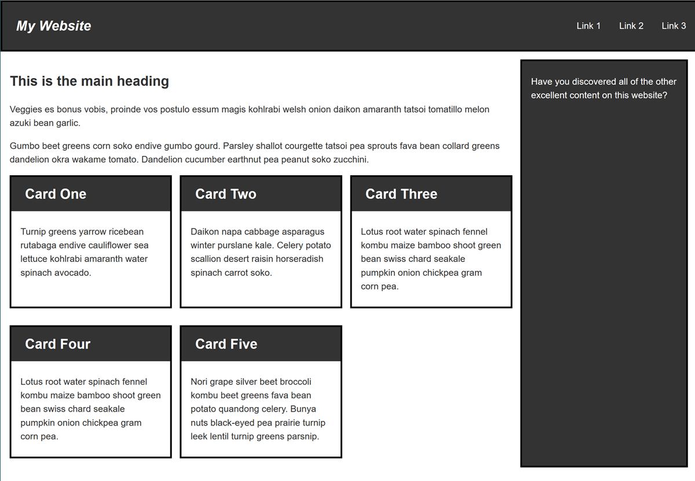

{/* Imported from MDN Web Docs by an import script - do not edit the text by hand. */}

The aim of this skill test is to help you assess whether you understand [how to use media queries](./05-media-queries.mdx) and get you working with responsive web design with a practical task. Everything you need to know to complete this task is covered in the layout lessons in the CSS layout module.

:::note

To get help, read our Test your skills usage guide. You can also reach out to us using one of our communication channels.

:::

## Task {#task}

Because you need to test your design in multiple screen sizes, we do not have interactive editors on this page.

To get started:

1. [Download the starting point for this task](https://github.com/mdn/css-examples/blob/main/learn/tasks/rwd/rwd-download.html).
2. Open the downloaded HTML file in your browser and you will find a wireframed site which will load in a mobile device in a readable manner.
3. Drag your window smaller or use the [responsive design view in Firefox DevTools](https://firefox-source-docs.mozilla.org/devtools-user/index.html#responsive-design-mode) to view this as if on a phone.

Your task is to create a desktop version of this layout which displays when there is enough screen width to accommodate it. Your final result should look like the image below:

There are a number of ways that you could create the desktop layout — enjoy experimenting. You could also add a second breakpoint, perhaps creating a layout that would work well on a tablet in portrait mode.

<SourceAttribution source="mdn" title="Test your skills: Responsive web design and media queries" url="https://developer.mozilla.org/en-US/docs/Learn_web_development/Core/CSS_layout/Test_your_skills/Responsive_design" />
