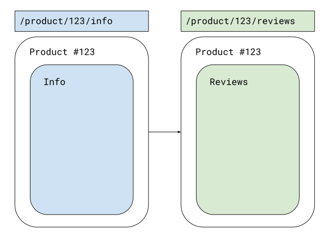

{/* Imported by tools/import-docs from the Angular documentation - do not edit the text by hand. */}

Routes serve as the fundamental building blocks for navigation within an Angular app.

## What are routes?

In Angular, a **route** is an object that defines which component should render for a specific URL path or pattern, as well as additional configuration options about what happens when a user navigates to that URL.

Here is a basic example of a route:

```ts
import {AdminPage} from './app-admin';

const adminPage = {
  path: 'admin',
  component: AdminPage,
};
```

For this route, when a user visits the `/admin` path, the app will display the `AdminPage` component.

### Managing routes in your application

Most projects define routes in a separate file that contains `routes` in the filename.

A collection of routes looks like this:

```ts
import {Routes} from '@angular/router';
import {HomePage} from './home-page';
import {AdminPage} from './admin-page';

export const routes: Routes = [
  {
    path: '',
    component: HomePage,
  },
  {
    path: 'admin',
    component: AdminPage,
  },
];
```

:::tip

If you generated a project with Angular CLI, your routes are defined in `src/app/app.routes.ts`.

:::

### Adding the router to your application

When bootstrapping an Angular application without the Angular CLI, you can pass a configuration object that includes a `providers` array.

Inside of the `providers` array, you can add the Angular router to your application by adding a `provideRouter` function call with your routes.

```ts
import {ApplicationConfig} from '@angular/core';
import {provideRouter} from '@angular/router';

import {routes} from './app.routes';

export const appConfig: ApplicationConfig = {
  providers: [
    provideRouter(routes),
    // ...
  ],
};
```

## Route URL Paths

### Static URL Paths

Static URL Paths refer to routes with predefined paths that don't change based on dynamic parameters. These are routes that match a `path` string exactly and have a fixed outcome.

Examples of this include:

- "/admin"
- "/blog"
- "/settings/account"

### Define URL Paths with Route Parameters

Parameterized URLs allow you to define dynamic paths that allow multiple URLs to the same component while dynamically displaying data based on parameters in the URL.

You can define this type of pattern by adding parameters to your route’s `path` string and prefixing each parameter with the colon (`:`) character.

:::warning

Parameters are distinct from information in the URL's query string.
Learn more about [query parameters in Angular in this guide](./04-read-route-state.mdx#query-parameters).

:::

The following example displays a user profile component based on the user id passed in through the URL.

```ts
import {Routes} from '@angular/router';
import {UserProfile} from './user-profile/user-profile';

const routes: Routes = [{path: 'user/:id', component: UserProfile}];
```

In this example, URLs such as `/user/leeroy` and `/user/jenkins` render the `UserProfile` component. This component can then read the `id` parameter and use it to perform additional work, such as fetching data. See [reading route state guide](./04-read-route-state.mdx) for details on reading route parameters.

Valid route parameter names must start with a letter (a-z, A-Z) and can only contain:

- Letters (a-z, A-Z)
- Numbers (0-9)
- Underscore (\_)
- Hyphen (-)

You can also define paths with multiple parameters:

```ts
import {Routes} from '@angular/router';
import {UserProfile} from './user-profile';
import {SocialMediaFeed} from './social-media-feed';

const routes: Routes = [
  {path: 'user/:id/:social-media', component: SocialMediaFeed},
  {path: 'user/:id', component: UserProfile},
];
```

With this new path, users can visit `/user/leeroy/youtube` and `/user/leeroy/bluesky` and see respective social media feeds based on the parameter for the user leeroy.

See [Reading route state](./04-read-route-state.mdx) for details on reading route parameters.

### Wildcards

When you need to catch all routes for a specific path, the solution is a wildcard route which is defined with the double asterisk (`**`).

A common example is defining a Page Not Found component.

```ts
import {Routes} from '@angular/router';
import {Home} from './home/home';
import {UserProfile} from './user-profile';
import {NotFound} from './not-found';

const routes: Routes = [
  {path: 'home', component: Home},
  {path: 'user/:id', component: UserProfile},
  {path: '**', component: NotFound},
];
```

In this routes array, the app displays the `NotFound` component when the user visits any path outside of `home` and `user/:id`.

:::tip

Wildcard routes are typically placed at the end of a routes array.

:::

## How Angular matches URLs

When you define routes, the order is important because Angular uses a first-match wins strategy. This means that once Angular matches a URL with a route `path`, it stops checking any further routes. As a result, always put more specific routes before less specific routes.

The following example shows routes defined from most-specific to least specific:

```ts
const routes: Routes = [
  {path: '', component: Home}, // Empty path
  {path: 'users/new', component: NewUser}, // Static, most specific
  {path: 'users/:id', component: UserDetail}, // Dynamic
  {path: 'users', component: Users}, // Static, less specific
  {path: '**', component: NotFound}, // Wildcard - always last
];
```

If a user visits `/users/new`, Angular router would go through the following steps:

1. Checks `''` - doesn't match
1. Checks `users/new` - matches! Stops here
1. Never reaches `users/:id` even though it could match
1. Never reaches `users`
1. Never reaches `**`

## Redirects

You can define a route that redirects to another route instead of rendering a component:

```ts
import {Routes} from '@angular/router';
import {Blog} from './home/blog';

const routes: Routes = [
  {
    path: 'articles',
    redirectTo: '/blog',
  },
  {
    path: 'blog',
    component: Blog,
  },
];
```

If you modify or remove a route, some users may still click on out-of-date links or bookmarks to that route. You can add a redirect to direct those users to an appropriate alternative route instead of a "not found" page.

## Nested Routes

Nested routes, also known as child routes, are a common technique for managing more complex navigation routes where a component has a sub-view that changes based on the URL.



You can add child routes to any route definition with the `children` property:

```ts
const routes: Routes = [
  {
    path: 'product/:id',
    component: Product,
    children: [
      {
        path: 'info',
        component: ProductInfo,
      },
      {
        path: 'reviews',
        component: ProductReviews,
      },
    ],
  },
];
```

The above example defines a route for a product page that allows a user to change whether the product info or reviews are displayed based on the url.

The `children` property accepts an array of `Route` objects.

To display child routes, the parent component (`Product` in the example above) includes its own `<router-outlet>`.

```html
<!-- Product -->
<article>
  <h1>Product {{ id }}</h1>
  <router-outlet />
</article>
```

After adding child routes to the configuration and adding a `<router-outlet>` to the component, navigation between URLs that match the child routes updates only the nested outlet.

<SourceAttribution source="angular" title="Define routes" url="https://angular.dev/guide/routing/define-routes" />
