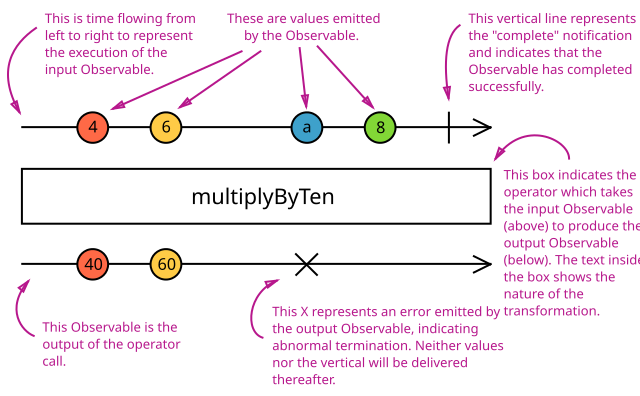

{/* Imported by tools/import-docs from the RxJS documentation - do not edit the text by hand. */}

RxJS is mostly useful for its _operators_, even though the Observable is the foundation. Operators are the essential pieces that allow complex asynchronous code to be easily composed in a declarative manner.

## What are operators?

Operators are **functions**. There are two kinds of operators:

**Pipeable Operators** are the kind that can be piped to Observables using the syntax `observableInstance.pipe(operator)` or, more commonly, `observableInstance.pipe(operatorFactory())`. Operator factory functions include, `filter(...)`, and `mergeMap(...)`.

When Pipeable Operators are called, they do not _change_ the existing Observable instance. Instead, they return a _new_ Observable, whose subscription logic is based on the first Observable.

_A Pipeable Operator is a function that takes an Observable as its input and returns another Observable. It is a pure operation: the previous Observable stays unmodified._

_A Pipeable Operator Factory is a function that can take parameters to set the context and return a Pipeable Operator. The factory’s arguments belong to the operator’s lexical scope._

A Pipeable Operator is essentially a pure function which takes one Observable as input and generates another Observable as output. Subscribing to the output Observable will also subscribe to the input Observable.

**Creation Operators** are the other kind of operator, which can be called as standalone functions to create a new Observable. For example: `of(1, 2, 3)` creates an observable that will emit 1, 2, and 3, one right after another. Creation operators will be discussed in more detail in a later section.

For example, the operator called `map` is analogous to the Array method of the same name. Just as `[1, 2, 3].map(x => x * x)` will yield `[1, 4, 9]`, the Observable created like this:

```ts
import { of, map } from 'rxjs';

of(1, 2, 3)
  .pipe(map((x) => x * x))
  .subscribe((v) => console.log(`value: ${v}`));

// Logs:
// value: 1
// value: 4
// value: 9
```

will emit `1`, `4`, `9`. Another useful operator is `first`:

```ts
import { of, first } from 'rxjs';

of(1, 2, 3)
  .pipe(first())
  .subscribe((v) => console.log(`value: ${v}`));

// Logs:
// value: 1
```

Note that `map` logically must be constructed on the fly, since it must be given the mapping function to. By contrast, `first` could be a constant, but is nonetheless constructed on the fly. As a general practice, all operators are constructed, whether they need arguments or not.

## Piping

Pipeable operators are functions, so they _could_ be used like ordinary functions: `op()(obs)` — but in practice, there tend to be many of them convolved together, and quickly become unreadable: `op4()(op3()(op2()(op1()(obs))))`. For that reason, Observables have a method called `.pipe()` that accomplishes the same thing while being much easier to read:

```ts
obs.pipe(op1(), op2(), op3(), op4());
```

As a stylistic matter, `op()(obs)` is never used, even if there is only one operator; `obs.pipe(op())` is universally preferred.

## Creation Operators

**What are creation operators?** Distinct from pipeable operators, creation operators are functions that can be used to create an Observable with some common predefined behavior or by joining other Observables.

A typical example of a creation operator would be the `interval` function. It takes a number (not an Observable) as input argument, and produces an Observable as output:

```ts
import { interval } from 'rxjs';

const observable = interval(1000 /* number of milliseconds */);
```

See the list of all static creation operators here.

## Higher-order Observables

Observables most commonly emit ordinary values like strings and numbers, but surprisingly often, it is necessary to handle Observables _of_ Observables, so-called higher-order Observables. For example, imagine you had an Observable emitting strings that were the URLs of files you wanted to see. The code might look like this:

```ts
const fileObservable = urlObservable.pipe(map((url) => http.get(url)));
```

`http.get()` returns an Observable (of string or string arrays probably) for each individual URL. Now you have an Observable _of_ Observables, a higher-order Observable.

But how do you work with a higher-order Observable? Typically, by _flattening_: by (somehow) converting a higher-order Observable into an ordinary Observable. For example:

```ts
const fileObservable = urlObservable.pipe(
  map((url) => http.get(url)),
  concatAll()
);
```

The `concatAll()` operator subscribes to each "inner" Observable that comes out of the "outer" Observable, and copies all the emitted values until that Observable completes, and goes on to the next one. All of the values are in that way concatenated. Other useful flattening operators (called _join operators_) are

- `mergeAll()` — subscribes to each inner Observable as it arrives, then emits each value as it arrives
- `switchAll()` — subscribes to the first inner Observable when it arrives, and emits each value as it arrives, but when the next inner Observable arrives, unsubscribes to the previous one, and subscribes to the new one.
- `exhaustAll()` — subscribes to the first inner Observable when it arrives, and emits each value as it arrives, discarding all newly arriving inner Observables until that first one completes, then waits for the next inner Observable.

Just as many array libraries combine `map()` and `flat()` (or `flatten()`) into a single `flatMap()`, there are mapping equivalents of all the RxJS flattening operators `concatMap()`, `mergeMap()`, `switchMap()`, and `exhaustMap()`.

## Marble diagrams

To explain how operators work, textual descriptions are often not enough. Many operators are related to time, they may for instance delay, sample, throttle, or debounce value emissions in different ways. Diagrams are often a better tool for that. _Marble Diagrams_ are visual representations of how operators work, and include the input Observable(s), the operator and its parameters, and the output Observable.

_In a marble diagram, time flows to the right, and the diagram describes how values ("marbles") are emitted on the Observable execution._

Below you can see the anatomy of a marble diagram.



Throughout this documentation site, we extensively use marble diagrams to explain how operators work. They may be really useful in other contexts too, like on a whiteboard or even in our unit tests (as ASCII diagrams).

<SourceAttribution source="rxjs" title="RxJS Operators" url="https://rxjs.dev/guide/operators" />
