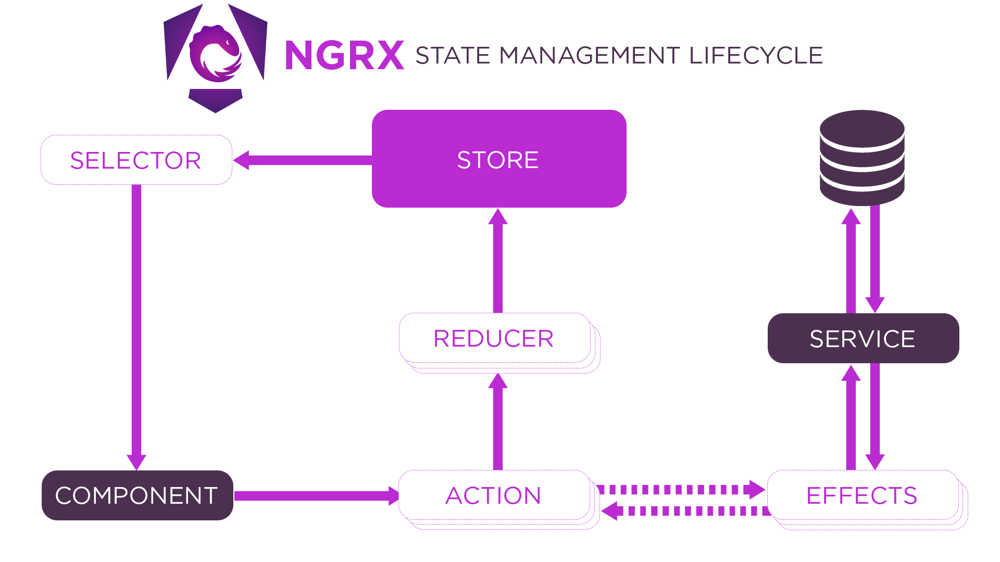

{/* Imported by tools/import-docs from the NgRx documentation - do not edit the text by hand. */}

Store is RxJS powered global state management for Angular applications, inspired by Redux. Store is a controlled state container designed to help write performant, consistent applications on top of Angular.

## Key concepts

- [Actions](./03-actions.mdx) describe unique events that are dispatched from components and services.
- State changes are handled by pure functions called [reducers](./04-reducers.mdx) that take the current state and the latest action to compute a new state.
- [Selectors](./05-selectors.mdx) are pure functions used to select, derive and compose pieces of state.
- State is accessed with the `Store`, an observable of state and an observer of actions.

## Local state management

NgRx Store is mainly for managing global state across an entire application. In cases where you need to manage temporary or local component state, consider using NgRx Signals.

## Diagram

The following diagram represents the overall general flow of application state in NgRx.

  

:::note

**Note:** All `Actions` that are dispatched within an application state are always first processed by the `Reducers` before being handled by the `Effects` of the application state.

:::

## Tutorial

The following tutorial shows you how to manage the state of a counter, and how to select and display it within an Angular component.

1.  Generate a new project with `ng new`, and add NgRx with `npm install @ngrx/store`.

2.  In the `src` folder, create a new file named `counter.actions.ts` to describe the counter actions to increment, decrement, and reset its value.

```ts title="src/counter.actions.ts"
import { createAction } from '@ngrx/store';

export const increment = createAction('[Counter Component] Increment');
export const decrement = createAction('[Counter Component] Decrement');
export const reset = createAction('[Counter Component] Reset');
```

3.  Define a reducer function to handle changes in the counter value based on the provided actions.

```ts title="src/counter.reducer.ts"
import { createReducer, on } from '@ngrx/store';
import { increment, decrement, reset } from './counter.actions';

export const initialState = 0;

export const counterReducer = createReducer(
  initialState,
  on(increment, (state) => state + 1),
  on(decrement, (state) => state - 1),
  on(reset, () => 0)
);
```

4.  Add the `provideStore` function in the `providers` array of your `ApplicationConfig` (within `app.config.ts`) with an object containing the `count` and the `counterReducer` that manages the state of the counter. The `provideStore` method registers the global providers needed to access the `Store` throughout your application.

```ts title="src/app.config.ts"
import { ApplicationConfig } from '@angular/core';
import { provideStore } from '@ngrx/store';
import { counterReducer } from './counter.reducer';

export const appConfig: ApplicationConfig = {
  providers: [provideStore({ count: counterReducer })],
};
```

5.  Create a new file called `my-counter.component.ts` in a folder named `my-counter` within the `app` folder that defines a new component called `MyCounterComponent`. This component renders buttons that allow the user to change the count state. Also add the component's HTML template to the component using the `template` property. If you prefer to use an external HTML file for the template, create a file named `my-counter.component.html` in the same folder and move the template code there, then update the `templateUrl` property of the component accordingly.

```ts title="src/my-counter/my-counter.component.todo.ts"
import { Component } from '@angular/core';
import { Observable } from 'rxjs';

@Component({
  selector: 'ngrx-my-counter',
  template: `
    <button (click)="increment()">Increment</button>

    <div>Current Count: {{ count$ | async }}</div>

    <button (click)="decrement()">Decrement</button>

    <button (click)="reset()">Reset Counter</button>
  `,
})
export class MyCounterComponent {
  count$: Observable<number>;

  constructor() {
    // TODO: Connect `this.count$` stream to the current store `count` state
  }

  increment() {
    // TODO: Dispatch an increment action
  }

  decrement() {
    // TODO: Dispatch a decrement action
  }

  reset() {
    // TODO: Dispatch a reset action
  }
}
```

6.  Add the new component to your AppComponent's imports and declare it in the template:

```ts title="src/app.component.ts"
import { Component } from '@angular/core';
// 👇 Import the counter component
import { MyCounterComponent } from './my-counter/my-counter.component';

@Component({
  selector: 'ngrx-root',
  // 👇 Add the counter component to the imports
  imports: [MyCounterComponent],
  template: `
    <h1>NgRx Tutorial</h1>

    <!-- 👇 add the counter component -->
    <ngrx-my-counter></ngrx-my-counter>
  `,
})
export class AppComponent {}
```

7.  Inject the store into `MyCounterComponent` and connect the `count$` stream to the store's `count` state. Implement the `increment`, `decrement`, and `reset` methods by dispatching actions to the store.

```ts title="src/my-counter/my-counter.component.ts"
import { Component, Signal, inject } from '@angular/core';
import { Store } from '@ngrx/store';
import { increment, decrement, reset } from '../counter.actions';

@Component({
  selector: 'ngrx-my-counter',
  template: `
    <button id="increment" (click)="increment()">Increment</button>

    <div>Current Count: {{ count() }}</div>

    <button id="decrement" (click)="decrement()">Decrement</button>

    <button id="reset" (click)="reset()">Reset Counter</button>
  `,
})
export class MyCounterComponent {
  private readonly store: Store<{ count: number }> = inject(Store);
  count: Signal<number> = this.store.selectSignal((state) => state.count);

  increment() {
    this.store.dispatch(increment());
  }

  decrement() {
    this.store.dispatch(decrement());
  }

  reset() {
    this.store.dispatch(reset());
  }
}
```

And that's it! Click the increment, decrement, and reset buttons to change the state of the counter.

Let's cover what you did:

- Defined actions to express events.
- Defined a reducer function to manage the state of the counter.
- Registered the global state container that is available throughout your application.
- Injected the `Store` service to dispatch actions and select the current state of the counter.

## Next Steps

Learn about the architecture of an NgRx application through [actions](./03-actions.mdx), [reducers](./04-reducers.mdx), and [selectors](./05-selectors.mdx).

<SourceAttribution source="ngrx" title="@ngrx/store" url="https://ngrx.io/guide/store" />
