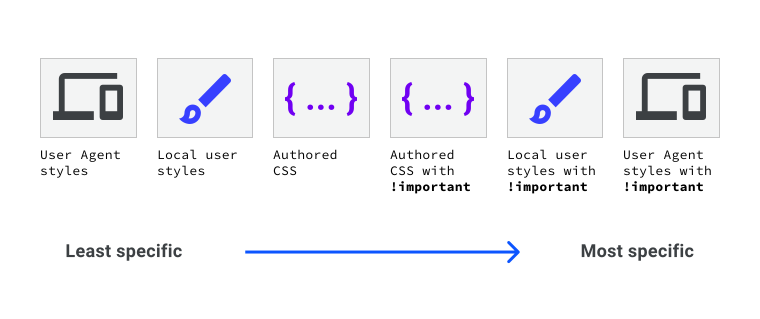
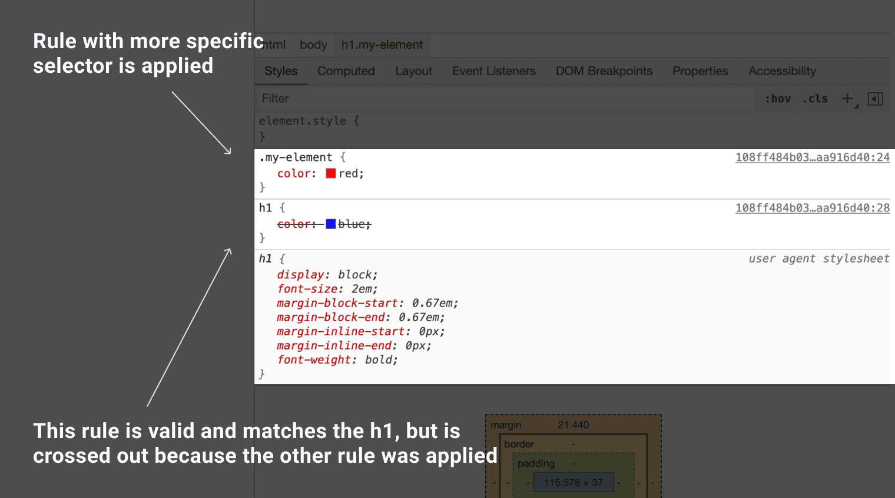

**Required reading**

:::info[Source]

Adapted from [The cascade](https://web.dev/learn/css/the-cascade) by the web.dev authors (Google), web.dev, licensed under [CC BY 4.0](https://creativecommons.org/licenses/by/4.0/). Changes: converted to Markdown for offline use; interactive embeds, browser-compatibility tables and site navigation removed.

:::

CSS stands for Cascading Stylesheets. The cascade is the algorithm for solving conflicts where multiple CSS rules apply to an HTML element. It's the reason that the text of the button styled with the following CSS will be blue.

```css
button {
  color: red;
}

button {
  color: blue;
}
```

:::note[Interactive demo not available offline]

This lesson has an interactive CodePen demo here. CodePen is not reachable from our network. Use the code on this page in the playground instead. (Pen id for reference: `web-dot-dev/GRrgMOm`)

:::

Understanding the cascade algorithm helps you understand how the browser resolves conflicts like this. The cascade algorithm is split into 4 distinct stages.

1. **Position and order of appearance**: the order of which your CSS rules appear
2. **Specificity**: an algorithm which determines which CSS selector has the strongest match
3. **Origin**: the order of when CSS appears and where it comes from, whether that is a browser style, CSS from a browser extension, or your authored CSS
4. **Importance**: some CSS rules are weighted more heavily than others, especially with the `!important` rule type

## Position and order of appearance

The order in which your CSS rules appear and how they appear is taken into consideration by the cascade while it calculates conflict resolution. This is the final step of the cascade, and will always result in a single winning declaration. But position is only considered if there are still conflicting styles after every other step of the cascade has been considered.

The demo right at the start of this lesson is the most straightforward example of position. There are two author-origin rules without importance, both are un-layered, and come from rules that have selectors of identical specificity, so the last one to be declared won.

Styles can come from various sources on an HTML page, such as a `<link>` tag, an embedded `<style>` tag, an `@import` rule, and inline CSS as defined in an element's `style` attribute.

If you have a `<link>` that includes CSS at the top of your HTML page, then another `<link>` that includes CSS at the bottom of your page: the styles in the bottom `<link>` will have higher priority. The same thing happens with embedded `<style>` elements, or conflicting declarations within a single `style` attribute. When every other step of the cascade is equal, the last style will win.

:::note[Interactive demo not available offline]

This lesson has an interactive CodePen demo here. CodePen is not reachable from our network. Use the code on this page in the playground instead. (Pen id for reference: `web-dot-dev/NWdPaWv`)

:::

*The button has a blue background, as defined by CSS which is included by a `<link />` element. A CSS rule that sets it to be dark is in a second linked style sheet and is applied because of its later position.*

This ordering also applies to embedded `<style>` elements. If they are declared before a `<link>`, the linked stylesheet's CSS will have the higher priority.

:::note[Interactive demo not available offline]

This lesson has an interactive CodePen demo here. CodePen is not reachable from our network. Use the code on this page in the playground instead. (Pen id for reference: `web-dot-dev/xxgbLoB`)

:::

*The `<style>` element is declared in the `<head>`, while the `<link />` element is declared in the `<body>`. This means it gets more specificity than the `<style>` element*

The ordering of selectors in relation to `style` attributes is not important, since those conflicts are resolved by the Element Attachment step of the cascade. But multiple declarations within the same style attribute can still rely on positioning to determine a winner.

Position also applies in the order of your CSS rule. In this example, the element will have a purple background because `background: purple` was declared last. Because the green background was declared before the purple background, it is now ignored by the browser.

```css
.my-element {
  background: green;
  background: purple;
}
```

Being able to specify two values for the same property can be a simple way to create fallbacks for browsers that don't support a particular value. In this next example, `font-size` is declared twice. If `clamp()` is supported in the browser, then the previous `font-size` declaration will be discarded. If `clamp()` isn't supported by the browser, the initial declaration will be honored, and the font-size will be 1.5rem

```css
.my-element {
  font-size: 1.5rem;
  font-size: clamp(1.5rem, 1rem + 3vw, 2rem);
}
```

:::note[Interactive demo not available offline]

This lesson has an interactive CodePen demo here. CodePen is not reachable from our network. Use the code on this page in the playground instead. (Pen id for reference: `web-dot-dev/xxgbPMP`)

:::

:::note

This approach of declaring the same property twice works because browsers ignore values they don't understand. Unlike some other programming languages, CSS won't throw an error or break your program when it detects a line it cannot parse—the value it cannot parse is invalid and therefore ignored. The browser then continues to process the rest of the CSS without breaking stuff it already understands.

:::

### Check your understanding

Test your knowledge of the cascade

## Check your understanding (1)

**Question 1.**

If you have the following HTML on your page:

```html
<!DOCTYPE html>
<html lang="en">
  <head>
    <link rel="stylesheet" href="/styles.css" />
  </head>
  <body>
    <button>I am a button</button>
    <style>
      button {
        background: pink;
      }
    </style>
  </body>
</html>
```

Inside `styles.css`, is the following CSS rule:

```css
button {
  background: yellow;
}
```

What color is the button's background?

- pink
- yellow

<details><summary>Show answer</summary><p><strong>pink</strong>: The embedded <code translate="no" dir="ltr">&lt;style&gt;</code> origin is further down the page than the <code translate="no" dir="ltr">&lt;link&gt;</code> tag, so while the specificity of <code translate="no" dir="ltr">button</code> is the same, the <strong>position</strong> of the style rule makes it win.</p></details>

## Specificity

Specificity is an algorithm which determines which CSS selector is the most specific, using a weighting or scoring system to make those calculations. By making a rule more specific, you can cause it to be applied even if some other CSS that matches the selector appears later in the CSS.

In [the next lesson](./04-specificity.md) you can learn the details of how specificity is calculated, however keeping a few things in mind will help you avoid too many specificity issues.

CSS targeting a class on an element will make that rule more specific, and therefore seen as more important to be applied, than CSS targeting the element alone. This means that with the following CSS, the `h1` will be colored red even though both rules match and the rule for the `h1` selector comes later in the style sheet.

```html
<h1 class="my-element">Heading</h1>
```

```css
.my-element {
  color: red;
}

h1 {
  color: blue;
}
```

An `id` makes the CSS even more specific, so styles applied to an ID will override those applied many other ways. This is one reason why it is generally not a good idea to attach styles to an `id`. It can make it difficult to overwrite that style with something else.

### Specificity is cumulative

As you can find out in the next lesson, each type of selector is awarded points which indicate how specific it is, the points for all of the selectors you have used to target an element are added together. This means that if you target an element with a selector list such as `a.my-class.another-class[href]:hover` you get something quite hard to overwrite with other CSS. For this reason, and to help make your CSS more reusable, it's a good idea to keep your selectors as simple as possible. Use specificity as a tool to get at elements when you need to, but always consider refactoring long, specific selector lists, if you can.

## Origin

The CSS that you write isn't the only CSS applied to a page. The cascade takes into account the origin of the CSS. This origin includes the browser's internal style sheet, styles added by browser extensions or the operating system, and your authored CSS. The **order of specificity of these origins**, from least specific, to most specific is as follows:

1. **User agent base styles**. These are the styles that your browser applies to HTML elements by default.
2. **Local user styles**. These can come from the operating system level, such as a base font size, or a preference of reduced motion. They can also come from browser extensions, such as a browser extension that allows a user to write their own custom CSS for a webpage.
3. **Authored CSS**. The CSS that you author.
4. **Authored `!important`**. Any `!important` that you add to your authored declarations.
5. **Local user styles `!important`**. Any `!important` that come from the operating system level, or browser extension level CSS.
6. **User agent `!important`**. Any `!important` that are defined in the default CSS, provided by the browser.



If you have an `!important` rule type in the CSS you have authored and the user has an `!important` rule type in their custom CSS, whose CSS wins?

### Check your understanding

Test your knowledge of cascade origins

## Check your understanding (2)

**Question 1.**

**Test your knowledge of cascade origins**, consider the following style rules from various origins:

#### User-agent style

```css
h1 { margin-block-start: 0.83em; }
```

#### Bootstrap

```css
h1 { margin-block-start: 20px; }
```

#### Page Author styles

```css
h1 { margin-block-start: 2ch; }

@media (max-width: 480px) {
  h1 { margin-block-start: 1ch; }
}
```

#### User custom style

```css
h1 { margin-block-start: 2rem !important; }
```

Then, given the following HTML:

```html
<h1>Lorem ipsum</h1>
```

What is the final `margin-block-start` of the `h1`?

- 20px
- 0.83em
- 2rem
- 2ch
- 1ch

<details><summary>Show answer</summary><p><strong>2rem</strong>: This <code translate="no" dir="ltr">!important</code> user custom style has the most specific origin.</p></details>

## Importance

Not all CSS rules are calculated the same as each other, or given the same specificity as each other.

The **order of importance**, from least important, to most important is as follows:

1. normal rule type, such as `font-size`, `background` or `color`
2. `animation` rule type
3. `!important` rule type (following the same order as origin)
4. `transition` rule type

Active animation and transition rule types have higher importance than normal rules. In the case of transitions higher importance than `!important` rule types. This is because when an animation or transition becomes active, its expected behaviour is to change visual state.

## Using DevTools to find out why some CSS is not applying

Browser DevTools will typically show all CSS that could match an element, with those which are not being used crossed out.



If the CSS you expected to apply doesn't appear at all, then it didn't match the element. In that case you need to look elsewhere, perhaps for a typo in a class or element name or some invalid CSS.

### Check your understanding

Test your knowledge of the cascade

## Check your understanding (3)

**Question 1.**

The Cascade can be used for...

- Resolving conflicts when multiple styles apply to an element.
- Ensuring there's only one style value for each property at draw time.
- Scoring and weighting style rules.
- Sorting and filtering style attributes.

<details><summary>Show answer</summary><p><strong>Resolving conflicts when multiple styles apply to an element.</strong>: This is one of its primary goals, conflict resolution.</p><p><strong>Ensuring there's only one style value for each property at draw time.</strong>: The text can only be one color, and The Cascade is a way of determining which it should be.</p></details>

## Resources

- [A highly interactive explainer of the cascade](https://2019.wattenberger.com/blog/css-cascade)
- [MDN cascade reference](https://developer.mozilla.org/docs/Learn/CSS/Building_blocks/Cascade_and_inheritance)
