**Required reading**

> **Trainer note:** Then play Grid Garden (all 28 levels; 18-28 matter most for the feed layout).

:::info[Source]

Adapted from [Grid](https://web.dev/learn/css/grid) by the web.dev authors (Google), web.dev, licensed under [CC BY 4.0](https://creativecommons.org/licenses/by/4.0/). Changes: converted to Markdown for offline use; interactive embeds, browser-compatibility tables and site navigation removed.

:::

A really common layout in web design is a header, sidebar, body and footer layout.

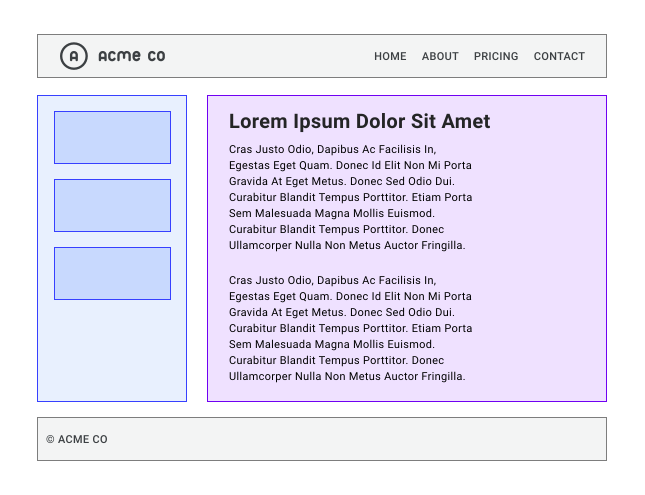

Over the years, there have been many methods to solve this layout, but with CSS grid, not only is it relatively straightforward, but you have lots of options. Grid is exceptionally useful at combining the control that extrinsic sizing provides with the flexibility of intrinsic sizing, which makes it ideal for this sort of layout. This is because grid is a layout method designed for two-dimensional content. That is, laying things out in rows and columns at the same time.

When creating a grid layout you define a grid with rows and columns. Then you place items onto that grid, or allow the browser to auto-place them into the cells you have created. There's a lot to grid, but with an overview of what is available you'll be making grid layouts in no time.

## Overview

So what can you do with grid? Grid layouts have the following features. You'll learn about all of them in this guide.

1. A grid can be defined with rows and columns. You can choose how to size these row and column tracks or they can react to the size of the content.
2. Direct children of the grid container will be automatically placed onto this grid.
3. Or, you can place the items in the precise location that you want.
4. Lines and areas on the grid can be named to make placement easier.
5. Spare space in the grid container can be distributed between the tracks.
6. Grid items can be aligned within their area.

## Grid terminology

Grid comes with a bunch of new terminology as it's the first time CSS has had a real layout system.

### Grid lines

A grid is made up of lines, which run horizontally and vertically. If your grid has four columns, it will have five column lines including the one after the last column.

Lines are numbered starting from 1, with the numbering following the writing mode and script direction of the component. This means that column line 1 will be on the left in a left-to-right language such as English, and on the right in a right-to-left language such as Arabic.

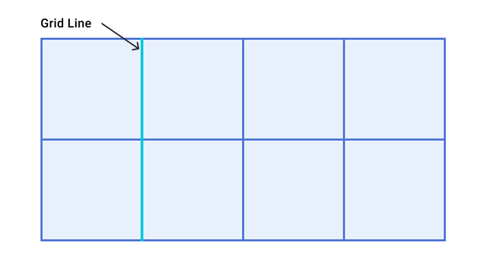

### Grid tracks

A track is the space between two grid lines. A row track is between two row lines and a column track between two column lines. When we create our grid we create these tracks by assigning a size to them.

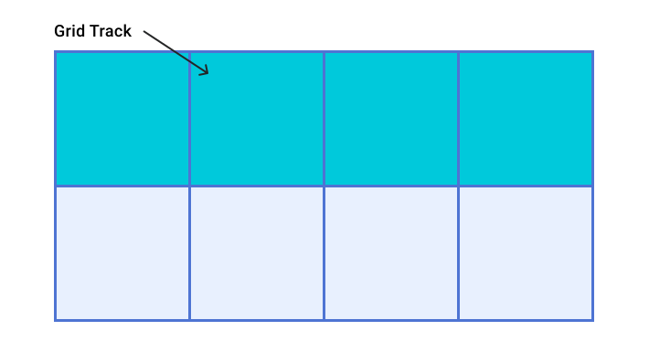

### Grid cell

A grid cell is the smallest space on a grid defined by the intersection of row and column tracks. It's just like a table cell or a cell in a spreadsheet. If you define a grid and don't place any of the items they will automatically be laid out one item into each defined grid cell.

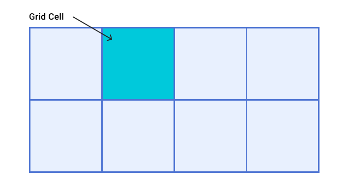

### Grid area

Several grid cells together. Grid areas are created by causing an item to span over multiple tracks.

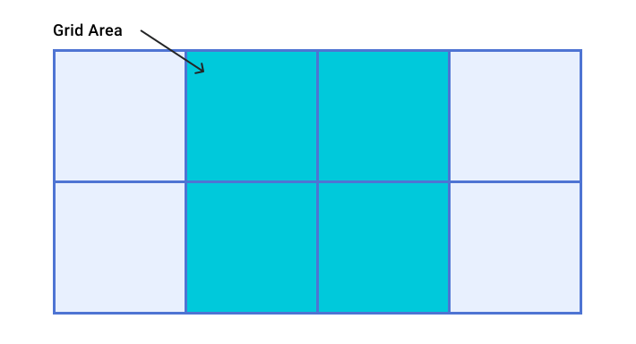

### Gaps

A gutter or alley between tracks. For sizing purposes these act like a regular track. You can't place content into a gap but you can span grid items across it.

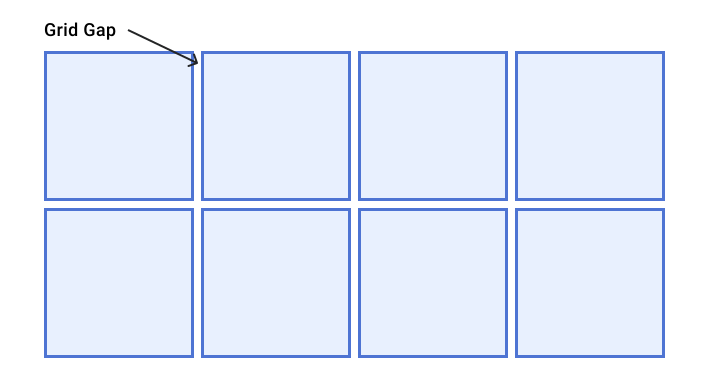

### Grid container

The HTML element which has `display: grid` applied, and therefore creates a new grid formatting context for the direct children.

```css
.container {
  display: grid;
}
```

### Grid item

A grid item is an item which is a direct child of the grid container.

```
<div class="container">
  <div class="item"></div>
  <div class="item"></div>
  <div class="item"></div>
</div>
```

## Rows and columns

To create a basic grid you can define a grid with three column tracks, two row tracks and a 10 pixel gap between the tracks as follows.

```css
.container {
    display: grid;
    grid-template-columns: 5em 100px 30%;
    grid-template-rows: 200px auto;
    gap: 10px;
}
```

This grid demonstrates many of the things described in the terminology section. It has three column tracks. Each track uses a different length unit. It has two row tracks, one using a length unit and the other auto. When used as a track sizing auto can be thought of as being as big as the content. Tracks are auto sized by default.

If the element with a class of `.container` has child items, they will immediately lay out on this grid. You can see this in action in the following demo:

:::note[Interactive demo not available offline]

This lesson has an interactive CodePen demo here. CodePen is not reachable from our network. Use the code on this page in the playground instead. (Pen id for reference: `web-dot-dev/NWdbrzr`)

:::

The [grid overlay in Chrome DevTools](https://developer.chrome.com/docs/devtools/css/grid) can help you understand the various parts of the grid.

Open the [demo](https://codepen.io/web-dot-dev/full/NWdbrzr) in Chrome. Inspect the element with the grey background, which has an ID of `container`. Highlight the grid by selecting the grid badge in the DOM, next to the `.container` element. Inside the Layout tab under **Overlay display settings**, select **Show line numbers** in the drop-down to see the line numbers on your grid.

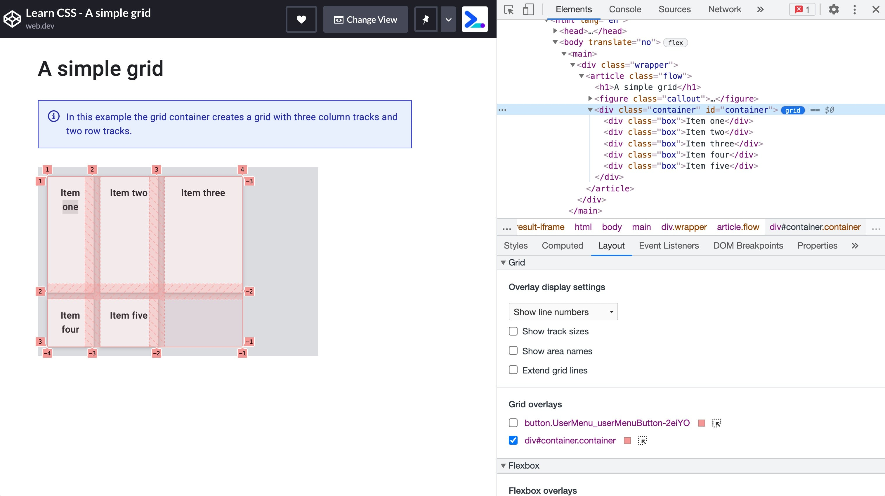

*A grid highlighted in Chrome DevTools showing line numbers, cells and tracks.*

### Intrinsic sizing keywords

In addition to the length and percentage dimensions as described in the section on [sizing units](./06-sizing.md), grid tracks can use intrinsic sizing keywords. These keywords are defined in the Box Sizing specification and add additional methods of sizing boxes in CSS, not just grid tracks.

- `min-content`
- `max-content`
- `fit-content()`

The [`min-content`](https://developer.mozilla.org/docs/Web/CSS/min-content) keyword will make a track as small as it can be without the track content overflowing. Changing the example grid layout to have three column tracks all at `min-content` size will mean they become as narrow as the longest word in the track.

The [`max-content`](https://developer.mozilla.org/docs/Web/CSS/max-content) keyword has the opposite effect. The track will become as wide enough for all of the content to display in one long unbroken string. This might cause overflows as the string won't wrap.

The [`fit-content()`](https://developer.mozilla.org/docs/Web/CSS/fit-content\(\)) function acts like `max-content` at first. However, once the track reaches the size that you pass into the function, the content starts to wrap. So `fit-content(10em)` will create a track that is less than 10em, if the `max-content` size is less than 10em, but never larger than 10em.

In the next demo try out the different intrinsic sizing keywords by changing the sizing of the grid tracks.

:::note[Interactive demo not available offline]

This lesson has an interactive CodePen demo here. CodePen is not reachable from our network. Use the code on this page in the playground instead. (Pen id for reference: `web-dot-dev/qBRqNgL`)

:::

:::note

You might spot in this demo that when auto is used the grid columns stretch to fill the container. Auto sized tracks will stretch by default if there is additional space in the grid container.

:::

### The `fr` unit

We have existing length dimensions, percentages, and also these new keywords. There is also a special sizing method which only works in grid layout. This is the `fr` unit, a flexible length which describes a share of the available space in the grid container.

The `fr` unit works in a similar way to using `flex: auto` in flexbox. It distributes space after the items have been laid out. Therefore to have three columns which all get the same share of available space:

```css
.container {
  display: grid;
  grid-template-columns: 1fr 1fr 1fr;
}
```

As the fr unit shares out available space, it can be combined with a fixed size gap or fixed size tracks. To have a component with a fixed size element and the second track taking up whatever space is left, you can use as a tracklisting of `grid-template-columns: 200px 1fr`.

Using different values for the fr unit will share the space in proportion. Larger values getting more of the spare space. In the following demo, change the value of the third track.

:::note[Interactive demo not available offline]

This lesson has an interactive CodePen demo here. CodePen is not reachable from our network. Use the code on this page in the playground instead. (Pen id for reference: `web-dot-dev/vYgyXNE`)

:::

### The `minmax()` function

This function means that you can set a minimum and a maximum size for a track. This can be quite useful. If we take the previous example of the `fr` unit which distributes remaining space, it could be written out using [`minmax()`](https://developer.mozilla.org/docs/Web/CSS/minmax\(\)) as `minmax(auto, 1fr)`. Grid looks at the intrinsic size of the content, then distributes available space after giving the content enough room. This means that you might not get tracks that each have an equal share of all space available in the grid container.

To force a track to take an equal share of the space in the grid container minus gaps use minmax. Replace `1fr` as a track size with `minmax(0, 1fr)`. This makes the minimum size of the track 0 and not the min-content size. Grid will then take all of the available size in the container, deduct the size needed for any gaps, and share the rest out according to your fr units.

### `repeat()` notation

If you want to create a 12 column track grid with equal columns, you could use the following CSS.

```css
.container {
    display: grid;
    grid-template-columns:
      minmax(0,1fr),
      minmax(0,1fr),
      minmax(0,1fr),
      minmax(0,1fr),
      minmax(0,1fr),
      minmax(0,1fr),
      minmax(0,1fr),
      minmax(0,1fr),
      minmax(0,1fr),
      minmax(0,1fr),
      minmax(0,1fr),
      minmax(0,1fr);
}
```

Or, you could write it out using [`repeat()`](https://developer.mozilla.org/docs/Web/CSS/repeat\(\)):

```css
.container {
    display: grid;
    grid-template-columns: repeat(12, minmax(0,1fr));
}
```

The `repeat()` function can be used to repeat any section of your track listing. For example you can repeat a pattern of tracks. You can also have some regular tracks and a repeating section.

```css
.container {
    display: grid;
    grid-template-columns: 200px repeat(2, 1fr 2fr) 200px; /*creates 6 tracks*/
}
```

### `auto-fill` and `auto-fit`

You can combine everything you have learned about track sizing, `minmax()`, and repeat, to create a useful pattern with grid layout. Perhaps you don't want to specify the number of column tracks, but instead want to create as many as will fit in your container.

You can achieve this with `repeat()` and the `auto-fill` or `auto-fit` keywords. In the following demo, grid will create as many 200 pixel tracks as will fit in the container. Open the demo in a new window and see how the grid changes as you change the size of the viewport.

:::note[Interactive demo not available offline]

This lesson has an interactive CodePen demo here. CodePen is not reachable from our network. Use the code on this page in the playground instead. (Pen id for reference: `web-dot-dev/XWpNjgO`)

:::

In the demo we get as many tracks as will fit. The tracks are not flexible however. You will get a gap on the end until there is enough space for another 200 pixel track. If you add the `minmax()` function, you can request as many tracks as will fit with a minimum size of 200 pixels and a maximum of 1fr. Grid then lays out the 200 pixel tracks and whatever space is leftover is distributed equally to them.

This creates a two-dimensional responsive layout with no need for any media queries.

:::note[Interactive demo not available offline]

This lesson has an interactive CodePen demo here. CodePen is not reachable from our network. Use the code on this page in the playground instead. (Pen id for reference: `web-dot-dev/OJWbRax`)

:::

There is a subtle difference between `auto-fill` and `auto-fit`. In the next demo play with a grid layout using the syntax explained previously, but with only two grid items in the grid container. Using the `auto-fill` keyword you can see that empty tracks have been created. Change the keyword to `auto-fit` and the tracks collapse down to 0 size. This means that the flexible tracks now grow to consume the space.

:::note[Interactive demo not available offline]

This lesson has an interactive CodePen demo here. CodePen is not reachable from our network. Use the code on this page in the playground instead. (Pen id for reference: `web-dot-dev/MWJbbNe`)

:::

The `auto-fill` and `auto-fit` keywords otherwise act in exactly the same way. There is no difference between them once the first track is filled.

## Auto-placement

You have already seen grid auto-placement at work in the demos so far. Items are placed on the grid one per cell in the order that they appear in the source. For many layouts this might be all you need. If you need more control then there are a couple of things you might like to do. The first is to tweak the auto-placement layout.

### Placing items in columns

The default behavior of grid layout is to place items along the rows. You can instead cause the items to place into columns using `grid-auto-flow: column`. You need to define row tracks otherwise the items will create intrinsic column tracks, and layout out all in one long row.

These values relate to the writing mode of the document. A row always runs in the direction a sentence runs in the writing mode of the document or component. In the next demo you can change mode the value of `grid-auto-flow` and the `writing-mode` property.

:::note[Interactive demo not available offline]

This lesson has an interactive CodePen demo here. CodePen is not reachable from our network. Use the code on this page in the playground instead. (Pen id for reference: `web-dot-dev/PoWbWbr`)

:::

### Spanning tracks

You can cause some or all of the items in an auto-placed layout to span more than one track. Use the `span` keyword plus the number of lines to span as a value for `grid-column-end` or `grid-row-end`.

```css
.item {
    grid-column-end: span 2; /* will span two lines, therefore covering two tracks */
}
```

As you have not specified a `grid-column-start`, this uses the initial value of `auto` and is placed according to the auto-placement rules. You can also specify the same thing using the shorthand `grid-column`:

```css
.item {
    grid-column: auto / span 2;
}
```

### Filling gaps

An auto-placed layout with some items spanning multiple tracks may result in a grid with some unfilled cells. The default behavior of grid layout with a fully auto-placed layout is to always progress forward. The items will be placed according to the order they are in the source, or any modification with the `order` property. If there is not enough space to fit an item, grid will leave a gap and move to the next track.

The next demo shows this behavior. The checkbox will apply the dense packing mode. This is enabled by giving `grid-auto-flow` a value of `dense`. With this value in place, grid will take items later in the layout and use them to fill gaps. This may mean that the display becomes disconnected from the logical order.

:::note[Interactive demo not available offline]

This lesson has an interactive CodePen demo here. CodePen is not reachable from our network. Use the code on this page in the playground instead. (Pen id for reference: `web-dot-dev/ZELBLrJ`)

:::

## Placing items

You have a lot of functionality from CSS Grid already. Now, take a look at how to position items on the grid we have created.

The first thing to remember is that CSS Grid Layout is based on a grid of numbered lines. The simplest way to place things onto the grid is to place them from one line to another. You'll discover other ways of placing items in this guide, but you always have access to those numbered lines.

The properties that you can use to place items by line number are:

- [`grid-column-start`](https://developer.mozilla.org/docs/Web/CSS/grid-column-start)
- [`grid-column-end`](https://developer.mozilla.org/docs/Web/CSS/grid-column-end)
- [`grid-row-start`](https://developer.mozilla.org/docs/Web/CSS/grid-row-start)
- [`grid-row-end`](https://developer.mozilla.org/docs/Web/CSS/grid-row-end)

They have shorthands which allow you to set both start and end lines at once:

- [`grid-column`](https://developer.mozilla.org/docs/Web/CSS/grid-column)
- [`grid-row`](https://developer.mozilla.org/docs/Web/CSS/grid-row)

To place your item set the start and end lines of the grid area that it should be placed into.

```css
.container {
    display: grid;
    grid-template-columns: repeat(4, 1fr);
    grid-template-rows: repeat(2, 200px 100px);
}

.item {
    grid-column-start: 1; /* start at column line 1 */
    grid-column-end: 4; /* end at column line 4 */
    grid-row-start: 2; /*start at row line 2 */
    grid-row-end: 4; /* end at row line 4 */
}
```

[Chrome DevTools](https://developer.chrome.com/docs/devtools/css/grid) can give you a visual guide to the lines in order to check where your item is placed.

The line numbering follows the writing mode and direction of the component. In the next demo change the writing mode or direction to see how the placement of the items stays consistent to the way that text flows.

:::note[Interactive demo not available offline]

This lesson has an interactive CodePen demo here. CodePen is not reachable from our network. Use the code on this page in the playground instead. (Pen id for reference: `web-dot-dev/QWdGdzd`)

:::

### Stacking items

Using line-based positioning you can place items into the same cell of the grid. This means that you can stack items, or cause one item to partly overlap another. Items which come later in the source will be displayed on top of items that come earlier. You can change this stacking order using `z-index` just as with positioned items.

:::note[Interactive demo not available offline]

This lesson has an interactive CodePen demo here. CodePen is not reachable from our network. Use the code on this page in the playground instead. (Pen id for reference: `web-dot-dev/BapQWQW`)

:::

### Negative line numbers

When you create a grid using `grid-template-rows` and `grid-template-columns` you create what is known as the **explicit grid**. This is a grid that you have defined and given size to the tracks.

Sometimes you will have items which display outside this explicit grid. For example, you might define column tracks and then add several rows of grid items without ever defining row tracks. The tracks would be auto sized by default. You also might place an item using `grid-column-end` that is outside of the explicit grid defined. In both of these cases grid will create tracks to make the layout work, and these tracks are referred to as the **implicit grid**.

Most of the time it will make no difference if you are working with an implicit or explicit grid. However, with line-based placement you may run into the main difference between the two.

Using negative line numbers you can place items from the end line of the explicit grid. This can be useful if you want an item to span from the first to the last column line. In that case you can use `grid-column: 1 / -1`. The item will stretch right across the explicit grid.

This only works for the explicit grid however. Take a layout of three rows of auto-placed items where you would like the very first item to span to the end line of the grid.

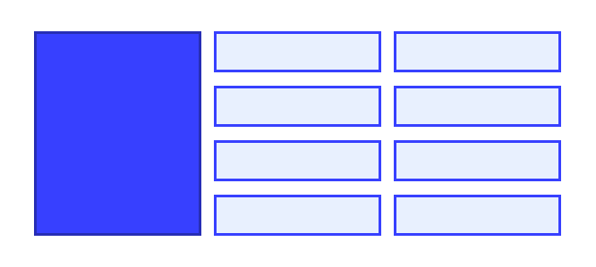

You might think that you can give that item `grid-row: 1 / -1`. In the following demo, you can see that this doesn't work. The tracks are created in the implicit grid, there is no way to reach the end of the grid using `-1`.

:::note[Interactive demo not available offline]

This lesson has an interactive CodePen demo here. CodePen is not reachable from our network. Use the code on this page in the playground instead. (Pen id for reference: `web-dot-dev/YzNpZeq`)

:::

#### Sizing implicit tracks

The tracks created in the implicit grid will be auto-sized by default. However if you want to control the sizing of the rows, use the [`grid-auto-rows`](https://developer.mozilla.org/docs/Web/CSS/grid-auto-rows) property, and for columns [`grid-auto-columns`](https://developer.mozilla.org/docs/Web/CSS/grid-auto-columns).

To create all implicit rows at a minimum size of `10em` and a maximum size of `auto`:

```css
.container {
    display: grid;
    grid-auto-rows: minmax(10em, auto);
}
```

To create implicit columns with a pattern of 100px and 200px wide tracks. In this case the first implicit column will be 100px, the second 200px, the third 100px, and so on.

```css
.container {
    display: grid;
    grid-auto-columns: 100px 200px;
}
```

## Named grid lines

It can make it easier to place items into a layout if the lines have a name rather than a number. You can name any line on your grid by adding a name of your choosing between square brackets. Multiple names can be added, separated by a space inside the same brackets. Once you have named lines they can be used instead of the numbers.

```css
.container {
    display: grid;
    grid-template-columns:
      [main-start aside-start] 1fr
      [aside-end content-start] 2fr
      [content-end main-end]; /* a two column layout */
}

.sidebar {
    grid-column: aside-start / aside-end;
    /* placed between line 1 and 2*/
}

footer {
    grid-column: main-start / main-end;
    /* right across the layout from line 1 to line 3*/
}
```

## Grid Template Areas

You can also name areas of the grid and place items onto those named areas. This is a lovely technique as it lets you see what your component looks like right there in the CSS.

To start, give the direct children of your grid container a name using the [`grid-area`](https://developer.mozilla.org/docs/Web/CSS/grid-area) property:

```css
header {
    grid-area: header;
}

.sidebar {
    grid-area: sidebar;
}

.content {
    grid-area: content;
}

footer {
    grid-area: footer;
}
```

The name can be anything you like other than the keywords `auto` and `span`. Once all of your items are named, use the [`grid-template-areas`](https://developer.mozilla.org/docs/Web/CSS/grid-template-areas) property to define which grid cells each item will span. Each row is defined within quotes.

```css
.container {
    display: grid;
    grid-template-columns: repeat(4,1fr);
    grid-template-areas:
        "header header header header"
        "sidebar content content content"
        "sidebar footer footer footer";
}
```

There are a few rules when using `grid-template-areas`.

- The value must be a complete grid with no empty cells.
- To span tracks repeat the name.
- The areas created by repeating the name must be rectangular and cannot be disconnected.

If you break any of the previous rules, the value is treated as invalid and thrown away.

To leave whitespace on the grid use a `.` or multiples with no whitespace between them. For example to leave the very first cell on the grid empty I could add a series of `.` characters:

```css
.container {
    display: grid;
    grid-template-columns: repeat(4,1fr);
    grid-template-areas:
        "....... header header header"
        "sidebar content content content"
        "sidebar footer footer footer";
}
```

As your entire layout is defined in one place, it makes it straightforward to redefine the layout using media queries. In the next example I have created a two column layout which moves to three columns by redefining the value of `grid-template-columns` and `grid-template-areas`. Open the example in a new window to play with the viewport size and see the layout change.

You can also see how the `grid-template-areas` property relates to `writing-mode` and direction, as with other grid methods.

:::note[Interactive demo not available offline]

This lesson has an interactive CodePen demo here. CodePen is not reachable from our network. Use the code on this page in the playground instead. (Pen id for reference: `web-dot-dev/oNBYepg`)

:::

## Shorthand properties

There are two shorthand properties which allow you to set many of the grid properties in one go. These can look a little confusing until you break down exactly how they go together. Whether you want to use them or prefer to use longhands is up to you.

### `grid-template`

The [`grid-template`](https://developer.mozilla.org/docs/Web/CSS/grid-template) property is a shorthand for `grid-template-rows`, `grid-template-columns` and `grid-template-areas`. The rows are defined first, along with the value of `grid-template-areas`. Column sizing is added after a `/`.

```css
.container {
    display: grid;
    grid-template:
      "head head head" minmax(150px, auto)
      "sidebar content content" auto
      "sidebar footer footer" auto / 1fr 1fr 1fr;
}
```

### `grid` property

The [`grid`](https://developer.mozilla.org/docs/Web/CSS/grid) shorthand can be used in exactly the same way as the `grid-template` shorthand. When used in this way it will reset the other grid properties that it accepts to their initial values. The full set being:

- `grid-template-rows`
- `grid-template-columns`
- `grid-template-areas`
- `grid-auto-rows`
- `grid-auto-columns`
- `grid-auto-flow`

You can alternately use this shorthand to define how the implicit grid behaves, for example:

```css
.container {
    display: grid;
    grid: repeat(2, 80px) / auto-flow  120px;
}
```

## Subgrid

Any grid item can also become its own grid container by adding `display: grid`. By default, this nested grid has its own track sizing, separate from the parent grid. By using subgrid, your child grid container will inherit the track sizing, line names, and gap from the parent grid, making it easier to align items by using shared grid lines.

To use the parent's grid columns on a nested grid, set `grid-template-columns: subgrid`. To use the parent's grid rows on a nested grid, set `grid-template-rows: subgrid`. You can also use `subgrid` for both rows and columns.

In the following demo, there is a grid with a class of `gallery` that has a few flexible columns. Since it does not have a `grid-template-rows` definition, the row sizing comes from the content. The grid items within the gallery are also grid containers which are set to start at the next available row (`auto`) and span two tracks. Finally, subgrid is used for the `grid-template-rows` property which allows the separate `gallery-item` grids to share the same grid track sizing. If you comment out this line, you will see how the captions are no longer aligned.

:::note[Interactive demo not available offline]

This lesson has an interactive CodePen demo here. CodePen is not reachable from our network. Use the code on this page in the playground instead. (Pen id for reference: `web-dot-dev/ogXEvqX`)

:::

### Applying subgrid to columns and rows

When applying subgrid to both row and column, the subgrid uses the parent's grid tracks in both dimensions. In the following code snippet, there is an explicit grid with four columns and four rows with different track sizes.

```css
.container {
  display: grid;
  gap: 1em;
  grid-template-columns: auto 2fr 1fr auto;
  grid-template-rows: 5fr 1fr 2fr 1fr;
}
```

One of the grid items also has `display: grid` and is set to span two columns and three rows of the parent grid. Before the `subgrid` value is added, the items within the nested grid don't line up with the grid items in the parent grid.

```css
.subgrid-container {
  display: grid;
  grid-column: auto / span 2;
  grid-row: auto / span 3;
}
```

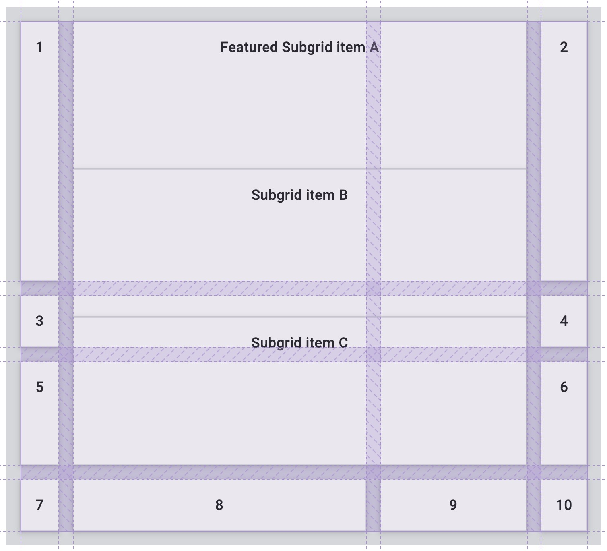

Once subgrid is applied, the grid items within the subgrid inherit the gap set on the parent grid and flows its grid items using the columns and tracks of the parent grid.

```css
.subgrid-container {
  display: grid;
  grid-column: auto / span 2;
  grid-row: auto / span 3;
  grid-template-columns: subgrid;
  grid-template-rows: subgrid;
}
```

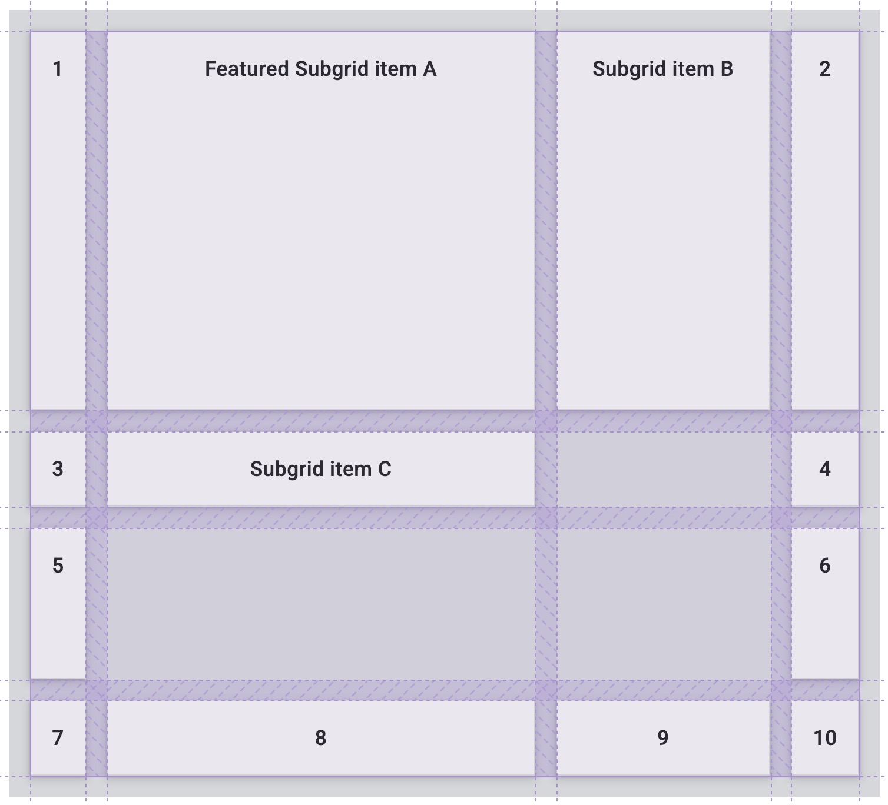

Within the subgrid, you can apply the same properties and values for any grid item. For example, you can extend a grid item within the subgrid to take up two grid columns.

```css
.featured-subgrid-item {
  grid-column: span 2;
}
```

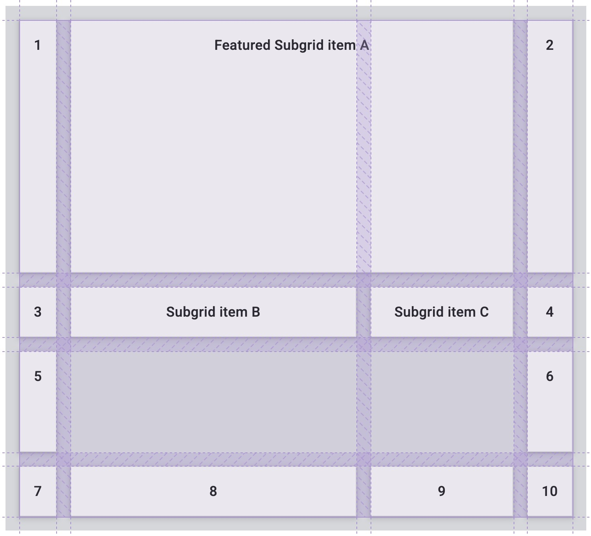

This also works for grid rows.

```css
.subgrid-item {
  grid-row: span 2;
}
```

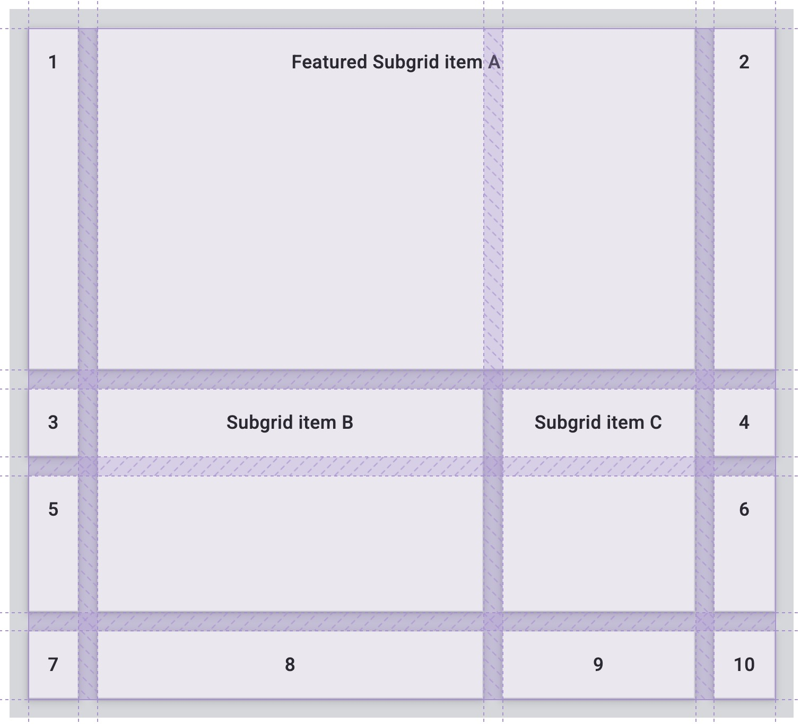

Here is the CodePen demo using subgrid in both dimensions:

:::note[Interactive demo not available offline]

This lesson has an interactive CodePen demo here. CodePen is not reachable from our network. Use the code on this page in the playground instead. (Pen id for reference: `web-dot-dev/ogXPqBa`)

:::

:::note

Using subgrid can help in situations where you don't have full control over the markup or have to use an additional wrapping container that you may not have planned for in advance. While `display: contents;` can be used in some circumstances when trying to remove the added wrapper, it isn't always the best option and also has accessibility issues when used on items with semantic meaning.

:::

## Alignment

Grid layout uses the same alignment properties that you learned about in the guide to [flexbox](./08-flexbox.md). In grid the properties which begin with `justify-` are always used on the inline axis, the direction in which sentences run in your writing mode.

The properties which begin with `align-` are used on the block axis, the direction in which blocks are laid out in your writing mode.

- [`justify-content`](https://developer.mozilla.org/docs/Web/CSS/justify-content) and [`align-content`](https://developer.mozilla.org/docs/Web/CSS/align-content): distribute additional space in the grid container around or between tracks.
- [`justify-self`](https://developer.mozilla.org/docs/Web/CSS/justify-self) and [`align-self`](https://developer.mozilla.org/docs/Web/CSS/align-self): are applied to a grid item to move it around inside the grid area it is placed in.
- [`justify-items`](https://developer.mozilla.org/docs/Web/CSS/justify-items) and [`align-items`](https://developer.mozilla.org/docs/Web/CSS/align-items): are applied to the grid container to set all of the `justify-self` properties on the items.

### Distributing extra space

In this demo the grid is larger than the space needed to lay out the fixed width tracks. This means we have space in both the inline and block dimensions of the grid. Try different values of `align-content` and `justify-content` to see how the tracks behave.

:::note[Interactive demo not available offline]

This lesson has an interactive CodePen demo here. CodePen is not reachable from our network. Use the code on this page in the playground instead. (Pen id for reference: `web-dot-dev/rNjjMVd`)

:::

Note how the gaps become larger when using values such as `space-between`, and any grid item spanning two tracks also grows to absorb the additional space added to the gap.

:::note

As with flexbox, these properties will only work if there is additional space to distribute. If your grid tracks neatly fill the container then there will be no space to share out.

:::

### Moving content around

Items with a background color appear to completely fill the grid area they are placed in, because the initial value for `justify-self` and `align-self` is `stretch`.

:::note

If your item is an image, or something else with an intrinsic aspect ratio, the initial value will be `start` rather than `stretch` to avoid stretching things out of shape.

:::

In the demo change the values of `justify-items` and `align-items` to see how this changes the layout. The grid area is not changing size, instead the items are being moved around inside the defined area.

:::note[Interactive demo not available offline]

This lesson has an interactive CodePen demo here. CodePen is not reachable from our network. Use the code on this page in the playground instead. (Pen id for reference: `web-dot-dev/YzZOOXB`)

:::

### Check your understanding

Test your knowledge of grid

## Check your understanding

**Question 1.**

Which of the following are CSS grid terms?

- lines
- circles
- cells
- areas
- trains
- gaps
- tracks

<details><summary>Show answer</summary><p><strong>lines</strong>: The grid is divided by these horizontal and vertically running separators.</p><p><strong>cells</strong>: A single intersection of a row and a column creates a grid cell.</p><p><strong>areas</strong>: Multiple cells together.</p><p><strong>gaps</strong>: The space between cells.</p><p><strong>tracks</strong>: A single row or a column is a track in the grid.</p></details>

**Question 2.**

```css
main {
  display: grid;
}
```

What is the default layout direction of a grid?

- Rows
- Columns

<details><summary>Show answer</summary><p><strong>Rows</strong>: Without any columns defined, grid children lay out in the block direction as they normally would.</p></details>

**Question 3.**

What is the difference between `auto-fit` and `auto-fill`?

- `auto-fit` will stretch cells to fit the container, where `auto-fill` won't.
- `auto-fit` will stretch a container to fit the children, where `auto-fill` makes the children fit to the container.

<details><summary>Show answer</summary><p><strong><code translate="no" dir="ltr">auto-fit</code> will stretch cells to fit the container, where <code translate="no" dir="ltr">auto-fill</code> won't.</strong>: <code translate="no" dir="ltr">auto-fill</code> places as many items into the template as possible, without stretching. Fit <strong>makes</strong> them fit.</p></details>

**Question 4.**

What is `min-content`?

- Same as 0%
- The smallest letter
- The longest word or image.

<details><summary>Show answer</summary><p><strong>The longest word or image.</strong>: In the phrase 'CSS is awesome', the word awesome would be the <code translate="no" dir="ltr">min-content</code>.</p></details>

**Question 5.**

What is `max-content`?

- The longest sentence or biggest image.
- The longest letter.
- The longest word.

<details><summary>Show answer</summary><p><strong>The longest sentence or biggest image.</strong>: This is the maximum size the content of the box is asking for or has specified. It's a sentence at its widest or an image at its widest.</p></details>

**Question 6.**

What is auto-placement?

- When grid takes the child items and places them in the best order based on browser heuristics.
- When grid child items have been given a `grid-area` and are placed on that cell.
- When unassigned grid items are placed next in a layout template.

<details><summary>Show answer</summary><p><strong>When unassigned grid items are placed next in a layout template.</strong>: Grid items without an explicit area will be placed in the next available grid cell</p></details>

**Question 7.**

True or false: You can only create a subgrid in one dimension (row or column).

- True
- False

<details><summary>Show answer</summary><p><strong>False</strong>: You can span subgrid items across both multiple rows, multiple columns, or both.</p></details>

## Resources

This guide has given you an overview of the different parts of the grid layout specification. To find out more, take a look at the following resources.

- [MDN CSS Grid Layout](https://developer.mozilla.org/docs/Web/CSS/CSS_Grid_Layout)
- [A Complete Guide to Grid](https://css-tricks.com/snippets/css/complete-guide-grid/)
- [Creating a Grid Container](https://www.smashingmagazine.com/2020/01/understanding-css-grid-container/)
- [Inspect CSS grid in Chrome DevTools](https://developer.chrome.com/docs/devtools/css/grid)
- [A comprehensive collection of grid learning material](https://gridbyexample.com/)
