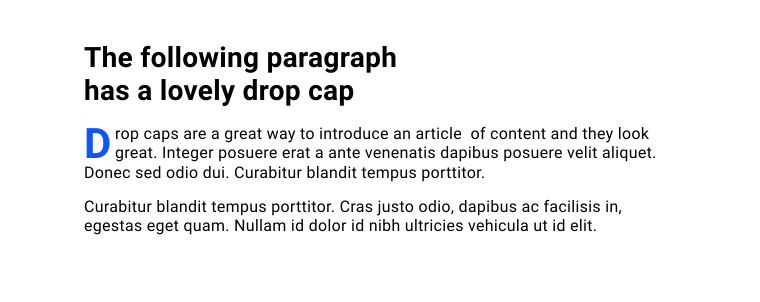

**Required reading**

:::info[Source]

Adapted from [Pseudo-elements](https://web.dev/learn/css/pseudo-elements) by the web.dev authors (Google), web.dev, licensed under [CC BY 4.0](https://creativecommons.org/licenses/by/4.0/). Changes: converted to Markdown for offline use; interactive embeds, browser-compatibility tables and site navigation removed.

:::

If you've got an article of content and you want the first letter to be a much bigger drop cap— how do you achieve that?



In CSS, you can use the `::first-letter` pseudo-element to achieve this sort of design detail.

```css
p::first-letter {
  color: blue;
  float: left;
  font-size: 2.6em;
  font-weight: bold;
  line-height: 1;
  margin-inline-end: 0.2rem;
}
```

:::note[Interactive demo not available offline]

This lesson has an interactive CodePen demo here. CodePen is not reachable from our network. Use the code on this page in the playground instead. (Pen id for reference: `web-dot-dev/PoWjybP`)

:::

A pseudo-element is like adding or targeting an extra element without having to add more HTML. This example solution, using `::first-letter`, is one of many pseudo-elements. They have a range of roles, and in this lesson you're going to learn which pseudo-elements are available and how you can use them.

## `::before` and `::after`

Both the [`::before`](https://developer.mozilla.org/docs/Web/CSS/::before) and [`::after`](https://developer.mozilla.org/docs/Web/CSS/::after) pseudo-elements create a child element inside an element **only** if you define a `content` property.

```css
.my-element::before {
    content: "";
}

.my-element::after {
    content: "";
}
```

The `content` can be any string —even an empty one— but be mindful that anything other than an empty string will likely be announced by a screen reader. You can add an image `url`, which will insert an image at its original dimensions, so you won't be able to resize it. You can also insert a [`counter`](https://developer.mozilla.org/docs/Web/CSS/counter\(\)).

:::info

You can create a named counter and then increment it, based on its position in the document flow. There's all sorts of contexts where they can be really useful, such as automatically numbering an outline.

:::

Once a `::before` or `::after` element has been created, you can style it however you want with no limits. You can only insert a `::before` or `::after` element to an element that will accept child elements ([elements with a document tree](https://www.w3.org/TR/CSS21/generate.html)), so elements such as ``, `<video>` and `<input>` won't work.

:::note[Interactive demo not available offline]

This lesson has an interactive CodePen demo here. CodePen is not reachable from our network. Use the code on this page in the playground instead. (Pen id for reference: `web-dot-dev/GRrEYrg`)

:::

:::note

**:** `input[type="checkbox"]` is an exception. It is allowed to have pseudo-element children.

:::

## `::first-letter`

We met this pseudo-element at the start of the lesson. It is worth being aware that not all CSS properties can be used when targeting [`::first-letter`](https://developer.mozilla.org/docs/Web/CSS/::first-letter). The available properties are:

- `color`
- `background` properties (such as `background-image`)
- `border` properties (such as `border-color`)
- `float`
- `font` properties (such as `font-size` and `font-weight`)
- text properties (such as `text-decoration` and `word-spacing`)

```css
p::first-letter {
  color: goldenrod;
  font-weight: bold;
}
```

:::note[Interactive demo not available offline]

This lesson has an interactive CodePen demo here. CodePen is not reachable from our network. Use the code on this page in the playground instead. (Pen id for reference: `web-dot-dev/JjEJmOx`)

:::

:::note

You can only use `:first-letter` on block containers. Therefore, it won't work if you try to add it to an element that has `display: inline`.

:::

## `::first-line`

The [`::first-line`](https://developer.mozilla.org/docs/Web/CSS/::first-line) pseudo-element will let you style the first line of text only if the element with `::first-line` applied has a `display` value of `block`, `inline-block`, `list-item`, `table-caption` or `table-cell`.

```css
p::first-line {
  color: goldenrod;
  font-weight: bold;
}
```

:::note[Interactive demo not available offline]

This lesson has an interactive CodePen demo here. CodePen is not reachable from our network. Use the code on this page in the playground instead. (Pen id for reference: `web-dot-dev/vYgZVaO`)

:::

Like the `::first-letter` pseudo-element, there's only a subset of CSS properties you can use:

- `color`
- `background` properties
- `font` properties
- `text` properties

## `::backdrop`

If you have an element that is presented in full screen mode, such as a `<dialog>` or a `<video>`, you can style the backdrop—the space between the element and the rest of the page—with the [`::backdrop`](https://developer.mozilla.org/docs/Web/CSS/::backdrop) pseudo-element:

```css
video::backdrop {
  background-color: goldenrod;
}
```

:::note[Interactive demo not available offline]

This lesson has an interactive CodePen demo here. CodePen is not reachable from our network. Use the code on this page in the playground instead. (Pen id for reference: `web-dot-dev/rNjwqRQ`)

:::

## `::marker`

The [`::marker`](https://developer.mozilla.org/docs/Web/CSS/::marker) pseudo-element lets you style the bullet or number for a list item or the arrow of a `<summary>` element.

```css
::marker {
  color: hotpink;
}

ul ::marker {
  font-size: 1.5em;
}

ol ::marker {
  font-size: 1.1em;
}

summary::marker {
  content: '\002B'' '; /* Plus symbol with space */
}

details[open] summary::marker {
  content: '\2212'' '; /* Minus symbol with space */
}
```

Only a small subset of CSS properties are supported for `::marker`:

- `color`
- `content`
- `white-space`
- `font` properties
- `animation` and `transition` properties

You can change the marker symbol, using the `content` property. You can use this to set a plus and minus symbol for the closed and empty states of a `<summary>` element, for example.

:::note[Interactive demo not available offline]

This lesson has an interactive CodePen demo here. CodePen is not reachable from our network. Use the code on this page in the playground instead. (Pen id for reference: `web-dot-dev/MWJozrR`)

:::

## `::selection`

The [`::selection`](https://developer.mozilla.org/docs/Web/CSS/::selection) pseudo-element allows you to style how selected text looks.

```css
::selection {
  background: green;
  color: white;
}
```

:::note[Interactive demo not available offline]

This lesson has an interactive CodePen demo here. CodePen is not reachable from our network. Use the code on this page in the playground instead. (Pen id for reference: `web-dot-dev/JjEJeZK`)

:::

This pseudo-element can be used to style all selected text as in the above demo. It can also be used in combination with other selectors for a more specific selection style.

```css
p:nth-of-type(2)::selection {
  background: darkblue;
  color: yellow;
}
```

:::note[Interactive demo not available offline]

This lesson has an interactive CodePen demo here. CodePen is not reachable from our network. Use the code on this page in the playground instead. (Pen id for reference: `web-dot-dev/MWJozXM`)

:::

As with other pseudo-elements, only a subset of CSS properties are allowed:

- `color`
- `background-color` but **not** `background-image`
- `text` properties

## `::placeholder`

You can add a helper hint to form elements, such as `<input>` with a `placeholder` attribute. The [`::placeholder`](https://developer.mozilla.org/docs/Web/CSS/::placeholder) pseudo-element allows you to style that text.

```css
input::placeholder {
  color: darkcyan;
}
```

:::note[Interactive demo not available offline]

This lesson has an interactive CodePen demo here. CodePen is not reachable from our network. Use the code on this page in the playground instead. (Pen id for reference: `web-dot-dev/KKaqrrY`)

:::

The `::placeholder` only supports a subset of CSS rules:

- `color`
- `background` properties
- `font` properties
- `text` properties

:::note

A `placeholder` is not `<label>` and should not be used in place of a `<label>`. Form elements must be labelled or they will be inaccessible.

:::

## `::cue`

Last in this tour of pseudo-elements is the [`::cue`](https://developer.mozilla.org/docs/Web/CSS/::cue) pseudo-element. This allows you to style the WebVTT cues, which are the captions of a `<video>` element.

You can also pass a selector into a `::cue`, which allows you to style specific elements *inside* a caption.

```css
video::cue {
  color: yellow;
}

video::cue(b) {
  color: red;
}

video::cue(i) {
  color: lightpink;
}
```

### Check your understanding

Test your knowledge of pseudo-elements

## Check your understanding

**Question 1.**

Which of the following are not pseudo-elements?

- `::before`
- `::first-paragraph`
- `::after`
- `::marker`
- `::pencil`
- `:active`

<details><summary>Show answer</summary><p><strong><code translate="no" dir="ltr">::first-paragraph</code></strong>: This doesn't exist in CSS.</p><p><strong><code translate="no" dir="ltr">::pencil</code></strong>: This doesn't exist in CSS.</p><p><strong><code translate="no" dir="ltr">:active</code></strong>: This is a pseudo-class not a pseudo-element.</p></details>

**Question 2.**

Pseudo-elements can be found in an HTML file.

- True
- False

<details><summary>Show answer</summary><p><strong>False</strong>: They can be targeted by CSS but won't be found in the HTML.</p></details>
