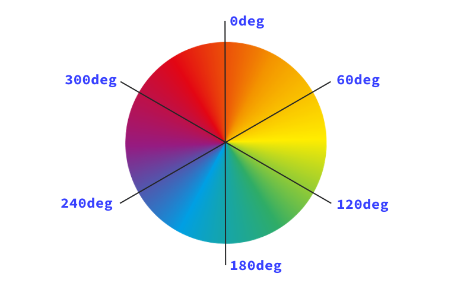
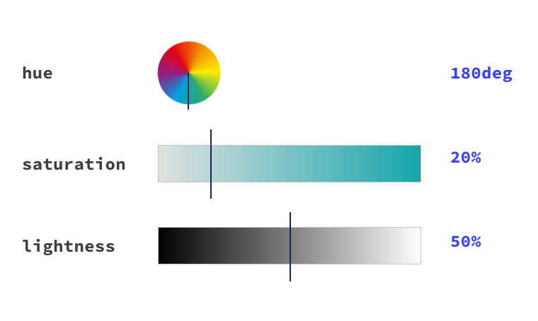

**Skim**: read the headings and examples, come back when you need it.

:::info[Source]

Adapted from [Color](https://web.dev/learn/css/color) by the web.dev authors (Google), web.dev, licensed under [CC BY 4.0](https://creativecommons.org/licenses/by/4.0/). Changes: converted to Markdown for offline use; interactive embeds, browser-compatibility tables and site navigation removed.

:::

Color is an important part of any website and in CSS there are many options for specifying and manipulating colors.

How do you decide which color type to use? How do you make your colors semi-transparent? In this lesson, you're going to learn which options you have to help you make the right decisions for your project and team.

CSS has [various different data types](https://developer.mozilla.org/docs/Web/CSS/CSS_Types), such as strings and numbers. Color is one of these types and uses other types, such as numbers for its own definitions.

## Choosing colors

### Named colors

The simplest way for you to choose a color is by picking one of the [148 named colors in CSS](https://developer.mozilla.org/docs/Web/CSS/named-color). These are plain English names such as `purple`, `tomato`, and `goldenrod`. Some of the most popular names, according to the [Web Almanac](https://almanac.httparchive.org/en/2019/css), are `black`, `white`, `red`, `blue`, and `gray`. Our favorites include `goldenrod`, `aliceblue`, and `hotpink`.

:::note[Interactive demo not available offline]

This lesson has an interactive CodePen demo here. CodePen is not reachable from our network. Use the code on this page in the playground instead. (Pen id for reference: `web-dot-dev/ZELGraM`)

:::

### Numeric colors

While named colors can be convenient, you will likely need to use specific colors that aren't available in that set. You can specify colors with numerical values in a few different forms.

#### Hex colors

```css
h1 {
  color: #b71540;
}
```

Hexadecimal notation (often shortened to hex) is a shorthand syntax for RGB, which assigns a numeric value to red green and blue, which are the three **primary colors**.

:::note

According to the 2022 Web Almanac, [hex is the most popular color syntax type](https://almanac.httparchive.org/en/2022/css#colors).

:::

The hexadecimal ranges are **0-9** and **A-F**. When used in a six digit sequence, they are translated to the RGB numerical ranges which are 0-255 which correspond to the red, green, and blue color channels respectively.

:::note[Interactive demo not available offline]

This lesson has an interactive CodePen demo here. CodePen is not reachable from our network. Use the code on this page in the playground instead. (Pen id for reference: `web-dot-dev/BapNrPG`)

:::

You can also define an alpha value with any numerical colors. An alpha value is a percentage of transparency. In hex code, you add another two digits to the six digit sequence, making an eight digit sequence. For example, to set black in hex code, write `#000000`. To add a 50% transparency, change it to `#00000080`.

Because the hex scale is **0-9** and **A-F**, the transparency values are probably not quite what you'd expect them to be. Here are some key, common values added to the black hex code, `#000000`:

- 0% alpha—which is fully transparent—is **00**: `#00000000`
- 50% alpha is **80**: `#00000080`
- 75% alpha is **BF**: `#000000BF`

:::note[Interactive demo not available offline]

This lesson has an interactive CodePen demo here. CodePen is not reachable from our network. Use the code on this page in the playground instead. (Pen id for reference: `web-dot-dev/VwPLXdr`)

:::

To convert a two digit hex to a decimal, take the first digit and multiply it by 16 (because hex is base 16), then add the second digit. Using **BF** as an example for 75% alpha:

1. B is equal to 11, which when multiplied by 16 equals 176
2. F is equal to 15
3. 176 + 15 = 191
4. The alpha value is 191—75% of 255

:::note

You can also write hex codes in a three digit shorthand. A three digit hex code is a shortcut to an equivalent six digit sequence. For example, `#a4e` is identical to `#aa44ee`. To add alpha, then `#a4e8` would expand to `#aa44ee88`.

:::

#### RGB (Red, Green, Blue)

```css
h1 {
  color: rgb(183 21 64);
}
```

RGB colors are defined with the [`rgb()`](https://developer.mozilla.org/docs/Web/CSS/color_value/rgb) color function, using either numbers or percentages as parameters. The numbers need to be within the **0-255** range and the percentages are between **0% and 100%‌**. RGB works on the 0-255 scale, so 255 would be equivalent to 100%, and 0 to 0%.

To set black in RGB, define it as `rgb(0 0 0)`, which is zero red, zero green and zero blue. Black can also be defined as `rgb(0% 0% 0%)`. White is the exact opposite: `rgb(255 255 255)` or `rgb(100% 100% 100%)`.

An alpha is set in `rgb()` in one of two ways. Either add a `/` **after** the red, green and blue parameters, or use the [`rgba()`](https://web.dev/%3Chttps://developer.mozilla.org/docs/Web/CSS/color_value/rgba\(\)%3E) function. The alpha can be defined with a percentage or a decimal between 0 and 1. For example, to set a 50% alpha black in modern browsers, write: `rgb(0 0 0 / 50%)` or `rgb(0 0 0 / 0.5)`.

:::note[Interactive demo not available offline]

This lesson has an interactive CodePen demo here. CodePen is not reachable from our network. Use the code on this page in the playground instead. (Pen id for reference: `web-dot-dev/dyNomWW`)

:::

:::note

You may also use commas instead of spaces to separate the channels in `rgb()` and `hsl()` notation. The commas used to be required for these functions, but that requirement has been removed for consistency with other color functions and with CSS in general.

:::

#### HSL (Hue, Saturation, Lightness)

```css
h1 {
  color: hsl(344 79% 40%);
}
```

HSL stands for hue, saturation and lightness. Hue describes the value on the color wheel, from 0 to 360 degrees, starting with red (being both 0 and 360). A hue of 180, or 50% would be in the blue range. It's the origin of the color that we see.



Saturation is how vibrant the selected hue is. A fully desaturated color (with a saturation of `0%`) will appear grayscale. And finally, lightness is the parameter which describes the scale from white to black of added light. A lightness of `100%` will always give you white.

Using the [`hsl()`](https://web.dev/%3Chttps://developer.mozilla.org/docs/Web/CSS/color_value/hsl\(\)%3E) color function, you define a true black by writing `hsl(0 0% 0%)`, or even `hsl(0deg 0% 0%)`. This is because the hue parameter defines the degree on the color wheel, which if you use the number type, is **0-360**. You can also use the angle type, which is (`0deg`) or `(0turn)`. Both saturation and lightness are defined with percentages.



:::note

[The angle type](https://developer.mozilla.org/docs/Web/CSS/angle) in CSS is great for defining hue because it represents the angle of the color wheel really well. This type accepts degrees, turns, radians and gradians.

:::

:::note[Interactive demo not available offline]

This lesson has an interactive CodePen demo here. CodePen is not reachable from our network. Use the code on this page in the playground instead. (Pen id for reference: `web-dot-dev/poRJLQo`)

:::

Alpha is defined in `hsl()`, in the same way as `rgb()` by adding a `/` after the hue, saturation and lightness parameters *or* by using the [`hsla()`](https://web.dev/%3Chttps://developer.mozilla.org/docs/Web/CSS/color_value/hsla\(\)%3E) function. The alpha can be defined with a percentage or a decimal between 0 and 1. For example, to set a 50% alpha black, use: `hsl(0 0% 0% / 50%)` or `hsl(0 0% 0% / 0.5)`. Using the `hsla()` function, write: `hsla(0, 0%, 0%, 50%)` or `hsla(0, 0%, 0%, 0.5)`.

### High definition colors

RGB and HSL define colors in the sRGB gamut. Newer monitors support many more colors than can be described by these formats, and outside of the sRGB gamut. You can choose these colors with a variety of CSS functions.

:::note

You can think of color gamuts as all the colors that can be defined, and color spaces as how you choose a color. Read more in the [High definition CSS color guide](https://developer.chrome.com/docs/css-ui/high-definition-css-color-guide).

:::

#### The `color()` function

```css
h1 {
  color: color(srgb 0.9 0.2 0.4);
}
```

The CSS `color()` function lets you choose a color in a specific color space. The first argument is the color space to use, which defines the options for the following channels. Like `rgb()`, you can set the alpha channel by setting a number between `0` and `1`, or a percentage, after a `/`.

:::note[Interactive demo not available offline]

An embedded demo was here and is not available offline.

:::

For example, the dark red RGB color in the previous code snippet, which is defined as `rgb(183 21 64)`, can be defined with percentages as `rgb(72% 8% 25%)`. You can use the `color()` function with the `srgb` keyword to specify the same color with `color(srgb .72 .08 .25)`.

:::note[Interactive demo not available offline]

This lesson has an interactive CodePen demo here. CodePen is not reachable from our network. Use the code on this page in the playground instead. (Pen id for reference: `web-dot-dev/jEPpydZ`)

:::

The `srgb` sets the color space and tells us that the next three arguments are red, green, and blue. Values go from `0` to `1` instead of `0` to `255`.

Similar to `rgb()` we can set the alpha with a `/` and a percentage, or decimal between `0` and `1`.

There are many color spaces that you can use with the `color()` function, each with different strengths and use cases.

:::note

Currently all defined color spaces have 3 channels plus alpha, but future additions to CSS may include color spaces with more or fewer channels, for example, CMYK.

:::

#### Display P3

```css
h1 {
  color: color(display-p3 0.9 0.2 0.4);
}
```

The Display P3 gamut contains 50% more colors than sRGB. You can specify all the colors in the Display P3 gamut with the Display P3 color space using the `color()` function.

To set black in Display P3, define it as `color(display-p3 0 0 0)`. After specifying the `display-p3` color space for the `color()` function, you have three channels: Red, green, and blue, similar to `color(srgb)`. But because the channel values represent coordinates in a wider color space, the same channel values will mean different things.

`color(srgb 1 .5 0)` is an orange color that is equivalent to `color(display-p3 0.93596 0.52724 0.1983)`. We can make the orange even more vibrant by extending it out of the sRGB space, to `color(display-p3 1 .5 0)`.

:::note[Interactive demo not available offline]

This lesson has an interactive CodePen demo here. CodePen is not reachable from our network. Use the code on this page in the playground instead. (Pen id for reference: `web-dot-dev/ZYGjLgm`)

:::

#### Oklab

Oklab is defined with the `oklab()` function, with channels of Lightness, `a`, and `b`. It's useful for making smooth gradients and for adjusting a color's saturation, while keeping the hue and lightness.

```css
h1 {
  color: oklab(75% 0.1 0.1)
}
```

:::note[Interactive demo not available offline]

An embedded demo was here and is not available offline.

:::

The lightness channel goes from `0` to `1` or `0%` to `100%`. Colors with a lightness of `0` will always be black.

The `a` channel goes from `-0.4` to `0.4` or `0%` to `100%`. Lower values are greener, and higher values are more red.

The `b` channel goes from `-0.4` to `0.4` or `0%` to `100%`. Lower values are bluer, and higher values are more yellow.

:::note[Interactive demo not available offline]

This lesson has an interactive CodePen demo here. CodePen is not reachable from our network. Use the code on this page in the playground instead. (Pen id for reference: `web-dot-dev/bNdjqNa`)

:::

#### OkLCh

OkLCh is the polar, or cylindrical form of OKLab, and is defined with channels of Lightness, Chroma, and Hue. It is useful for adjusting colors in a perceptually uniform way. This means that changes to the hue won't impact how light or saturated a color appears.

```css
h1 {
  color: oklch(80% 0.1 200)
}
```

:::note[Interactive demo not available offline]

An embedded demo was here and is not available offline.

:::

You've worked with lightness and hue in HSL, and chroma is similar to saturation. You can set black with `oklch(0 0 0)` and white with `oklch(1 0 0)`.

The lightness channel goes from `0` to `1` or `0%` to `100%`. Colors with a lightness of `0` will always be black.

The chroma channel sets how vibrant a color is—0 or 0% will be desaturated, and higher values will have more color. A value of `100%` is the same as `.4`, but it's possible to quickly get outside of gamut with values close to `.4`.

Hue is specified in degrees, just like `hsl()`.

:::note[Interactive demo not available offline]

This lesson has an interactive CodePen demo here. CodePen is not reachable from our network. Use the code on this page in the playground instead. (Pen id for reference: `web-dot-dev/ByNPWjm`)

:::

OkLCh isn't bounded by a gamut like Display P3, so you need to make sure you are making colors that can be displayed. `oklch(80% 50% 200)` is a bright blue that numerically looks like a reasonable color, but it is outside of the Display P3 gamut.

#### Other spaces

There are many ways to specify colors in CSS, and you don't need to learn them all. `rgb()` and Hex formats are commonly used in design tools and in existing code, and are useful to know. It's also helpful to be familiar with a format that can be manipulated predictably. You can change `hsl` or `oklch` values directly, and have a sense of what the resulting color will be.

Read more in [Access more colors and new spaces](https://developer.chrome.com/docs/css-ui/access-colors-spaces#choosing_a_color_space).

### System colors

In addition to named colors like purple or teal, there are also special keywords available:

- `transparent` is a fully transparent color. It is also the initial value of `background-color`
- `currentColor` is the contextual computed dynamic value of the `color` property. If you have a text color of `red`, and then set `border-color` to be `currentColor`, it will also be `red`. If the element that you define `currentColor` on doesn't have a value for color defined, `currentColor` will be computed by the cascade instead.

:::note

System keywords are colors that are defined by your operating system theme. Some examples of these colors are `ButtonBorder`, which is the border color for controls, or Highlight, which is the highlight color of selected items. These are just two of [many options](https://developer.mozilla.org/docs/Web/CSS/system-color). All color keywords are case-insensitive, however you will often see system colors with capitalization to differentiate them from standard color keywords.

:::

## Manipulating colors

While you may have a palette of colors to use on your site, you may need variants of those colors for hover states, borders, and other UI elements. You could specify each color, but CSS also provides ways to transform colors to create these variants.

:::note[Interactive demo not available offline]

This lesson has an interactive CodePen demo here. CodePen is not reachable from our network. Use the code on this page in the playground instead. (Pen id for reference: `web-dot-dev/ByNPWjm`)

:::

### `color-mix()`

:::note[Interactive demo not available offline]

An embedded demo was here and is not available offline.

:::

To use the result of mixing two colors, you can use the `color-mix()` method. This is useful for mixing a color with white or black to create a lighter or darker variant.

To use `color-mix()`, you'll need to define the two colors, how you want them to mix (the interpolation method), and how much of each color you want.

:::note

As you learned earlier in this lesson, colors can be defined in many different ways. The same color can be defined as `rgb(100% 66% 76%)` and `oklch(82.425% 0.10622 0.56816)`. Finding the average of two colors will be different depending on what color space you do the calculation in. Different color spaces will give you different outcomes.

:::

:::note[Interactive demo not available offline]

This lesson has an interactive CodePen demo here. CodePen is not reachable from our network. Use the code on this page in the playground instead. (Pen id for reference: `web-dot-dev/MYwBpoR`)

:::

For color spaces that have a hue, you also get to decide which way around the color wheel you want to go. The default is to use the `shorter` path, but you can also choose `longer`, or `increasing` and `decreasing`.

Together, the color space and the direction are the interpolation method.

You can also provide the amount of each color to mix by.

:::note[Interactive demo not available offline]

This lesson has an interactive CodePen demo here. CodePen is not reachable from our network. Use the code on this page in the playground instead. (Pen id for reference: `web-dot-dev/JodBWyG`)

:::

:::note

When creating colors dynamically, be careful to avoid generating color combinations that don't provide sufficient contrast.

:::

### Relative color syntax

:::note[Interactive demo not available offline]

An embedded demo was here and is not available offline.

:::

You can also work more directly with a color using relative color syntax, which lets you take any color, and perform calculations on it to create a new color.

```css
h1 {
  color: oklch(from red l c h);
}
```

Using the `oklch()` function means you will work with lightness, chroma, and hue channels. After the keyword `from` you can specify any color in any syntax. This then gives you each channel value to use as a letter. This will resolve to a red color, without any adjustments.

To make adjustments, you can use the `calc()` function to change the channel values, or just replace the channel completely. Here we use the same `red` color, but define it with `oklch(62% 0.25 29)`.

```css
h1 {
  color: oklch(from oklch(62% 0.25 29) calc(l / 2) c 180);
}
```

The lightness channel is `62% / 2`, or `31%` The chroma channel is unchanged, so it is `0.25`. The hue channel is `180`. This creates the new color `oklch(31% 0.25 180)`, a new dark green color.

You will often be using a custom property as the input color. This lets you dynamically create color variations.

:::note[Interactive demo not available offline]

This lesson has an interactive CodePen demo here. CodePen is not reachable from our network. Use the code on this page in the playground instead. (Pen id for reference: `web-dot-dev/ZYGjeXN`)

:::

You can do this with any color function, and it's useful to do this with color functions that have channels that describe the changes you'll want to make. For example, if you want to adjust the lightness of a color, choose `oklch` or `hsl`, as you can directly change the lightness channel.

```css
h1 {
  color: oklch(from var(--primary-color) calc(l * 0.9) c h);
}
```

Using Relative Color Syntax, or RCS, you can create a palette of colors to use for your site.

:::note[Interactive demo not available offline]

This lesson has an interactive CodePen demo here. CodePen is not reachable from our network. Use the code on this page in the playground instead. (Pen id for reference: `web-dot-dev/jEPpBaQ`)

:::

## Out of gamut colors

Your content will be shown on different screens that may or may not support wide gamut colors. If you specify a color that isn’t supported by a screen, it will go through a process called gamut mapping to find a similar color that can be displayed on the screen. If you want to define specific colors in those cases, you can use the `color-gamut` media query.

:::note[Interactive demo not available offline]

This lesson has an interactive CodePen demo here. CodePen is not reachable from our network. Use the code on this page in the playground instead. (Pen id for reference: `web-dot-dev/azOjJEv`)

:::

## Where to use color in CSS rules

If a CSS property accepts the [`<color>`](https://developer.mozilla.org/docs/Web/CSS/color_value) data type as a value, it will accept any of the previously outlined methods of expressing color. For styling text, use the `color`, `text-shadow` and `text-decoration-color` properties which all accept color as the value or color as part of the value.

For backgrounds, you can set a color as the value for `background` or `background-color`. Colors can also be used in gradients, such as `linear-gradient`. Gradients are a type of image that can be programmatically defined in CSS. Gradients accept two or more colors in any combination of color format, such as hex, rgb or hsl.

:::note

There's lots to learn with gradients so we wrote [a whole lesson](./20-gradients.md) on how to use them.

:::

Finally, `border-color`, and `outline-color` set the color for borders and outlines on your boxes. The `box-shadow` property also accepts color as one of the values.

:::note[Interactive demo not available offline]

This lesson has an interactive CodePen demo here. CodePen is not reachable from our network. Use the code on this page in the playground instead. (Pen id for reference: `web-dot-dev/bGgdJKd`)

:::

### Check your understanding

Test your knowledge of color

## Check your understanding

**Question 1.**

Which of the following are valid colors?

- `rbga(400 0 1)`
- `#0f08`
- `#OOFZ2`
- `rgb(255, 0, 0)`
- `hsl(180deg 50% 50%)`
- `hotpink`

<details><summary>Show answer</summary><p><strong><code translate="no" dir="ltr">#0f08</code></strong>: 🎉</p><p><strong><code translate="no" dir="ltr">rgb(255, 0, 0)</code></strong>: 🎉</p><p><strong><code translate="no" dir="ltr">hsl(180deg 50% 50%)</code></strong>: 🎉</p><p><strong><code translate="no" dir="ltr">hotpink</code></strong>: 🎉</p></details>

**Question 2.**

Spot the invalid hsl color.

- `hsl(5, 0%, 90%)`
- `hsl(.5turn 40% 60%)`
- `hsl(0, 0, 0)`
- `hsl(2rad 50% 50%)`
- `hsl(0 0% 0% / 20%)`

<details><summary>Show answer</summary><p><strong><code translate="no" dir="ltr">hsl(0, 0, 0)</code></strong>: 🎉 You found it, the 2nd and 3rd values should be percentages.</p></details>

## Resources

- [A handy demo showing how you can use angles with HSL](https://codepen.io/argyleink/pen/ExjReJa)
- [A comprehensive guide on color](https://css-tricks.com/nerds-guide-color-web/)
- [A comprehensive guide on wide gamut color](https://developer.chrome.com/articles/high-definition-css-color-guide)
- [\[video\] An explainer on how to read hex codes](https://www.youtube.com/watch?v=eqZqx6lRPe0)
- [How hexadecimal codes work](https://medium.com/basecs/hexs-and-other-magical-numbers-9785bc26b7ee)
