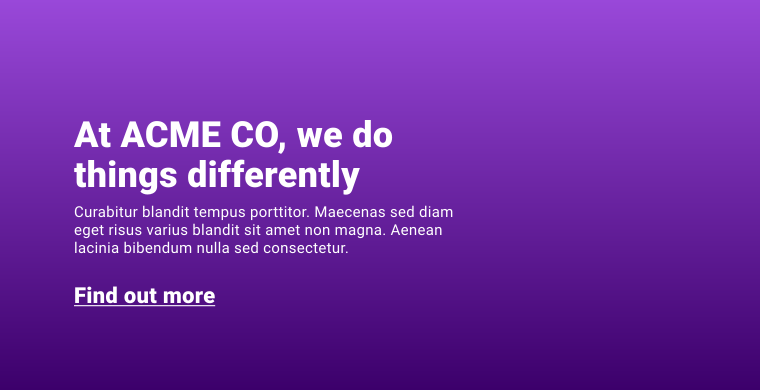

**Skim**: read the headings and examples, come back when you need it.

> **Trainer note:** Useful for the story ring around avatars.

:::info[Source]

Adapted from [Gradients](https://web.dev/learn/css/gradients) by the web.dev authors (Google), web.dev, licensed under [CC BY 4.0](https://creativecommons.org/licenses/by/4.0/). Changes: converted to Markdown for offline use; interactive embeds, browser-compatibility tables and site navigation removed.

:::

Imagine you've got a site to build and at the top, there's an intro with a heading, summary and a button. The designer has handed over a design which has a purple background for this intro. The only problem is the background features two shades of purple as a gradient. How do you do this?



You might initially think that you're going to need to export an image from your design tool for this, but you can use a [`linear-gradient`](https://developer.mozilla.org/docs/Web/CSS/linear-gradient\(\)) instead.

:::note[Interactive demo not available offline]

This lesson has an interactive CodePen demo here. CodePen is not reachable from our network. Use the code on this page in the playground instead. (Pen id for reference: `web-dot-dev/XWpzdoV`)

:::

A gradient is an image and can be used anywhere images can be used, but it's created with CSS and is made up with colors, numbers and angles. CSS gradients allow you to create anything from a smooth gradient between two colors, right up to impressive artwork by mixing and repeating multiple gradients.

## Linear gradient

The [`linear-gradient()`](https://developer.mozilla.org/docs/Web/CSS/linear-gradient\(\)) function generates an image of one or more colors, progressively. It takes multiple arguments, but in its simplest configuration, you can pass in one or more colors like this and it will automatically split them evenly, while blending them.

```css
.my-element {
    background: linear-gradient(black, white);
}
```

:::note[Interactive demo not available offline]

This lesson has an interactive CodePen demo here. CodePen is not reachable from our network. Use the code on this page in the playground instead. (Pen id for reference: `web-dot-dev/mdRqPoZ`)

:::

Although it's valid CSS to use only one color in gradient functions, this will only produce a solid color:

```css
.my-element {
    background: linear-gradient(red);
}
```

You can also pass an angle or keywords that represent an angle. If you choose to use keywords, specify a direction after the `to` keyword. This means if you want a gradient that is black and white, that runs from left (black) to right (white), you would specify the angle as `to right` as the first argument.

```css
.my-element {
    background: linear-gradient(to right, black, white);
}
```

:::note[Interactive demo not available offline]

This lesson has an interactive CodePen demo here. CodePen is not reachable from our network. Use the code on this page in the playground instead. (Pen id for reference: `web-dot-dev/zYNPqXW`)

:::

A color stop value defined where a color stops and mixes with its neighbors. For a gradient starting with a dark shade of red running at a 45deg angle, at 30% of the size of the gradient changing to a lighter red: it looks like this.

```css
.my-element {
    background: linear-gradient(45deg, darkred 30%, crimson);
}
```

:::note[Interactive demo not available offline]

This lesson has an interactive CodePen demo here. CodePen is not reachable from our network. Use the code on this page in the playground instead. (Pen id for reference: `web-dot-dev/NWdwNZr`)

:::

You can add as many colors and color stops as you like in a `linear-gradient()`, and you can layer gradients on top of each other by separating each gradient with a comma.

:::note[Interactive demo not available offline]

This lesson has an interactive CodePen demo here. CodePen is not reachable from our network. Use the code on this page in the playground instead. (Pen id for reference: `web-dot-dev/abpVZbj`)

:::

## Radial gradient

To create a gradient that radiates in a circular fashion, the [`radial-gradient()`](https://developer.mozilla.org/docs/Web/CSS/radial-gradient\(\)) function steps in to help. It's similar to `linear-gradient()`, but instead of specifying an angle, you optionally specify a position and ending shape. If you just specify colors, the `radial-gradient()` will auto-select the position as `center` and select either a circle or ellipse, depending on the size of the box.

```css
.my-element {
    background: radial-gradient(white, black);
}
```

:::note[Interactive demo not available offline]

This lesson has an interactive CodePen demo here. CodePen is not reachable from our network. Use the code on this page in the playground instead. (Pen id for reference: `web-dot-dev/LYxOZEq`)

:::

The gradient's position is similar to `background-position` using keywords and/or number values. The size of the radial gradient determines the size of the gradient's ending shape (circle or ellipse) and by default will be `farthest-corner`, which means it exactly meets the farthest corner of the box from the center. You can also use the following keywords:

- `closest-corner` will meet the closest corner to the center of the gradient.
- `closest-side` will meet the side of the box closest to the center of the gradient.
- `farthest-side` will do the opposite to `closest-side`.

You can add as many color stops as you like, just like with the `linear-gradient`. Likewise, you can add as many `radial-gradients` as you like too.

:::note[Interactive demo not available offline]

This lesson has an interactive CodePen demo here. CodePen is not reachable from our network. Use the code on this page in the playground instead. (Pen id for reference: `web-dot-dev/MWJOepV`)

:::

## Conic gradient

A conic gradient has a center point in your box and starts from the top (by default), and goes around in a 360 degree circle.

```css
.my-element {
    background: conic-gradient(white, black);
}
```

:::note[Interactive demo not available offline]

This lesson has an interactive CodePen demo here. CodePen is not reachable from our network. Use the code on this page in the playground instead. (Pen id for reference: `web-dot-dev/qBRVNXG`)

:::

The [`conic-gradient()`](https://developer.mozilla.org/docs/Web/CSS/conic-gradient\(\)) function accepts position and angle arguments.

By default, the angle is 0 degrees which starts at the top, in the center. If you were to set the angle to be `45deg`, it would be the top right corner. The angle argument accepts any type of angle value, like the linear and radial gradients.

The position is center by default. As with radial and linear gradients, positioning can be keyword-based, or it can be defined with numeric values.

:::note[Interactive demo not available offline]

This lesson has an interactive CodePen demo here. CodePen is not reachable from our network. Use the code on this page in the playground instead. (Pen id for reference: `web-dot-dev/vYgWKpO`)

:::

You can add as many color stops as you want, like with other gradient types. A good use case for this capability, with conic gradients is rendering pie charts with CSS.

:::note[Interactive demo not available offline]

This lesson has an interactive CodePen demo here. CodePen is not reachable from our network. Use the code on this page in the playground instead. (Pen id for reference: `web-dot-dev/mdRqExP`)

:::

## Repeating and mixing

Each type of gradient has a repeating type, too. These are [`repeating-linear-gradient()`](https://developer.mozilla.org/docs/Web/CSS/repeating-linear-gradient\(\)), [`repeating-radial-gradient()`](https://developer.mozilla.org/docs/Web/CSS/repeating-radial-gradient\(\)) and [`repeating-conic-gradient()`](https://developer.mozilla.org/docs/Web/CSS/repeating-conic-gradient\(\)). They are similar to the non-repeating functions and take the same arguments. The difference is that if the defined gradient can be repeated to fill the box, based on both of their sizes, it will.

If your gradient doesn't appear to be repeating, you probably haven't set a length for one of the color stops. For example, you can create a striped background with a `repeating-linear-gradient` by setting color stop lengths.

```css
.my-element {
  background: repeating-linear-gradient(
    45deg,
    red,
    red 30px,
    white 30px,
    white 60px
  );
}
```

:::note[Interactive demo not available offline]

This lesson has an interactive CodePen demo here. CodePen is not reachable from our network. Use the code on this page in the playground instead. (Pen id for reference: `web-dot-dev/ExZbgdy`)

:::

You can also mix gradient functions on `background` properties, as well as defining as many gradients as you like, just like you would with a background image. For example, you can mix multiple linear-gradients together, or two linear-gradients with a radial gradient.

:::note[Interactive demo not available offline]

This lesson has an interactive CodePen demo here. CodePen is not reachable from our network. Use the code on this page in the playground instead. (Pen id for reference: `web-dot-dev/ExZqGxP`)

:::

## Interpolation and color spaces

Each gradient type can interpolate between colors in different ways using [color spaces](https://developer.chrome.com/docs/css-ui/access-colors-spaces) and the `in` keyword. This option lets you [customize the results between two color stops](https://developer.chrome.com/docs/css-ui/access-colors-spaces#control_interpolation) in a gradient.

For example, you can use the `oklab` color space to generally remove unsaturated middle colors to produce a safer and more vibrant gradient.

```css
.my-element {
  background: linear-gradient(in oklch, deeppink, yellow);
}
```

The following demo lets you compare the same gradient with and without customized interpolation. Try changing the color spaces to see how they compare, or even change the colors to see how the interpolation affects the gradient.

:::note[Interactive demo not available offline]

This lesson has an interactive CodePen demo here. CodePen is not reachable from our network. Use the code on this page in the playground instead. (Pen id for reference: `web-dot-dev/QwbBvdL`)

:::

You can also use the `increasing` or `decreasing` keywords with cylindrical color spaces to control the direction of the hue angle progression as a gradient changes from one color to the next. The angle will always move in the direction of the chosen keyword, regardless of whether that is longer or shorter.

```css
.my-element.increasing {
  background: linear-gradient(in oklch increasing hue, deeppink, yellow);
}

.my-element.decreasing {
  background: linear-gradient(in oklch decreasing hue, deeppink, yellow);
}
```

:::note[Interactive demo not available offline]

This lesson has an interactive CodePen demo here. CodePen is not reachable from our network. Use the code on this page in the playground instead. (Pen id for reference: `web-dot-dev/JodBNEy`)

:::

In addition to customizing interpolation, cylindrical color spaces (HSL, HWB, LCH, and OKLCH) offer the `shorter` (default) or `longer` keywords to specify if the gradient line should take the **long** way around the color wheel or the **short** way between the two colors.

```css
.my-element {
  background: linear-gradient(in oklch longer hue, deeppink, yellow);
}
```

:::note[Interactive demo not available offline]

This lesson has an interactive CodePen demo here. CodePen is not reachable from our network. Use the code on this page in the playground instead. (Pen id for reference: `web-dot-dev/vEBZyvz`)

:::

## Resources

- [MDN guide to gradients](https://developer.mozilla.org/docs/Web/CSS/CSS_Images/Using_CSS_gradients)
- [Gradient generator](https://gradient.style/)
- [Conic.css](https://www.conic.style/) - a useful collection of conic gradients

### Check your understanding

Test your knowledge of gradients

## Check your understanding

**Question 1.**

What is the *minimum* number of colors required to create a gradient?

- 1
- 2
- 3
- 4

<details><summary>Show answer</summary><p><strong>1</strong>: Correct!</p></details>

**Question 2.**

Elements can have multiple gradients as a background?

- True
- False

<details><summary>Show answer</summary><p><strong>True</strong>: The <code translate="no" dir="ltr">background-image</code> property allows many gradients, just separate them with a comma.</p></details>
