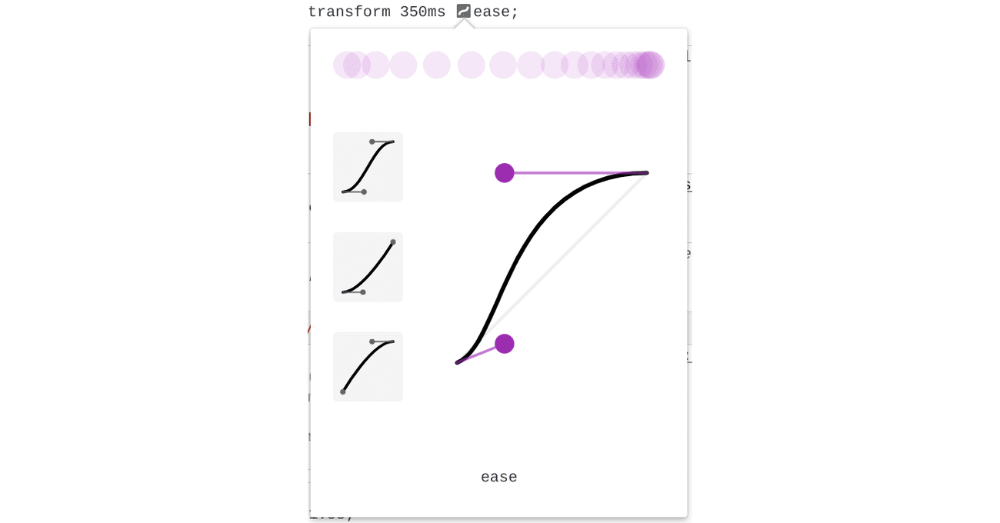
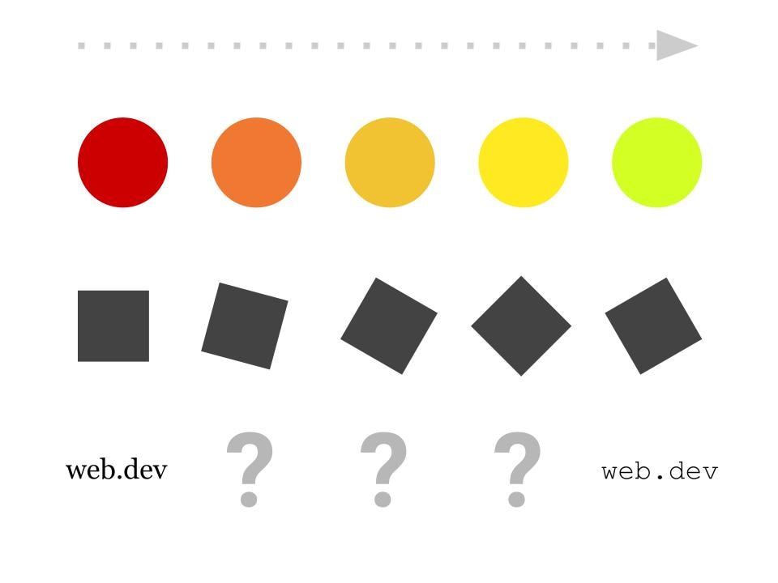

**Skim**: read the headings and examples, come back when you need it.

> **Trainer note:** Useful for the bonus micro-interactions.

:::info[Source]

Adapted from [Transitions](https://web.dev/learn/css/transitions) by the web.dev authors (Google), web.dev, licensed under [CC BY 4.0](https://creativecommons.org/licenses/by/4.0/). Changes: converted to Markdown for offline use; interactive embeds, browser-compatibility tables and site navigation removed.

:::

When interacting with a website, you might notice that many elements have *state*. For example, dropdowns can be in opened or closed states. Buttons might change color when focused or hovered. Modals appear and disappear.

By default, CSS switches the style of these states instantly.

Using CSS transitions, we can interpolate between the initial state and the target state of the element. The transition between the two enhances the user experience by providing visual direction, support, and hints about the cause and effect of the interaction.

:::info

*Interpolation* is the process of creating "in-between" steps that smoothly transition from one state to another.

:::

:::note[Interactive demo not available offline]

This lesson has an interactive CodePen demo here. CodePen is not reachable from our network. Use the code on this page in the playground instead. (Pen id for reference: `web-dot-dev/zYzNrJV`)

:::

## Transition properties

To use transitions in CSS, you can use the various transition properties or the `transition` shorthand property.

### `transition-property`

The [`transition-property`](https://developer.mozilla.org/docs/Web/CSS/transition-property) property specifies which style(s) to transition.

```css
.my-element {
  transition-property: background-color;
}
```

The `transition-property` accepts one or more CSS property names in a comma-separated list.

Optionally, you may use `transition-property: all` to indicate that every property should transition.

:::note[Interactive demo not available offline]

This lesson has an interactive CodePen demo here. CodePen is not reachable from our network. Use the code on this page in the playground instead. (Pen id for reference: `web-dot-dev/VwWPeEj`)

:::

### `transition-duration`

The [`transition-duration`](https://developer.mozilla.org/docs/Web/CSS/transition-duration) property is used to define the length of time that a transition will take to complete.

:::note[Interactive demo not available offline]

This lesson has an interactive CodePen demo here. CodePen is not reachable from our network. Use the code on this page in the playground instead. (Pen id for reference: `web-dot-dev/wvegMYp`)

:::

`transition-duration` accepts time units, either in seconds (`s`) or milliseconds (`ms`) and defaults to `0s`.

### `transition-timing-function`

Use the [`transition-timing-function`](https://developer.mozilla.org/docs/Web/CSS/transition-timing-function) property to vary the speed of a CSS transition over the course of the `transition-duration`.

By default, CSS will transition your elements at a constant speed (`transition-timing-function: linear`). Linear transitions can end up looking somewhat artificial, though: in real life, objects have weight and can't stop and start instantly. Easing into or out of a transition can make your transitions more lively and natural.

:::note[Interactive demo not available offline]

This lesson has an interactive CodePen demo here. CodePen is not reachable from our network. Use the code on this page in the playground instead. (Pen id for reference: `web-dot-dev/QWgdyZx`)

:::

Our [module on CSS Animation](https://web.dev/learn/css/animations#animation-timing-function) has a good overview of timing functions.

You can use [DevTools](https://developer.chrome.com/docs/devtools/css/animations) to experiment with different timing functions in real-time.



### `transition-delay`

Use the [`transition-delay`](https://developer.mozilla.org/docs/Web/CSS/transition-delay) property to specify the time at which a transition will start. If `transition-delay` is not specified, transitions will start instantly because the default value is `0s`. This property accepts a time unit, for example seconds (`s`) or milliseconds (`ms`).

:::note[Interactive demo not available offline]

This lesson has an interactive CodePen demo here. CodePen is not reachable from our network. Use the code on this page in the playground instead. (Pen id for reference: `web-dot-dev/jOwyWep`)

:::

This property is useful for staggering transitions, achieved by setting a longer `transition-delay` for each subsequent element in a group.

:::note[Interactive demo not available offline]

This lesson has an interactive CodePen demo here. CodePen is not reachable from our network. Use the code on this page in the playground instead. (Pen id for reference: `web-dot-dev/yLXgeRQ`)

:::

`transition-delay` is also useful for debugging. Setting the delay to a negative value can start a transition further into the timeline.

### Shorthand: `transition`

Like most CSS properties, there is a shorthand version. [`transition`](https://developer.mozilla.org/docs/Web/CSS/transition) combines `transition-property`, `transition-duration`, `transition-timing-function`, and `transition-delay`.

```css
.longhand {
  transition-property: transform;
  transition-duration: 300ms;
  transition-timing-function: ease-in-out;
  transition-delay: 0s;
}

.shorthand {
  transition: transform 300ms ease-in-out 0s;
}
```

## What can and can't transition?

When writing CSS, you can specify which properties should have animated transitions. See [this MDN list of animatable CSS properties](https://developer.mozilla.org/docs/Web/CSS/CSS_animated_properties).

In general, it's only possible to transition elements that can have a "middle state" between their start and final states. For example, it's impossible to add transitions for `font-family`, because it's unclear what the "middle state" between `serif` and `monospace` should look like. On the other hand, it is possible to add transitions for `font-size` because its unit is a length that can be interpolated between.



Here are some common properties you can transition.

### Transform

The [`transform`](https://developer.mozilla.org/docs/Web/CSS/transform) CSS property is commonly transitioned because it is a GPU-accelerated property that results in smoother animation that also consumes less battery. This property lets you arbitrarily scale, rotate, translate, or skew an element.

:::note[Interactive demo not available offline]

This lesson has an interactive CodePen demo here. CodePen is not reachable from our network. Use the code on this page in the playground instead. (Pen id for reference: `web-dot-dev/GRErowE`)

:::

### Individual transform properties

:::note[Interactive demo not available offline]

An embedded demo was here and is not available offline.

:::

You can also use the `scale`, `rotate`, or `translate` properties to set distinct transitions for each property, outside of a `transform` property.

:::note[Interactive demo not available offline]

This lesson has an interactive CodePen demo here. CodePen is not reachable from our network. Use the code on this page in the playground instead. (Pen id for reference: `web-dot-dev/yyNPLPJ`)

:::

Check out [the section on transforms](../03-modern-css/02-functions.md) in [our Functions module](../03-modern-css/02-functions.md).

### Color

Before, during, and after interaction, color can be a great indicator of state. For example, a button might change color if it's being hovered. This color change can provide feedback to the user that the button is clickable.

The `color`, `background-color`, and `border-color` properties are just a few places where color can be transitioned upon interaction.

:::note

Color transitions don't usually need to be behind a reduced motion preference. Use your best judgment.

:::

Check out [our module on color](./16-color.md).

### Shadows

Shadows are often transitioned to indicate elevation change, like from user focus.

:::note[Interactive demo not available offline]

This lesson has an interactive CodePen demo here. CodePen is not reachable from our network. Use the code on this page in the playground instead. (Pen id for reference: `web-dot-dev/gORgPQx`)

:::

Check out [our module on shadows](./18-shadows.md).

### Filters

[`filter`](https://developer.mozilla.org/docs/Web/CSS/filter) is a powerful CSS property that lets you add graphic effects on the fly. Transitioning between different `filter` states can create some pretty impressive results.

:::note[Interactive demo not available offline]

This lesson has an interactive CodePen demo here. CodePen is not reachable from our network. Use the code on this page in the playground instead. (Pen id for reference: `web-dot-dev/PojWZxJ`)

:::

Check out [our module on filters](https://web.dev/learn/css/filters).

## Transition triggers

Your CSS must include a change of state *and* an event that triggers that state change for CSS transitions to activate. A typical example of such a trigger is the `:hover` [pseudo-class](./11-pseudo-classes.md). This pseudo-class matches when the user hovers over an element with their cursor.

The following is a list of some pseudo-classes and events that can trigger state changes in your elements.

- [`:hover`](./11-pseudo-classes.md): matches if the cursor is over the element.
- [`:focus`](./11-pseudo-classes.md): matches if the element is focused.
- [`:focus-within`](./11-pseudo-classes.md) : matches if the element or any of its descendants are focused.
- [`:target`](./11-pseudo-classes.md): matches when the current URL's [fragment](https://developer.mozilla.org/docs/Web/HTTP/Basics_of_HTTP/Identifying_resources_on_the_Web#fragment) matches the element's `id` attribute value.
- [`:active`](./11-pseudo-classes.md): matches when the element is being activated (typically when the mouse is pressed over it).
- `class` change from JavaScript: when an element's CSS `class` changes using JavaScript, CSS will transition eligible properties that have changed.

## Different transitions for enter or exit

By setting different `transition` properties on hover/focus, it's possible to create some interesting effects.

```css
.my-element {
  background: red;

  /* This transition is applied on the "exit" transition */
  transition: background 2000ms ease-in;
}

.my-element:hover {
  background: blue;

  /* This transition is applied on the "enter" transition */
  transition: background 150ms ease;
}
```

:::note[Interactive demo not available offline]

This lesson has an interactive CodePen demo here. CodePen is not reachable from our network. Use the code on this page in the playground instead. (Pen id for reference: `web-dot-dev/OJgWMaO`)

:::

## Accessibility considerations

CSS transitions are not for everyone. For some people, transitions and animations can cause motion sickness or discomfort. Thankfully, CSS has a media feature called [`prefers-reduced-motion`](https://developer.mozilla.org/docs/Web/CSS/@media/prefers-reduced-motion) that detects if a user has indicated a preference for less motion from their device.

```css
/*
  If the user has expressed their preference for
  reduced motion, then don't use transitions.
*/
@media (prefers-reduced-motion: reduce) {
  .my-element {
    transition: none;
  }
}

/*
  If the browser understands the media query and the user
  explicitly hasn't set a preference, then use transitions.
*/
@media (prefers-reduced-motion: no-preference) {
  .my-element {
    transition: transform 250ms ease;
  }
}
```

Check out our blog post [prefers-reduced-motion: Sometimes less movement is more](https://web.dev/articles/prefers-reduced-motion) for more information on this media feature.

:::note

In the Learn Accessibility module on [animation and motion](https://web.dev/learn/accessibility/motion) discover how to add delight to your site without causing problems for some users.

:::

## Performance considerations

When working with CSS transitions, you may encounter performance issues if you add transitions for certain CSS properties. For example, when properties such as `width` or `height` change, they push content around on the rest of the page. This forces CSS to calculate new positions for every affected element for each frame of the transition. When possible, we recommend using properties like `transform` and `opacity` instead.

Check out our [guide on high-performance CSS animations](https://web.dev/articles/animations-guide) for a deep-dive on peformance considerations with CSS transitions.

### Check your understanding

Test your knowledge of transitions

## Check your understanding

**Question 1.**

Which transition property is for specifying easing?

- `transition-duration`
- `transition-easing`
- `transition-cubic-bezier`
- `transition-timing-function`
- `animation-ease`

<details><summary>Show answer</summary><p><strong><code translate="no" dir="ltr">transition-timing-function</code></strong>: Correct!</p></details>

**Question 2.**

It's best practice to use `transition-property: all`

- true
- false

<details><summary>Show answer</summary><p><strong>false</strong>: Correct. Best practice is to specify each property individually. Finer control will lead to better performance and more predictable outcomes.</p></details>

**Question 3.**

All properties can be transitioned.

- true
- false

<details><summary>Show answer</summary><p><strong>false</strong>: Correct. A transition can be specified for incompatible properties, but they will transition discretely.</p></details>
