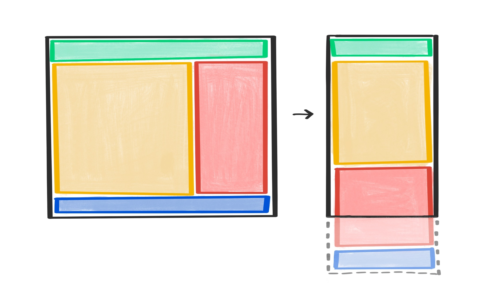

**Required reading**

> **Trainer note:** The feed + sidebar layout that collapses on mobile.

:::info[Source]

Adapted from [Macro layouts](https://web.dev/learn/design/macro-layouts) by the web.dev authors (Google), web.dev, licensed under [CC BY 4.0](https://creativecommons.org/licenses/by/4.0/). Changes: converted to Markdown for offline use; interactive embeds, browser-compatibility tables and site navigation removed.

:::

Macro layouts describe the larger, page-wide organization of your interface.



Before applying any layout, you should make sure that the flow of your content makes sense. This single column default ordering is what smaller screens will get.

```html
<body>
  <header>…</header>
  <main>
    <article>…</article>
    <aside>…</aside>
  </main>
  <footer>…</footer>
</body>
```

:::note[Interactive demo not available offline]

This lesson has an interactive CodePen demo here. CodePen is not reachable from our network. Use the code on this page in the playground instead. (Pen id for reference: `web-dot-dev/oNeePOX`)

:::

When you arrange these individual page-level components, you're designing a macro layout: a high-level view of your page. Using media queries, you can supply rules in CSS describing how this view should adjust to different screen sizes.

<video controls="" style="max-width:100%"><source src="./img/23-macro-layouts/3KENjI9FiNARctTiKDak.mp4" type="video/mp4"></video>

## Grid

[CSS grid](./09-grid.md) is an excellent tool for applying a layout to your page. In the previous example, say you want a two-column layout once there's enough screen width available. To apply this two-column layout once the browser is wide enough, use a media query to define the grid styles above a specified breakpoint.

```css
@media (min-width: 45em) {
  main {
    display: grid;
    grid-template-columns: 2fr 1fr;
  }
}
```

:::note

While it would make more sense to specify `min-inline-size` instead of `min-width`, logical properties don't work in media queries yet.

:::

:::note[Interactive demo not available offline]

This lesson has an interactive CodePen demo here. CodePen is not reachable from our network. Use the code on this page in the playground instead. (Pen id for reference: `web-dot-dev/vYJJzMK`)

:::

## Flexbox

For this specific layout, you could also use [flexbox](./08-flexbox.md). The styles would look like this:

```css
@media (min-width: 45em) {
  main {
    display: flex;
    flex-direction: row;
  }

  main article {
    flex: 2;
  }

  main aside {
    flex: 1;
  }
}
```

:::note[Interactive demo not available offline]

This lesson has an interactive CodePen demo here. CodePen is not reachable from our network. Use the code on this page in the playground instead. (Pen id for reference: `web-dot-dev/gOxxdym`)

:::

However, the flexbox version requires more CSS. Each column has a separate rule to describe how much space it should take up. In the grid example, that same information is encapsulated in one rule for the containing element.

## Do you need a media query?

You might not always need to use a media query. Media queries work fine when you're applying changes to a few elements, but if the layout needs to be updated a lot, your media queries could get out of hand with lots of breakpoints.

Say you've got a page full of card components. The cards are never wider than `15em`, and you want to put as many cards on one line as will fit. You could write media queries with breakpoints like `30em`, `45em`, and `60em` but that's quite tedious and difficult to maintain.

Instead, you can apply rules so that the cards themselves automatically take up the right amount of space.

```css
.cards {
  display: grid;
  grid-template-columns: repeat(auto-fill, minmax(15em, 1fr));
  grid-gap: 1em;
}
```

:::note[Interactive demo not available offline]

This lesson has an interactive CodePen demo here. CodePen is not reachable from our network. Use the code on this page in the playground instead. (Pen id for reference: `web-dot-dev/QWMMVPm`)

:::

You can achieve a similar layout with flexbox. In this case, if there are not enough cards to fill the final row, the remaining cards will stretch to fill the available space rather than lining up in columns. If you want to line up rows and columns, then use grid.

```css
.cards {
  display: flex;
  flex-direction: row;
  flex-wrap: wrap;
  gap: 1em;
}
.cards .card {
  flex-basis: 15em;
  flex-grow: 1;
}
```

:::note[Interactive demo not available offline]

This lesson has an interactive CodePen demo here. CodePen is not reachable from our network. Use the code on this page in the playground instead. (Pen id for reference: `web-dot-dev/abyyaMg`)

:::

By applying some smart rules in flexbox or grid, it's possible to design dynamic macro layouts with minimal CSS and without any media queries. That's less work for you—you're making the browser do the calculations instead. To see some examples of modern CSS layouts that are fluid without requiring media queries, see [1linelayouts.com](https://1linelayouts.glitch.me/).

### Check your understanding

Test your knowledge of macro layouts.

## Check your understanding

**Question 1.**

Which sentence best describes macro layouts?

- Layouts that contain other layouts.
- When a design uses flexbox or grid.
- Low level layouts which cover small amounts of the screen.
- High level layouts which cover large amounts of the screen.

<details><summary>Show answer</summary><p><strong>High level layouts which cover large amounts of the screen.</strong>: 🎉 Macro layouts are foundational layouts for a page, spanning large amounts of visual area, and often are adjusted with page size media queries.</p></details>

**Question 2.**

Macro layouts always use media queries to adapt to different screen sizes?

- True
- False

<details><summary>Show answer</summary><p><strong>False</strong>: 🎉 Macro layouts may adapt to fit content, fill available space, and more, without a media query.</p></details>

Now that you've got some ideas for page-level macro layouts, turn your attention to the components within the page. This is the realm of [micro layouts](./24-micro-layouts.md).
