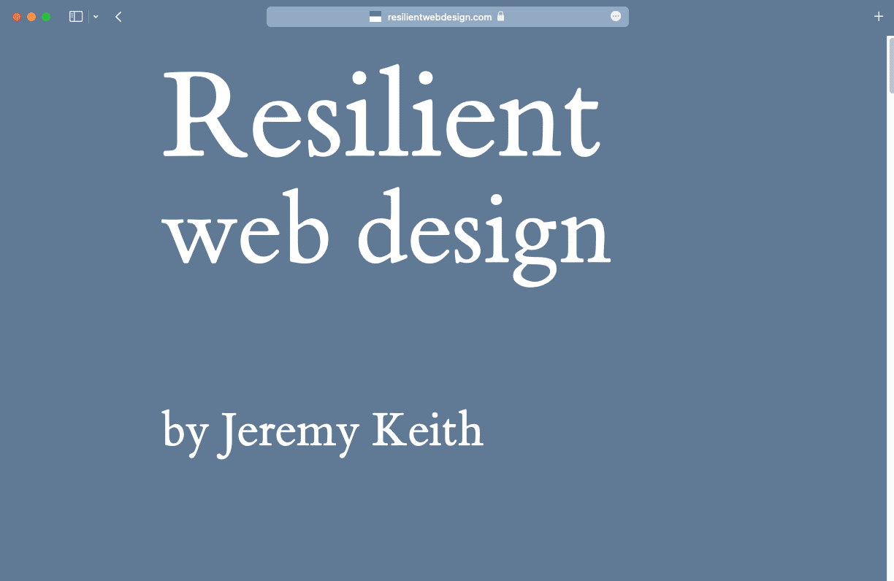
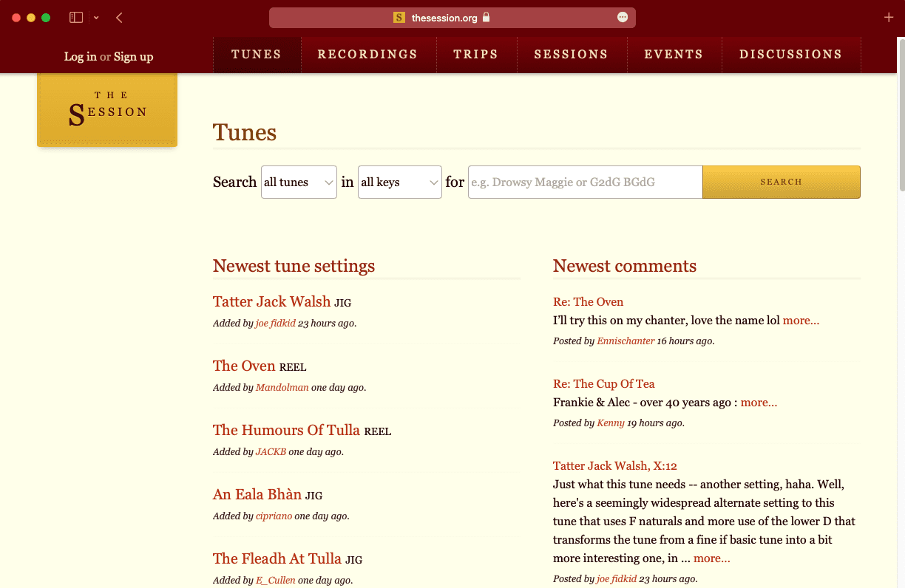
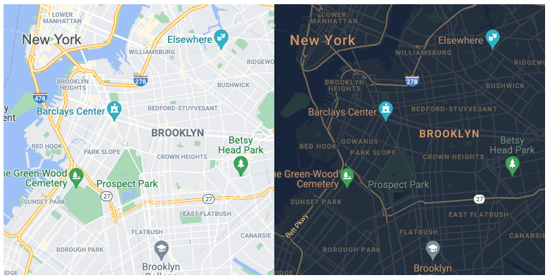

**Skim**: read the headings and examples, come back when you need it.

> **Trainer note:** Useful for the bonus dark mode.

:::info[Source]

Adapted from [Theming](https://web.dev/learn/design/theming) by the web.dev authors (Google), web.dev, licensed under [CC BY 4.0](https://creativecommons.org/licenses/by/4.0/). Changes: converted to Markdown for offline use; interactive embeds, browser-compatibility tables and site navigation removed.

:::

Even branding can be responsive. You can adjust the presentation of your website to match the user's preference. But first, here's how to extend your website's branding to include the browser itself.

## Customize the browser interface

Some browsers allow you to suggest a theme color based on your website's palette. The browser's interface adapts to your suggested color. Add the color in a `meta` element named `theme-color` in the `head` of your pages.

```html
<meta name="theme-color" content="#00D494">
```

:::note

It feels a little strange to put styling information like this in HTML rather than CSS, but this allows the browser to update its interface as soon as the page is loading rather than waiting for the CSS.

:::

  

*Three websites are viewed in the Safari browser. Each one has its own theme color that extends into the browser interface.*

You can update the value of `theme-color` using JavaScript. But use this power wisely. It can be overwhelming for users if their browser's color scheme changes too often. Think about subtle ways to adjust the theme color. If the changes are too jarring, users will leave in annoyance.

You can also specify a theme color in a [web app manifest](https://developer.mozilla.org/docs/Web/Manifest) file. This is a JSON file with metadata about your website.

Link to the manifest file from the `head` of your documents. Use a `link` element with a `rel` value of `manifest`.

```html
<link rel="manifest" href="/manifest.json">
```

In the manifest file, list your metadata using key/value pairs.

```json
{
  "short_name": "Clearleft",
  "name": "Clearleft design agency",
  "start_url": "/",
  "background_color": "#00D494",
  "theme_color": "#00D494",
  "display": "standalone"
}
```

If a visitor decides to add your website to their home screen, the browser will use the information in your manifest file to display an appropriate shortcut.

:::note

Find out more about how to [add a web app manifest](https://web.dev/articles/add-manifest).

:::

## Provide a dark mode

Many operating systems allow users to specify a preference for a light or a dark color palette, which is a good idea to optimize your site to your user's theme preferences. You can access this preference in a media feature called `prefers-color-scheme`.

```css
@media (prefers-color-scheme: dark) {
  // Styles for a dark theme.
}
```

:::note[Interactive demo not available offline]

This lesson has an interactive CodePen demo here. CodePen is not reachable from our network. Use the code on this page in the playground instead. (Pen id for reference: `web-dot-dev/wvrwLgN`)

:::

<video controls="" style="max-width:100%"><source src="./img/27-theming/hpMyDvtHUyLPz0ltO6SS.mp4" type="video/mp4"></video>

Specify theme colors with the `prefers-color-scheme` media feature within the `meta` element.

```html
<meta name="theme-color" content="#ffffff" media="(prefers-color-scheme: light)">
<meta name="theme-color" content="#000000" media="(prefers-color-scheme: dark)">
```

You can also use the `prefers-color-scheme` media feature inside SVG. If you use an SVG file for your favicon, it can be adjusted for dark mode. [Thomas Steiner](https://web.dev/authors/thomassteiner) wrote about [`prefers-color-scheme` in SVG favicons for dark mode icons](https://blog.tomayac.com/2019/09/21/prefers-color-scheme-in-svg-favicons-for-dark-mode-icons/).

## Theming with custom properties

If you use the same color values in multiple places throughout your CSS, it could be quite tedious to repeat all your selectors within a `prefers-color-scheme` media query.

```css
body {
  background-color: white;
  color: black;
}
input {
  background-color: white;
  color: black;
  border-color: black;
}
button {
  background-color: black;
  color: white;
}
@media (prefers-color-scheme: dark) {
  body {
    background-color: black;
    color: white;
  }
  input {
    background-color: black;
    color: white;
    border-color: white;
  }
  button {
    background-color: white;
    color: black;
  }
}
```

Use CSS custom properties to store your color values. Custom properties work like variables in a programming language. You can update the value of a variable without updating its name.

If you update the values of your custom properties within a `prefers-color-scheme` media query, you won't have to write all your selectors twice.

```css
html {
  --page-color: white;
  --ink-color: black;
}
@media (prefers-color-scheme: dark) {
  html {
    --page-color: black;
    --ink-color: white;
  }
}
body {
  background-color: var(--page-color);
  color: var(--ink-color);
}
input {
  background-color: var(--page-color);
  color: var(--ink-color);
  border-color: var(--ink-color);
}
button {
  background-color: var(--ink-color);
  color: var(--page-color);
}
```

:::note[Interactive demo not available offline]

This lesson has an interactive CodePen demo here. CodePen is not reachable from our network. Use the code on this page in the playground instead. (Pen id for reference: `web-dot-dev/qBPWzrj`)

:::

See [building a color scheme](https://web.dev/articles/building/a-color-scheme) for more advanced examples of theming with custom properties.

## Images

If you are using SVGs in your HTML, you can apply custom properties there too.

```css
svg {
  stroke: var(--ink-color);
  fill: var(--page-color);
}
```

Now your icons will change their colors along with the other elements on your page.

If you want to tone down the brightness of your photographic images when displayed in dark mode, you can apply a filter in CSS.

```css
@media (prefers-color-scheme: dark) {
  img {
    filter: brightness(.8) contrast(1.2);
  }
}
```

:::note[Interactive demo not available offline]

This lesson has an interactive CodePen demo here. CodePen is not reachable from our network. Use the code on this page in the playground instead. (Pen id for reference: `web-dot-dev/PoJYrpy`)

:::

 

*The effect is subtle, but you can tone down the brightness of images in dark mode.*

For some images, you might want to swap them out completely in dark mode. For example, you might want to show a map with a darker color scheme. Use the `<picture>` element containing a `<source>` element with the `prefers-color-scheme` media query.

```html
<picture>
  <source srcset="darkimage.png" media="(prefers-color-scheme: dark)">
  
</picture>
```

:::note[Interactive demo not available offline]

This lesson has an interactive CodePen demo here. CodePen is not reachable from our network. Use the code on this page in the playground instead. (Pen id for reference: `web-dot-dev/MWEgMmw`)

:::

<video controls="" style="max-width:100%"><source src="./img/27-theming/8Sz0XmotUrwnbprrHtoZ.mp4" type="video/mp4"></video>



*Two versions of the same map, one for light mode and one for dark mode.*

## Forms

Browsers provide a default color palette for form fields. Let the browser know that your site offers both a dark and a light mode. That way, the browser can provide the appropriate default styling for forms.

Add this to your CSS:

```css
html {
  color-scheme: light;
}
@media (prefers-color-scheme: dark) {
  html {
    color-scheme: dark;
  }
}
```

You can also use HTML. Add this in the `head` of your documents:

```html
<meta name="supported-color-schemes" content="light dark">
```

:::note[Interactive demo not available offline]

This lesson has an interactive CodePen demo here. CodePen is not reachable from our network. Use the code on this page in the playground instead. (Pen id for reference: `web-dot-dev/dyVbBWZ`)

:::

<video controls="" style="max-width:100%"><source src="./img/27-theming/6YuAM0ZCNhGNAjpI8fyT.mp4" type="video/mp4"></video>

Use the [`accent-color`](https://web.dev/articles/accent-color) property in CSS to style checkboxes, radio buttons, and some other form fields.

```css
html {
  accent-color: red;
}
```

It's common for dark themes to have subdued brand colors. You can update the `accent-color` value for dark mode.

```css
html {
  accent-color: red;
}
@media (prefers-color-scheme: dark) {
  html {
    accent-color: pink;
  }
}
```

It makes sense to use a custom property for this so you can keep all your color declarations in one place.

```css
html {
  color-scheme: light;
  --page-color: white;
  --ink-color: black;
  --highlight-color: red;
}
@media (prefers-color-scheme: dark) {
  html {
    color-scheme: dark;
    --page-color: black;
    --ink-color: white;
    --highlight-color: pink;
  }
}
html {
  accent-color: var(--highlight-color);
}
body {
  background-color: var(--page-color);
  color: var(--ink-color);
}
```

:::note[Interactive demo not available offline]

This lesson has an interactive CodePen demo here. CodePen is not reachable from our network. Use the code on this page in the playground instead. (Pen id for reference: `web-dot-dev/WNZeqjB`)

:::

<video controls="" style="max-width:100%"><source src="./img/27-theming/Dl00EnG4mwTbSQIkYBF9.mp4" type="video/mp4"></video>

:::note

For more on tinting elements with theme colors, see the section on [more tinting](https://web.dev/articles/accent-color#extra_more_tinting).

:::

Providing a dark mode is just one example of adapting your site to suit your user's preferences. Next you'll learn how to make your site adaptable to all sorts of [accessibility](./29-responsive-accessibility.md) considerations.

### Check your understanding

Test your knowledge on theming

## Check your understanding

**Question 1.**

To provide theme colors that impact the browser outside of the webpage, use:

- CSS
- JavaScript
- A web app manifest
- A 'theme-color' `<meta>` tag

<details><summary>Show answer</summary><p><strong>A web app manifest</strong>: <code translate="no" dir="ltr">manifest.json</code> can be provided and includes fields for specifying theme colors for tinting how the app looks being opened from a mobile homescreen.</p></details>

**Question 2.**

To hook into a user's system preference regarding a light or dark theme, use:

- The `(prefers-color-scheme)` media query
- JavaScript

<details><summary>Show answer</summary><p><strong>The <code translate="no" dir="ltr">(prefers-color-scheme)</code> media query</strong>: Pass the value you want to check for like light or dark and you're good to go.</p></details>

**Question 3.**

So you support dark theme, but all the form inputs are still light themed. What can you do?

- Add `html { color-scheme: light dark; }` to your CSS.
- Add `<meta name="supported-color-schemes" content="light dark">` to your HTML `<head>` tag.
- Write a bunch of CSS to change all the defaults of the input.

<details><summary>Show answer</summary><p><strong>Add <code translate="no" dir="ltr">html { color-scheme: light dark; }</code> to your CSS.</strong>: This signals from CSS that the form inputs should match the system color scheme.</p></details>
