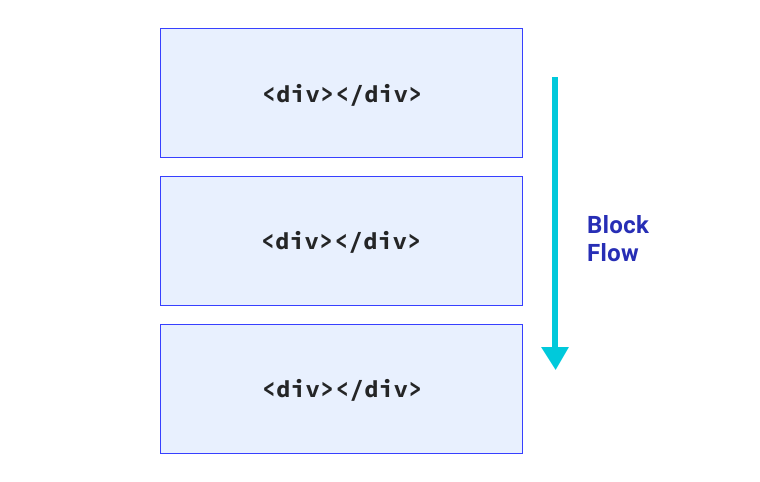
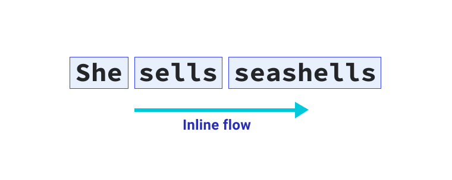
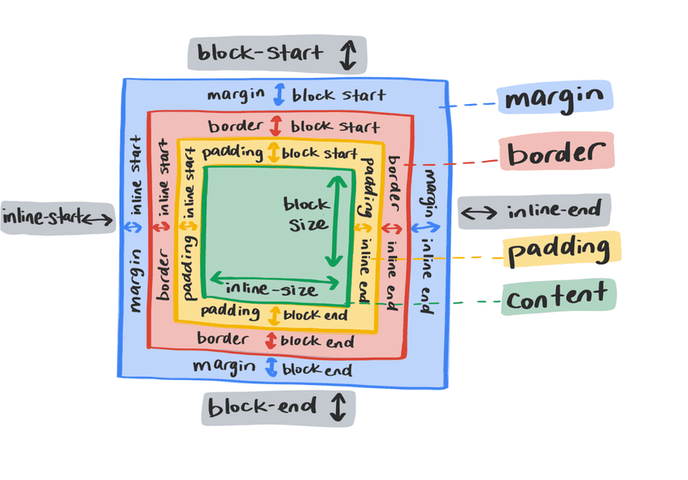

**Required reading**

:::info[Source]

Adapted from [Logical Properties](https://web.dev/learn/css/logical-properties) by the web.dev authors (Google), web.dev, licensed under [CC BY 4.0](https://creativecommons.org/licenses/by/4.0/). Changes: converted to Markdown for offline use; interactive embeds, browser-compatibility tables and site navigation removed.

:::

A really common user interface pattern is a text label with a supporting inline icon.

:::note[Interactive demo not available offline]

This lesson has an interactive CodePen demo here. CodePen is not reachable from our network. Use the code on this page in the playground instead. (Pen id for reference: `web-dot-dev/eYgvZBx`)

:::

The icon sits to the left of the text with a small gap between the two, provided by `margin-right` on the icon. There's a problem though, because this will only work when the text direction is left to right. If the text direction changed to right-to-left—which is how languages like Arabic read—the icon will sit up against the text.

:::note[Interactive demo not available offline]

This lesson has an interactive CodePen demo here. CodePen is not reachable from our network. Use the code on this page in the playground instead. (Pen id for reference: `web-dot-dev/BapWKWm`)

:::

How do you account for this in CSS? Logical properties allow you to resolve these situations. Among many other benefits, they provide free, automatic support for internationalization. They help you build a more resilient, inclusive front-end.

## Terminology

The physical properties of top, right, bottom, and left refer to the physical dimensions of the viewport. You can think of these like a compass rose on a map. Logical properties, on the other hand, refer to the edges of a box as they relate to the *flow of content*. Therefore, they can change if the text direction or writing mode changes. This is a big shift from directional styles, and it gives us a lot more flexibility when styling our interfaces.

## Block flow

Block flow is the direction in which content blocks are placed. For example, if there are two paragraphs, the block flow is where the second paragraph will go. In an English document, the block flow is top-to-bottom. Think of this in the context of paragraphs of text following each other, top-to-bottom.



## Inline flow

The inline flow is how text flows in a sentence. In an English document the inline flow is left to right. If you were to change the document language of your webpage to Arabic (`<html lang="ar">`), then the inline flow would be right-to-left.



Text flows in the direction determined by the document's writing mode. You can change the direction that text is laid out with the `writing-mode` property. This can be applied to the entire document, or to individual elements.

:::note[Interactive demo not available offline]

This lesson has an interactive CodePen demo here. CodePen is not reachable from our network. Use the code on this page in the playground instead. (Pen id for reference: `web-dot-dev/YzNZGam`)

:::

## Flow relative

Historically in CSS, we have only been able to apply properties like margin relative to the direction of their sides. For example, `margin-top` is applied to the physical top of the element. With logical properties, `margin-top` becomes `margin-block-start`. This means that regardless of language and text direction, the **block flow** has appropriate margin rules.

:::note[Interactive demo not available offline]

This lesson has an interactive CodePen demo here. CodePen is not reachable from our network. Use the code on this page in the playground instead. (Pen id for reference: `web-dot-dev/ZELeBzM`)

:::



## Sizing

To prevent an element exceeding a certain width or height, write a rule like this:

```css
.my-element {
  max-width: 150px;
  max-height: 100px;
}
```

The flow-relative equivalents are `max-inline-size` and `max-block-size`. You can also use `min-block-size` and `min-inline-size` instead of `min-height` and `min-width`.

With logical properties, that max width and height rule would look like this:

```css
.my-element {
  max-inline-size: 150px;
  max-block-size: 100px;
}
```

## Start and end

Instead of using directions such as top, right, bottom and left, use start and end. This gives you block-start, inline-end, block-end, and inline-start. These allow you to apply CSS properties that respond to writing mode changes.

For example, to align text to the right, you could use this CSS:

```css
p {
  text-align: right;
}
```

If your aim is not to align to the physical right, but rather to the start of the reading direction, this isn't helpful. With logical values, there are more helpful `start` and `end` values which map to the text direction. The text alignment rule now looks like this:

```css
p {
  text-align: end;
}
```

:::note[Interactive demo not available offline]

This lesson has an interactive CodePen demo here. CodePen is not reachable from our network. Use the code on this page in the playground instead. (Pen id for reference: `web-dot-dev/QWdpdwo`)

:::

## Spacing and positioning

Logical properties for `margin`, `padding` and `inset` make positioning elements, and determining how these elements interact with each other across writing modes easier and more efficient. The margin and padding related properties are still direct mappings to directions, but the key difference is that when a writing mode changes, they change with it.

```css
.my-element {
  padding-top: 2em;
  padding-bottom: 2em;
  margin-left: 2em;
  position: relative;
  top: 0.2em;
}
```

This adds some vertical inside space with `padding` and pushes it out from the left with `margin`. The `top` property also shifts it downwards. With logical property equivalents, it would instead look like this:

```css
.my-element {
  padding-block-start: 2em;
  padding-block-end: 2em;
  margin-inline-start: 2em;
  position: relative;
  inset-block-start: 0.2em;
}
```

This adds some inline inside space with `padding` and pushes it out from the inline-start with `margin`. The `inset-block` property moves it inwards from the block-start.

The `inset-block` property isn't the only shorthand option with logical properties. This rule can be further condensed, using shorthand versions of the margin and padding properties.

```css
.my-element {
  padding-block: 2em;
  margin-inline: 2em 0;
  position: relative;
  inset-block: 0.2em 0;
}
```

## Borders

Adding `border` and `border-radius` can also be done with logical properties. To add a border on the bottom and right, with a right-hand radius, you might write a rule like this:

```css
.my-element {
  border-bottom: 1px solid red;
  border-right: 1px solid red;
  border-bottom-right-radius: 1em;
}
```

Or, you could use logical properties like this:

```css
.my-element {
  border-block-end: 1px solid red;
  border-inline-end: 1px solid red;
  border-end-end-radius: 1em;
}
```

The `end-end` in `border-end-end-radius` is the block end *and* inline end.

:::note[Interactive demo not available offline]

This lesson has an interactive CodePen demo here. CodePen is not reachable from our network. Use the code on this page in the playground instead. (Pen id for reference: `web-dot-dev/yLgMgby`)

:::

## Units

Logical properties bring two new units: `vi` and `vb`. A `vi` unit is 1% of the viewport size in the inline direction. The non-logical property equivalent is `vw`. The `vb` unit is 1% of the viewport in the block direction. The non-logical property equivalent is `vh`.

These units will always map to the reading direction. For example, if you want an element to take up 80% of the available inline space of a viewport, using the `vi` unit will automatically switch that size to be top to bottom if the writing mode is vertical.

## Using logical properties pragmatically

Logical properties and writing modes are not just for internationalization. You can use them to produce a more versatile user interface.

If you have a chart that has labels on the X axis and Y axis, you might want the text on the Y label to read vertically.

:::note[Interactive demo not available offline]

This lesson has an interactive CodePen demo here. CodePen is not reachable from our network. Use the code on this page in the playground instead. (Pen id for reference: `web-dot-dev/zYNZNgE`)

:::

Because the Y axis label in the demo has a `writing-mode` of `vertical-rl`, you can use the same `margin` values on both labels. The `margin-block-start` value applies to both labels because the block start is on the right for the Y axis and on the top for the X axis. The block-start sides have a red border so you can see them.

## Solving the icon issue

Now that we've covered logical properties, this knowledge can be applied to the design problem we started with.

:::note[Interactive demo not available offline]

This lesson has an interactive CodePen demo here. CodePen is not reachable from our network. Use the code on this page in the playground instead. (Pen id for reference: `web-dot-dev/eYgvZBx`)

:::

```css
p {
  display: inline-flex;
  align-items: center;
}

p svg {
  width: 1.2em;
  height: 1.2em;
  margin-right: 0.5em;
  flex: none;
}
```

The margin has been applied to the right of the icon element. In order for the spacing between the icon and the text to support all reading direction, the `margin-inline-end` property needs to be used instead.

```css
p {
  display: inline-flex;
  align-items: center;
}

p svg {
  width: 1.2em;
  height: 1.2em;
  margin-inline-end: 0.5em;
  flex: none;
}
```

:::note[Interactive demo not available offline]

This lesson has an interactive CodePen demo here. CodePen is not reachable from our network. Use the code on this page in the playground instead. (Pen id for reference: `web-dot-dev/qBRrrOy`)

:::

Now, regardless of reading direction, the icon will position itself and space itself appropriately.

### Check your understanding

Test your knowledge of logical properties

## Check your understanding

**Question 1.**

As you write with your hand, your wrist is moving along which logical axis?

- `inline`
- `block`

<details><summary>Show answer</summary><p><strong><code translate="no" dir="ltr">inline</code></strong>: Words flow inline and so must a your hand travel when writing.</p></details>

**Question 2.**

Check all that can benefit from logical properties

- colors
- alignment
- shadows
- box sides
- sizes
- box corners

<details><summary>Show answer</summary><p><strong>alignment</strong>: Examples: <code translate="no" dir="ltr">flex-start</code>, <code translate="no" dir="ltr">block-end</code>, and <code translate="no" dir="ltr">inline-start</code></p><p><strong>box sides</strong>: Examples: <code translate="no" dir="ltr">block-start</code> and <code translate="no" dir="ltr">inline</code>.</p><p><strong>sizes</strong>: Examples: <code translate="no" dir="ltr">inline-size</code> and <code translate="no" dir="ltr">max-block-size</code>.</p><p><strong>box corners</strong>: Examples: <code translate="no" dir="ltr">border-end-end-radius</code>.</p></details>

**Question 3.**

Which logical side of a word is underlined?

- inline start
- inline end
- block start
- block end

<details><summary>Show answer</summary><p><strong>block end</strong>: Very nice that CSS does this positioning for you.</p></details>
