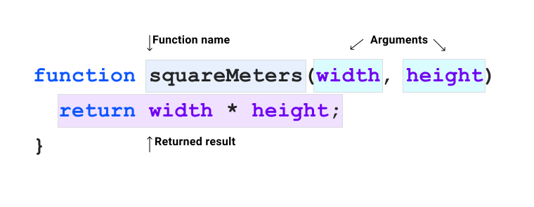

**Required reading**

> **Trainer note:** clamp(), min(), max(), calc().

:::info[Source]

Adapted from [Functions](https://web.dev/learn/css/functions) by the web.dev authors (Google), web.dev, licensed under [CC BY 4.0](https://creativecommons.org/licenses/by/4.0/). Changes: converted to Markdown for offline use; interactive embeds, browser-compatibility tables and site navigation removed.

:::

So far in this course, you've been exposed to several CSS functions. In the [grid](../02-css-fundamentals-and-layout/09-grid.md) module, you were introduced to `minmax()` and `fit-content()`, which help you size elements. In the [color](../02-css-fundamentals-and-layout/16-color.md) module, you were introduced to `rgb()`, and `hsl()`, which help you define colors.

Like many other programming languages, [CSS has **a lot** of built-in functions](https://developer.mozilla.org/docs/Web/CSS/CSS_Functions) that you can access whenever you need them.

Every CSS function has a specific purpose, in this lesson, you'll get a high-level overview, giving you a much better understanding of where and how to use them.

## What is a function?

A function is a named, self-contained piece of code that completes a specific task. A function is named so you can call it within your code and you can pass data into the function. This is known as passing arguments.



A lot CSS functions are *pure functions*, which means that if you pass the same arguments into them, they will always give you the same result back, regardless of what is happening in the rest of your code. These functions will often re-compute as values change in your CSS, similar to other elements in the language, such as computed cascaded values like `currentColor`.

In CSS, you can only use the provided functions, rather than write your own, but functions can be nested within each other in some contexts, giving them more flexibility. We'll cover that in more detail, later in this module.

## Functional selectors

```css
.post :is(h1, h2, h3) {
    line-height: 1.2;
}
```

You learned about functional selectors in the [pseudo-classes module](../02-css-fundamentals-and-layout/11-pseudo-classes.md) which detailed functions like [`:is()`](https://developer.mozilla.org/docs/Web/CSS/:is) and [`:not()`](https://developer.mozilla.org/docs/Web/CSS/:not). The arguments passed into these functions are CSS selectors, which are then evaluated. If there is a match with elements, the rest of the **CSS rule** will be applied to them.

## Custom properties and `var()`

```css
:root {
    --base-color: #ff00ff;
}

.my-element {
    background: var(--base-color);
}
```

A custom property is a variable which lets you tokenize values in your CSS code. [Custom properties are also affected by the cascade](https://piccalil.li/tutorial/getting-started-with-css-custom-properties/) which means they can be contextually manipulated or redefined. A custom property must be prefixed with two dashes (`--`) and are case sensitive.

The [`var()`](https://developer.mozilla.org/docs/Web/CSS/var\(\)) function takes one required argument: the custom property that you are trying to return as a value.

In the preceding snippet, the `var()` function has `--base-color` passed as an argument. If `--base-color` is defined, then `var()` will return the value.

```css
.my-element {
    background: var(--base-color, hotpink);
}
```

You can also pass a fallback declaration value into the `var()` function. This means that if `--base-color` can't be found, the passed **declaration** will be used instead, which in this sample's case is the `hotpink` color.

:::note[Interactive demo not available offline]

This lesson has an interactive CodePen demo here. CodePen is not reachable from our network. Use the code on this page in the playground instead. (Pen id for reference: `web-dot-dev/zYNPOjP`)

:::

## Functions that return a value

The `var()` function is just one of the CSS functions that return a value. Functions like [`attr()`](https://developer.mozilla.org/docs/Web/CSS/attr\(\)) and [`url()`](https://developer.mozilla.org/docs/Web/CSS/url\(\)) follow a similar structure to `var()`— you pass one or more arguments and use them on the **right side** of your CSS declaration.

```css
a::after {
  content: attr(href);
}
```

The `attr()` function here is taking the content of the `<a>` element's `href` attribute and setting it as the `content` of the `::after` pseudo-element. If the value of the `<a>` element's `href` attribute was to change, this would automatically be reflected in this `content` attribute.

```css
.my-element {
    background-image: url('/path/to/image.jpg');
}
```

The `url()` function takes a **string** URL and is used to load images, fonts and content. If a valid URL isn't passed in or the resource that the URL points to can't be found, nothing will be returned by the `url()` function.

## Color functions

You learned all about color functions in the [color](../02-css-fundamentals-and-layout/16-color.md) module. If you haven't read that one yet, it is strongly recommended that you do.

Some available color functions in CSS are `rgb()`, `hsl()`, `lab()`, `lch()`, `oklab()`, `oklch()`, and `color()`. All of these have a similar form where configuration arguments are passed in and a color is returned back.

## Mathematical expressions

Like many other programming languages, CSS provides useful mathematical functions to assist with various types of calculation.

### Arithmetic functions

#### `calc()`

The [`calc()`](https://developer.mozilla.org/docs/Web/CSS/calc\(\)) function takes a single mathematical expression as its parameter. This mathematical expression can be a mix of types, such as length, number, angle and frequency. Units can be mixed too.

```css
.my-element {
    width: calc(100% - 2rem);
}
```

In this example, the `calc()` function is being used to size an element's width as 100% of its containing parent element, then removing `2rem` off that computed value.

:::note[Interactive demo not available offline]

This lesson has an interactive CodePen demo here. CodePen is not reachable from our network. Use the code on this page in the playground instead. (Pen id for reference: `web-dot-dev/PopYema`)

:::

```css
:root {
  --root-height: 5rem;
}

.my-element {
  width: calc(calc(10% + 2rem) * 2);
  height: calc(var(--root-height) * 3);
}
```

The `calc()` function can be nested inside another `calc()` function. You can also pass custom properties in a `var()` function as part of an expression.

### `min()` and `max()`

The [`min()`](https://developer.mozilla.org/docs/Web/CSS/min\(\)) function returns the smallest computed value of the one or more passed arguments. The [`max()`](https://developer.mozilla.org/docs/Web/CSS/max\(\)) function does the opposite: get the largest value of the one or more passed arguments.

```css
.my-element {
  width: min(20vw, 30rem);
  height: max(20vh, 20rem);
}
```

In this example, the width should be the smallest value between `20vw` —which is 20% of the **viewport width**—and `30rem`. The height should be the largest value between `20vh` —which is 20% of the **viewport height**—and `20rem`.

:::note

We cover units like `vw` and `vh` in the [sizing](../02-css-fundamentals-and-layout/06-sizing.md) units module.

:::

### `clamp()`

The [`clamp()`](https://developer.mozilla.org/docs/Web/CSS/clamp\(\)) function takes three arguments: the minimum size, the ideal size and the maximum.

```css
h1 {
  font-size: clamp(2rem, 1rem + 3vw, 3rem);
}
```

In this example, the `font-size` will be fluid based on the width of the viewport. The `vw` unit is added to a `rem` unit to assist with screen zooming, because regardless of zoom level a `vw` unit will be the same size. Multiplying by a `rem` unit—based on the root font size— provides the `clamp()` function with a relative calculation point.

:::note[Interactive demo not available offline]

This lesson has an interactive CodePen demo here. CodePen is not reachable from our network. Use the code on this page in the playground instead. (Pen id for reference: `web-dot-dev/ByNZQba`)

:::

You can learn more about the `min()`, `max()`, and `clamp`() functions in [this article on these functions](https://web.dev/articles/min-max-clamp).

## Trigonometric Functions

Trigonometric functions allow you to find any point on a circle based on an angle, model cyclical phenomena such as sound waves, describe orbits, and more. In CSS, you can use trigonometric functions to set properties based on rotation, time animations, rotate elements based on a point, and other uses.

For more information and examples, see our [article on trigonometric functions](https://web.dev/articles/css-trig-functions).

### `sin()`, `cos()`, and `tan()`

The `sin()`, `cos()`, and `tan()` functions take an angle argument and return the sine, cosine, and tangent respectively. The `sin()` and `cos()` functions return a number between `-1` and `1`. The `tan()` function returns a number between `-Infinity` and `+Infinity`. The angle argument can be any supported angle unit.

```css
:root {
  --sine-degrees: sin(45deg);     /* returns 0.7071 */
  --sine-radians: sin(0.7853rad); /* returns 0.7071 */
}
```

In the preceding example, `--sine-degrees` and `--sine-radians` have the same value (in this case `0.7071`).

:::note[Interactive demo not available offline]

This lesson has an interactive CodePen demo here. CodePen is not reachable from our network. Use the code on this page in the playground instead. (Pen id for reference: `web-dot-dev/jEPwVJr`)

:::

In the preceding example, the `sin()` and `cos()` functions are used to create oscillating animations on the `x` and `y` axes by multiplying the result by the specified radius. Using both functions at once allows an orbiting animation. We use a [custom property](https://web.dev/blog/at-property-baseline), `--angle`, to smoothly animate the angle for all function calls.

### `asin()`, `acos()`, and `atan()`

The `asin()`, `acos()`, and `atan()` are the inverse of the `sin()`, `cos()`, and `tan()` functions, taking a number as an argument and returning an angle value between `-90deg` and `90deg`. The `asin()` and `acos()` functions accept a number between `-1` and `1` while the `atan()` function accepts a number between `-Infinity` and `+Infinity`.

```css
:root {
  --degrees: asin(0.7071); /* returns 45deg */
}
```

### `atan2()`

The `atan2()` function takes two arguments representing a point relative to the origin and returns the angle representing the direction to that point. You can use this to rotate elements to face a specific point. The arguments can be numbers, size units, or a percentage, but both arguments must both be the same kind.

:::note[Interactive demo not available offline]

This lesson has an interactive CodePen demo here. CodePen is not reachable from our network. Use the code on this page in the playground instead. (Pen id for reference: `web-dot-dev/EajXNMo`)

:::

In the example above the `atan2()` function is used to determine the angle between the center of the viewport and the current mouse position. Note that the `y` value is the first argument, and the `x` value is the second. The angle is then used to position the "pupils" relative to the center of the "eyes", so they follow the mouse.

### `hypot()`

The `hypot()` function takes two length arguments representing the sides of a right triangle and returns the length of the hypotenuse. You can use this as a shortcut for calculating this using exponential functions. Both arguments must be the same unit type and `hypot()` will return the same type.

```css
:root {
  --use-ems: hypot(3em, 4em);   /* returns 5em */
  --use-px:  hypot(30px, 40px); /* returns 50px */
}
```

## Exponential functions

### `pow()` and `exp()`

The `pow()` function takes two numeric arguments, the base and the exponent, and raises the base by the power of the exponent. Both arguments must be numbers without units. The `exp()` function takes a single argument and is equivalent to calling the `pow()` function with a base of [*e*](https://en.wikipedia.org/wiki/E_\(mathematical_constant\)).

```css
.my-element {
  width: calc(10px * pow(4, 2); /* 10px * (4 * 4) == 160px */
}
```

### `sqrt()`

The `sqrt()` function takes a numeric argument and returns its square root. The argument cannot include units.

```css
:root {
  --root: sqrt(25); /* returns 5 */
}
```

### `log()`

The `log()` function returns the [logarithm](https://en.wikipedia.org/wiki/Logarithm) of a numeric value. If one argument is passed, it will return the [natural logarithm](https://en.wikipedia.org/wiki/Natural_logarithm). If a second argument is passed, the `log()` function will use the second argument as the base for the logarithm.

```css
:root {
  --log2: log(16, 2); /* returns 4      */
  --logn: log(16);    /* returns 2.7725 */
}
```

## Sign related functions

### `abs()`

The `abs()` function takes a numeric argument and returns the absolute (positive) value of the argument value.

```css
.my-element {
  color: rgba(0, 0, 0, abs(-1));
}
```

In the preceding example, an `alpha` value of `-1` would result in transparent text, but the `abs()` function returns the absolute value of `1`, which results in fully opaque text.

### `sign()`

The `sign()` function takes a numeric argument and returns the arguments sign. Positive values return `1` and negative values return `-1`. Zero values return `0`.

```css
.my-element {
  top: calc(50vh + 25vh * sign(var(--value));
}
```

:::note[Interactive demo not available offline]

This lesson has an interactive CodePen demo here. CodePen is not reachable from our network. Use the code on this page in the playground instead. (Pen id for reference: `web-dot-dev/LEVLbaB`)

:::

In the preceding examples, if `--value` is positive, the top value will be `75vh`. If it is negative the, top value will be `25vh`. If it is zero, the top value will be `50vh`.

## Shapes

The [`clip-path`](https://developer.mozilla.org/docs/Web/CSS/clip-path), [`offset-path`](https://developer.mozilla.org/docs/Web/CSS/offset-path) and [`shape-outside`](https://developer.mozilla.org/docs/Web/CSS/shape-outside) CSS properties use shapes to visually clip your box or provide a shape for content to flow around.

There are shape functions that can be used with both of these properties. Simple shapes such as [`circle()`](https://developer.mozilla.org/docs/Web/CSS/basic-shape/circle\(\)), [`ellipse()`](https://developer.mozilla.org/docs/Web/CSS/basic-shape/ellipse\(\)) and [`inset()`](https://developer.mozilla.org/docs/Web/CSS/basic-shape/inset\(\)) take configuration arguments to size them. More complex shapes, such as [`polygon()`](https://developer.mozilla.org/docs/Web/CSS/basic-shape/polygon\(\)) take comma separated pairs of X and Y axis values to create custom shapes.

```css
.circle {
  clip-path: circle(50%);
}

.polygon {
  clip-path: polygon(0% 0%, 100% 0%, 100% 75%, 75% 75%, 75% 100%, 50% 75%, 0% 75%);
}
```

:::note[Interactive demo not available offline]

This lesson has an interactive CodePen demo here. CodePen is not reachable from our network. Use the code on this page in the playground instead. (Pen id for reference: `web-dot-dev/rNjYNNd`)

:::

Like `polygon()`, there is also a `path()` function which takes an SVG fill rule as an argument. This allows for highly complex shapes that can be drawn in a graphics tool such as Illustrator or Inkscape and then copied into your CSS.

## Transforms

Lastly in this overview of CSS functions are the transform functions, which skew, resize and even change the depth of an element. All of the following functions are used with the `transform` property.

### Rotation

You can rotate an element using the [`rotate()`](https://developer.mozilla.org/docs/Web/CSS/transform-function/rotate\(\)) function, which will rotate an element on its center axis. You can also use the [`rotateX()`](https://developer.mozilla.org/docs/Web/CSS/transform-function/rotateX\(\)), [`rotateY()`](https://developer.mozilla.org/docs/Web/CSS/transform-function/rotateY\(\)) and [`rotateZ()`](https://developer.mozilla.org/docs/Web/CSS/transform-function/rotateZ\(\)) functions to rotate an element on a specific axis instead. You can pass degree, turn and radian units to determine the level of rotation.

```css
.my-element {
  transform: rotateX(10deg) rotateY(10deg) rotateZ(10deg);
}
```

:::note[Interactive demo not available offline]

This lesson has an interactive CodePen demo here. CodePen is not reachable from our network. Use the code on this page in the playground instead. (Pen id for reference: `web-dot-dev/MWJOWzP`)

:::

The [`rotate3d()`](https://developer.mozilla.org/docs/Web/CSS/transform-function/rotate3d\(\)) function takes four arguments.

The first 3 arguments are numbers, which define the X, Y and Z coordinates. The fourth argument is the rotation which, like the other rotation functions, accepts degrees, angle and turns.

```css
.my-element {
  transform: rotate3d(1, 1, 1, 10deg);
}
```

:::note[Interactive demo not available offline]

This lesson has an interactive CodePen demo here. CodePen is not reachable from our network. Use the code on this page in the playground instead. (Pen id for reference: `web-dot-dev/GRrOJxa`)

:::

You can use the individual [`rotate`](https://developer.mozilla.org/docs/Web/CSS/rotate) property to rotate an element. When used outside of the `transform` property, you can transition it separately from other transformations. It accepts similar values to the rotate functions.

:::note[Interactive demo not available offline]

An embedded demo was here and is not available offline.

:::

:::note[Interactive demo not available offline]

This lesson has an interactive CodePen demo here. CodePen is not reachable from our network. Use the code on this page in the playground instead. (Pen id for reference: `web-dot-dev/bNdYGZV`)

:::

### Scale

You can change the scaling of an element with `transform` and the [`scale()`](https://developer.mozilla.org/docs/Web/CSS/transform-function/scale\(\)) function. The function accepts one or two numbers as a value which determine a positive or negative scaling. If you only define one number argument, both the X and Y axis will be scaled the same and defining both is a shorthand for X and Y. Just like `rotate()`, there are [`scaleX()`](https://developer.mozilla.org/docs/Web/CSS/transform-function/scaleX\(\)), [`scaleY()`](https://developer.mozilla.org/docs/Web/CSS/transform-function/scaleY\(\)) and [`scaleZ()`](https://developer.mozilla.org/docs/Web/CSS/transform-function/scaleZ\(\)) functions to scale an element on a specific axis instead.

```css
.my-element {
  transform: scaleX(1.2) scaleY(1.2);
}
```

:::note[Interactive demo not available offline]

This lesson has an interactive CodePen demo here. CodePen is not reachable from our network. Use the code on this page in the playground instead. (Pen id for reference: `web-dot-dev/vYgWOoq`)

:::

Also like the `rotate` function, there is a [`scale3d()`](https://developer.mozilla.org/docs/Web/CSS/transform-function/scale3d\(\)) function. This is similar to `scale()`, but it takes three arguments: the X, Y and Z scale factor.

You can use the individual [`scale`](https://developer.mozilla.org/docs/Web/CSS/scale) property to scale an element. When used outside of the `transform` property, you can [transition](https://web.dev/learn/css/functions/TODO) it separately from other transformations.

:::note[Interactive demo not available offline]

An embedded demo was here and is not available offline.

:::

:::note[Interactive demo not available offline]

This lesson has an interactive CodePen demo here. CodePen is not reachable from our network. Use the code on this page in the playground instead. (Pen id for reference: `web-dot-dev/YPXEPBw`)

:::

### Translate

The [`translate()`](https://developer.mozilla.org/docs/Web/CSS/transform-function/translate\(\)) functions move an element while it maintains its position in the document flow. They accept length and percentage values as arguments. The `translate()` function translates an element along the X axis if one argument is defined, and translates an element along the X and Y axis if both arguments are defined.

```css
.my-element {
  transform: translatex(40px) translatey(25px);
}
```

:::note[Interactive demo not available offline]

This lesson has an interactive CodePen demo here. CodePen is not reachable from our network. Use the code on this page in the playground instead. (Pen id for reference: `web-dot-dev/RwKjWgP`)

:::

You can—just like with other transform functions—use specific functions for a specific axis, using [`translateX`](https://developer.mozilla.org/docs/Web/CSS/transform-function/translateX\(\)), [`translateY`](https://developer.mozilla.org/docs/Web/CSS/transform-function/translateY\(\)) and [`translateZ`](https://developer.mozilla.org/docs/Web/CSS/transform-function/translateZ\(\)). You can also use [`translate3d`](https://developer.mozilla.org/docs/Web/CSS/transform-function/translate3d\(\)) which lets you define the X, Y and Z translation in one function.

Like `scale` and `rotate`, you can also use the [`translate`](https://developer.mozilla.org/docs/Web/CSS/translate) property outside of the `transform` property to move an element.

```css
.my-element{
  translate: 20px 30px;
}
```

:::note[Interactive demo not available offline]

An embedded demo was here and is not available offline.

:::

### Skewing

You can skew an element, using the [`skew()`](https://developer.mozilla.org/docs/Web/CSS/transform-function/skew\(\)) functions which accept angles as arguments. The `skew()` function works in a very similar way to `translate()`. If you only define one argument, it will only affect the X axis and if you define both, it will affect the X and Y axis. You can also use [`skewX`](https://developer.mozilla.org/docs/Web/CSS/transform-function/skewX\(\)) and [`skewY`](https://developer.mozilla.org/docs/Web/CSS/transform-function/skewY\(\)) to affect each axis independently.

```css
.my-element {
  transform: skew(10deg);
}
```

:::note[Interactive demo not available offline]

This lesson has an interactive CodePen demo here. CodePen is not reachable from our network. Use the code on this page in the playground instead. (Pen id for reference: `web-dot-dev/JjEOYMq`)

:::

### Perspective

Lastly, you can use the [`perspective`](https://developer.mozilla.org/docs/Web/CSS/perspective) property —which is part of the transform family of properties—to alter the distance between the user and the Z plane. This gives the feeling of distance and can be used to create a depth of field in your designs.

This example by David Desandro, from their very useful article, shows how it can be used, along with `perspective-origin-x` and `perspective-origin-y` properties to create truly 3D experiences.

:::note[Interactive demo not available offline]

This lesson has an interactive CodePen demo here. CodePen is not reachable from our network. Use the code on this page in the playground instead. (Pen id for reference: `web-dot-dev/bMqZmr`)

:::

## Animation functions, gradients and filters

CSS also provides functions that help you [animate](https://web.dev/learn/css/animations) elements, apply [gradients](../02-css-fundamentals-and-layout/20-gradients.md) to them and use graphical [filters](https://web.dev/learn/css/filters) to manipulate how they look. To keep this module as concise as possible, they are covered in the linked modules. They all follow a similar structure to the functions demonstrated in this module.

### Check your understanding

Test your knowledge of functions

## Check your understanding

**Question 1.**

CSS functions can be identified by which characters?

- `[]`
- `{}`
- `()`
- `::`
- `:`

<details><summary>Show answer</summary><p><strong><code translate="no" dir="ltr">()</code></strong>: Functions use these characters to wrap arguments yep!</p></details>

**Question 2.**

CSS has built-in math functions?

- True
- False

<details><summary>Show answer</summary><p><strong>True</strong>: There's a lot of them, and more being added to specs and browsers!</p></details>

**Question 3.**

A `calc()` function can be placed inside of another `calc()` like `font-size: calc(10px + calc(5px * 3));`

- True
- False

<details><summary>Show answer</summary><p><strong>True</strong>: 🎉</p></details>

**Question 4.**

Which of the following are valid arguments for `sin()` and `cos()`?

- `45`
- `10deg`
- `5em`
- `pi`

<details><summary>Show answer</summary><p><strong><code translate="no" dir="ltr">45</code></strong>: 🎉</p><p><strong><code translate="no" dir="ltr">10deg</code></strong>: 🎉</p><p><strong><code translate="no" dir="ltr">pi</code></strong>: 🎉</p></details>

**Question 5.**

Which of the following are CSS shape functions?

- `ellipse()`
- `square()`
- `circle()`
- `rect()`
- `inset()`
- `polygon()`

<details><summary>Show answer</summary><p><strong><code translate="no" dir="ltr">ellipse()</code></strong>: 🎉</p><p><strong><code translate="no" dir="ltr">circle()</code></strong>: 🎉</p><p><strong><code translate="no" dir="ltr">inset()</code></strong>: 🎉</p><p><strong><code translate="no" dir="ltr">polygon()</code></strong>: 🎉</p></details>
